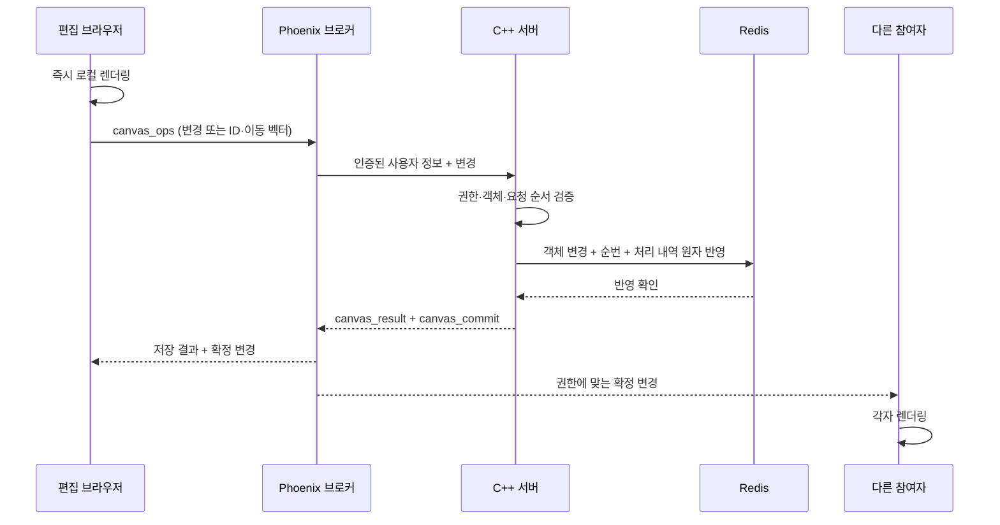

# 호스트 없는 캔버스 동기화

브라우저 호스트 선출과 승인을 제거했습니다. 각 브라우저가 자신의 화면을 렌더링하고,
인증된 Phoenix 브로커가 C++ 서버로 변경을 전달합니다. C++ 서버는 권한을 검증하고
Redis에 객체 변경과 처리 내역을 한 번에 반영합니다. 저장 결과와 순번이 있는 변경을
브로커가 참여자에게 전달합니다. 다른 사용자의 RTC 연결이나 접속 순서는 편집 권한과 무관합니다.



## 전달과 복구

- 한 클라이언트는 한 번에 하나의 저장 요청만 전송합니다. 후속 변경은 합쳐서 전송하며,
  일반 변경은 약 30Hz, 이동은 약 100ms 간격으로 전송합니다.
- `client_id`, 증가하는 `request_count`, `request_id`, 변경 내용의 SHA-256을 저장합니다.
  응답을 못 받은 경우 같은 요청을 재전송합니다. 저장된 요청은 다시 적용하지 않습니다.
- `canvas_result`는 Redis 반영 확인입니다. 로컬 초안은 확정 변경 또는 최신 스냅샷까지
  유지하여 저장 확인과 브로드캐스트 사이에 화면이 되돌아가지 않도록 합니다.
- 서버가 발급하는 전역 순번을 확인합니다. 순번 누락이나 1초 주기의 최신 순번 안내로
  차이를 발견하면 같은 연결에서 `canvas_sync`로 복구합니다.
- 새 사용자 등록 후 저장 요청과 같은 큐에서 스냅샷을 가져옵니다. 접속 시점과 첫 변경
  사이의 공백을 없애고, 재접속 시 처리 카운터를 함께 읽어 이미 저장된 이동을 재실행하지 않습니다.
- 마우스, 레이저, 선택 영역, 편집 상태는 브로커의 접속 상태 채널로 전달합니다.
  문서 변경에는 WebRTC를 사용하지 않으며, P2P는 통화 미디어에만 사용합니다.

## 데이터와 권한

객체 접근 권한과 권한 변경 검증은 C++ 서버가 담당합니다. 브로커는 수신자의 권한에
맞춰 항목을 필터링하고, 권한을 잃은 사용자의 화면에서는 기존 항목을 제거합니다.
빈 변경이라도 순번은 전달하므로 다른 그룹의 편집으로 동기화 누락을 오인하지 않습니다.

다중 이동은 객체 ID 목록과 `dx`, `dy`로 전달합니다. 텍스트는 Automerge의 공통 스냅샷과
변경 이력을 저장·합집합 처리하고 각 클라이언트가 병합한 내용을 렌더링합니다.
Redis의 일반 텍스트 필드는 표시용 보조 값이며, 동시 편집의 기준은 CRDT 이력입니다.

현재 요청 한도는 512개 작업, 이동 목록 10,000개 ID, 서버 확장 결과 20,000개 객체·8MiB입니다.
한 문서는 최대 4,096개 클라이언트의 처리 카운터를 보관합니다. 한도 초과는 명시적으로 거절하며
안전한 재전송에 필요한 내역을 임의로 지우지 않습니다.
저장 확인은 Redis 주 노드 반영이며 복제본이나 디스크 동기 쓰기 완료를 뜻하지 않습니다.
기존 Redis 비동기 복제의 장애 시 데이터 손실 범위는 이번 변경과 별개입니다.

구현: `src/canvas/sync/ServerCanvasSession.js`, `useServerCanvas.js`,
Wall의 `AgoraBroker.Room`, BE의 `CanvasQueryService`, `CanvasBrokerOperations`, `CanvasServiceMemory`.
기존 `HostCanvasSession`과 관련 테스트는 이전 동작의 참고용이며 현재 편집 경로에서는 사용하지 않습니다.

## 검증

- 프런트엔드 Node 테스트 183개 통과.
- C++ 변경·권한·CRDT·저장소·스냅샷 관련 테스트 대상 8개 통과.
- 브로커 테스트 25개 통과. 별도 TLS fixture가 필요한 9개는 제외했습니다.
- 실제 Chrome 브라우저 4개로 RTC 없이 편집·저장, 첫 참여자 퇴장,
  변경 누락 후 같은 연결에서 복구, 이동 중복 전송, 잘못된 배치의 전체 거절,
  동시 텍스트 병합, 드로잉 수정·삭제, 재접속 복원을 확인했습니다.
- 1,025개 객체 생성 도중 새 참여자가 들어와도 전체 상태가 일치하며,
  객체 수뿐 아니라 모든 객체 ID와 생성 속성도 일치하고, 분할된 삭제까지 모두 반영됨을 확인했습니다.
- Redis Lua 검증은 빈 배열·좌표 정밀도 유지, 같은 요청 재실행 방지,
  요청 내용 불일치와 오래된 쓰기의 거절을 확인합니다. 전용 임시 키를 사용하고 삭제합니다.
- 보고서용 아키텍처 도판과 캔버스 #2042도 새 구조로 갱신했습니다.

브라우저 검증은 새로 만든 `서버 동기화 검증 (임시)` 캔버스의 토큰·사용자·캔버스 응답을
담은 소유자 전용 세션 파일을 사용합니다. 운영 캔버스를 테스트 대상으로 지정하지 않습니다.

```sh
PLAYWRIGHT_MODULE_PATH=/path/to/playwright-core/index.mjs \
SYNC_SESSION_FILE=/owner-only/session.json node scripts/test-server-canvas-browser.mjs
AGORA_DB_DIR=/path/to/project-agora-DB python3 ../project-agora-BE/cpp/tests/broker_sync_redis_integration.py
```

## 2026-10-15 저장·신규 접속 경로 재검토

저장 성공 후 전달하는 순서를 유지합니다. C++는 브로커가 사용하는 내부 쿼리 연결로
변경을 받아 Redis에 저장하며, 브라우저 수신자와 동일한 방송을 구독하는 구조는 아닙니다.
C++의 성공 응답 이후에만 브로커가 확정 변경을 참여자에게 보냅니다.

- Nginx가 WebSocket의 `client_id`를 내부 연결로 전달하지 않던 문제를 수정했습니다.
  첫 스냅샷부터 해당 브라우저 세션의 처리 카운터를 가져옵니다. 실제 브라우저 검증에서도
  요청한 클라이언트 ID와 첫 스냅샷의 ID가 같은지 확인합니다.
- 발신자가 퇴장해도 이미 큐에 접수된 객체 변경은 처리합니다.
- 저장 결과가 불명확하거나 저장소가 일시적으로 응답하지 않으면 브로커가 동일한 요청을
  1초 후 재시도합니다. 인증 만료 또는 영구 거절 시 중단합니다. 기존 처리 영수증으로
  중복 적용을 막으며, 결과가 확정될 때까지 후속 저장·신규 접속 스냅샷의 순서를 유지합니다.
- 대기 중인 동일 요청의 클라이언트 재전송은 합치며, 같은 카운터로 다른 내용을 보내면 거절합니다.
- 오래된 스냅샷이나 다른 클라이언트용 스냅샷은 현재 상태와 처리 카운터를 덮어쓰지 않습니다.
  잘못된 첫 스냅샷은 편집을 활성화하지 않고 다시 요청합니다.
- 캔버스 간 이동 시 편집 세션을 새로 생성해 이전 캔버스의 대기 변경이 섞이지 않도록 합니다.
- 저장 결과를 끝내 확정하지 못하면 현재 순번이 같아도 강제 재동기화를 요청할 수 있습니다.

브로커의 메모리 큐 자체는 영속 로그가 아닙니다. 저장 전 브로커 프로세스가 종료되고
발신자도 사라지면 미확인 변경의 복구를 보장하지 않습니다. 또한 Redis 주 노드의 성공 응답은
복제본·디스크 동기 쓰기 완료와 다릅니다. 이 제한은 신규 사용자 스냅샷의 순서 보장과 구별해야 합니다.

이번 재검토의 배포 후 Chrome 검증에서도 위 공유 시나리오가 모두 통과했습니다.
첫 스냅샷의 클라이언트 ID 일치, 변경 한 건 누락 후 자동 복구, 1,025개 객체의
각 ID·속성 일치, 수정·삭제·재접속 복원을 확인했습니다. 마지막 Redis 객체 ID 집합도
브라우저에 남은 `sync-text` 하나와 일치했습니다. 예기치 않은 브라우저 오류는 없었습니다.
브로커 회귀 검증에는 발신자 퇴장 후 대기 저장, 중복 재전송 합치기, 결과 유실 후
발신자 없이 재시도와 신규 접속의 순서 유지, 저장 성공 전 방송 금지가 포함됩니다.
