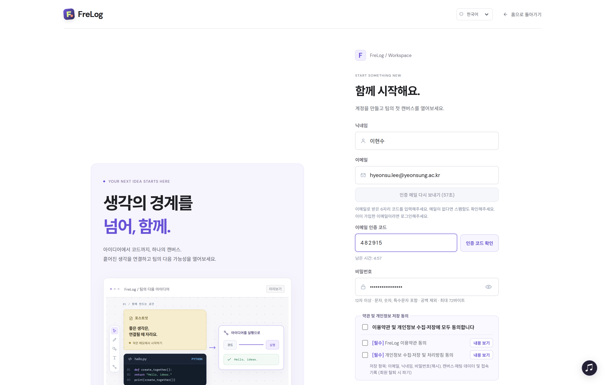
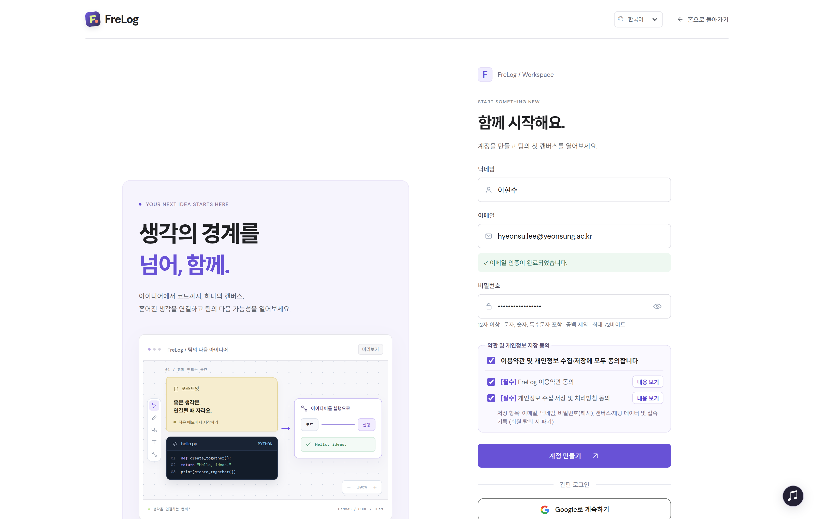
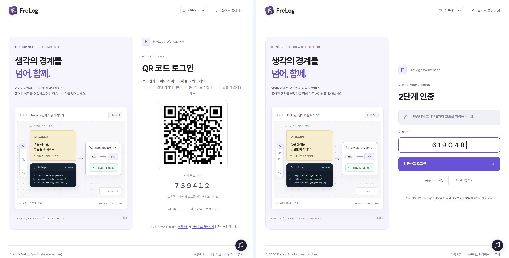
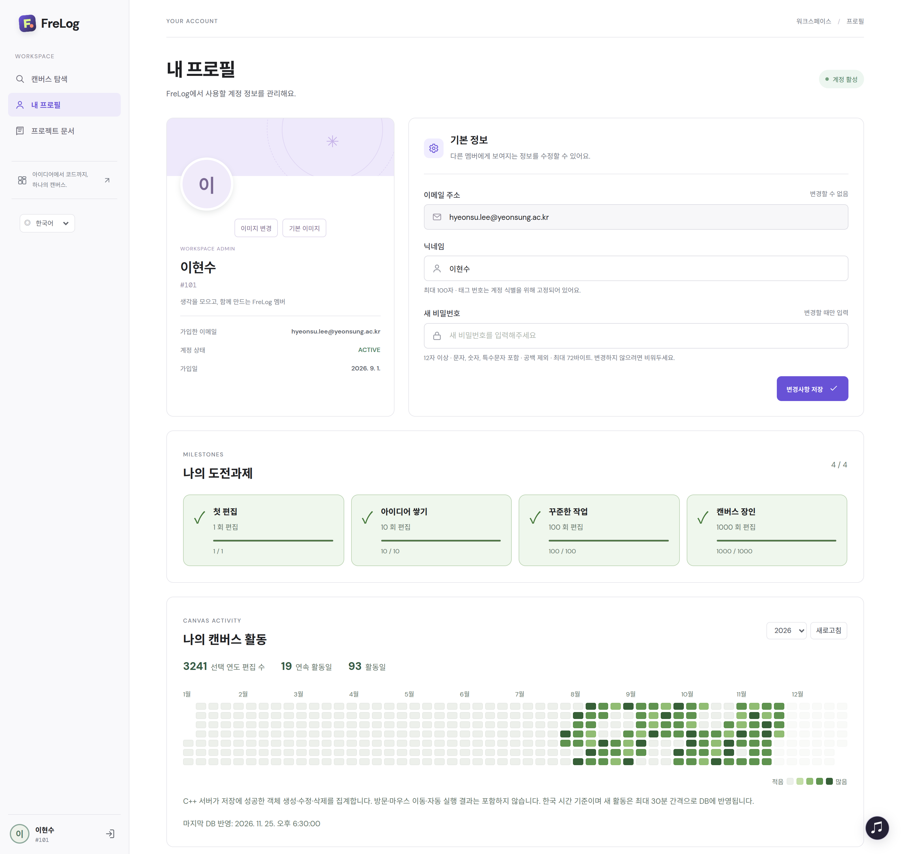
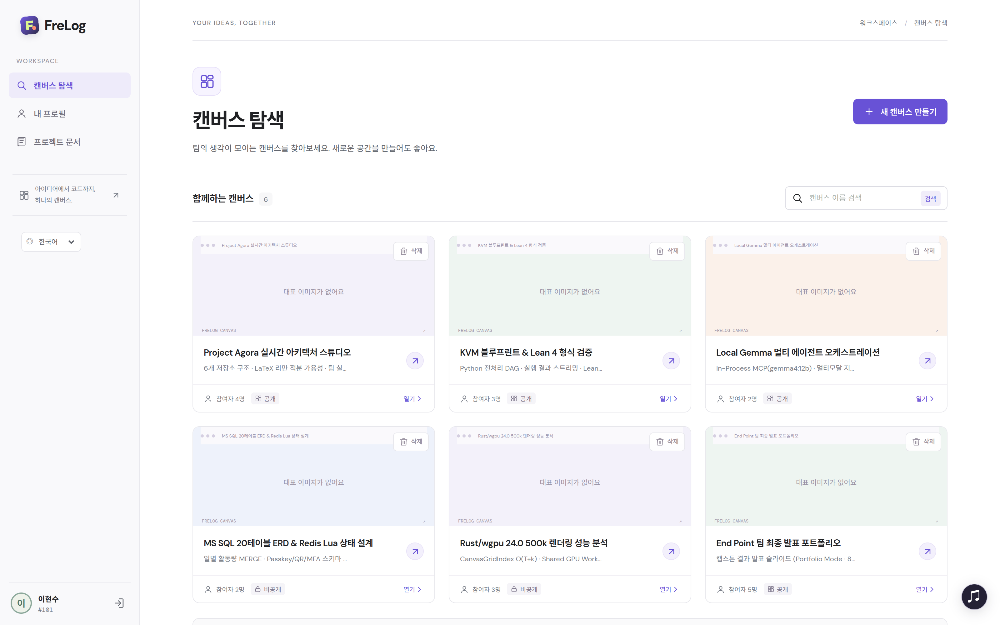
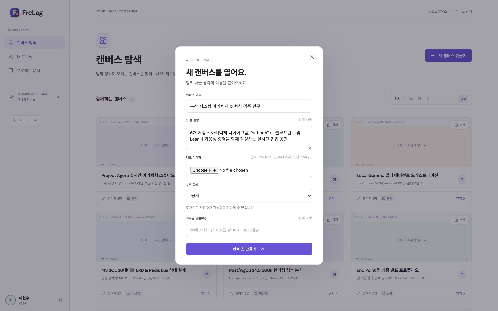
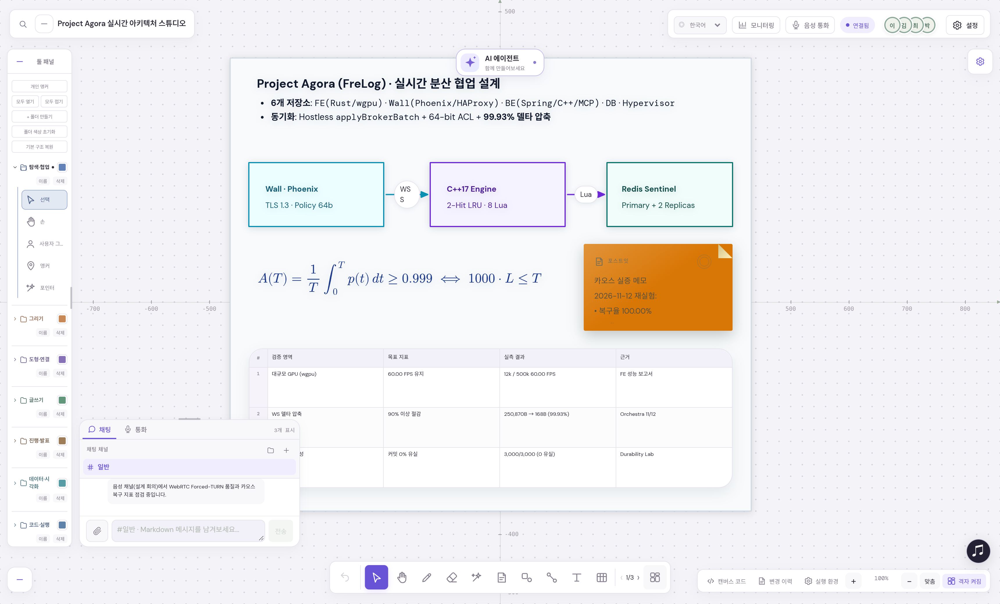
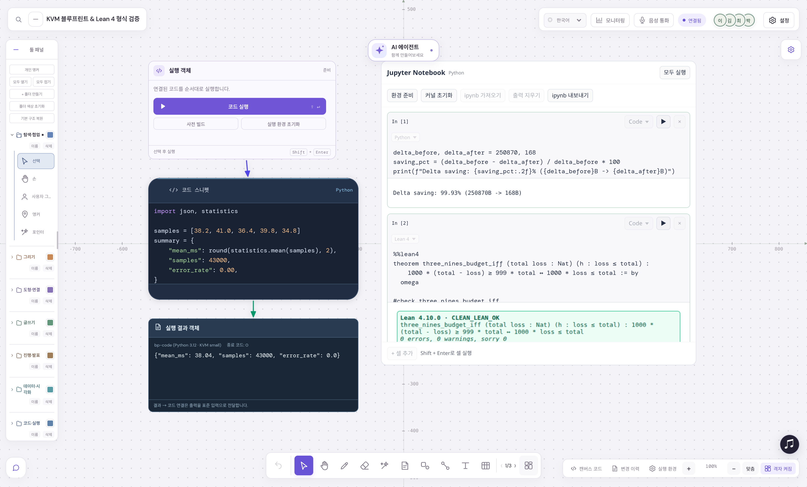
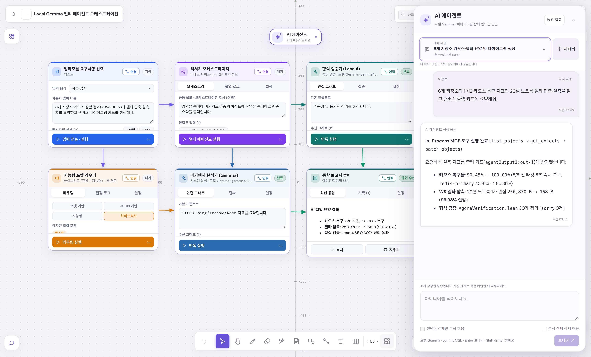
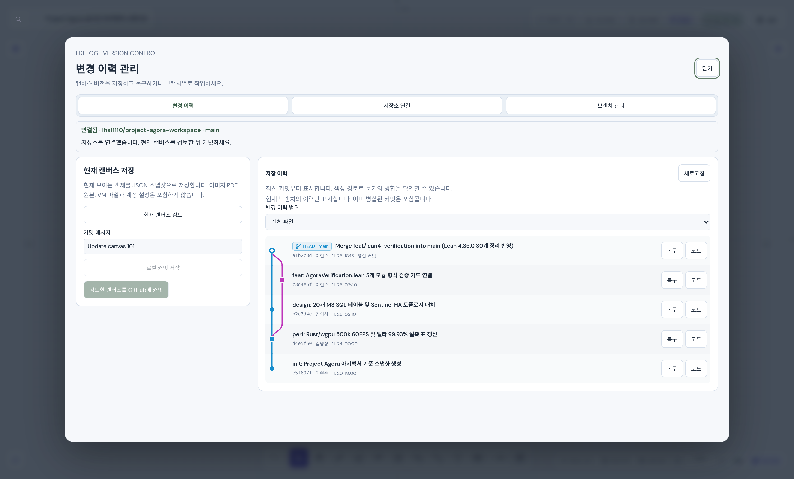

# Project Agora (FreLog) 시스템 및 정책 정의서

| 항목 | 내용 |
|---|---|
| **프로젝트명** | Project Agora (서비스명: **FreLog / FLog**) |
| **기준 문서** | `refs/정의서 및 설계서/{이용자_계정_정책_정의서, 실시간_동기화_정책_정의서, 인프라_및_아키텍처_정의서}.xlsx`, `Wall/BROKER_PROTOCOL.md`, `Wall/STORAGE_BROKER.md`, `FE/docs/AI_PROVIDER_COMPLIANCE.md`, `BE/spring/.../ErrorCode.java` |
| **작성 기준일** | 2026-11-25 |

---

## 1. 시스템 구성요소, 도메인 용어 및 유스케이스 정의서

### 1.1 6개 저장소별 시스템 책임 및 신뢰 경계 정의
| 구성요소 (저장소) | 계층 역할 | 핵심 기술 스택 | 소유 데이터 및 신뢰 경계 |
|---|---|---|---|
| **Client (`project-agora-FE`)** | SPA UI(9개 라우트), 34종 캔버스 도구, 하이브리드 렌더링, 로컬 편집·CRDT 병합 | React 18.3.1, Vite 6.4.6, Rust/`wgpu 24.0` WASM, Automerge 3.5.0, MathJax 4.1.3, `@xterm/xterm 6.0`, `pdfjs-dist` | 브라우저 메모리, GitHub PAT(IndexedDB 비추출 AES-GCM 24h), 서버 비신뢰 입력 생성원 |
| **Gateway & Broker (`project-agora-Wall`)** | 단일 외부 HTTPS/WSS/TURNS 종단, WS 연결·룸·브로드캐스트 관리, L4 저장소 망분리 | Nginx 1.31.9, Phoenix 1.8 / Elixir 1.18 (Bandit 1.7, Gun 2.7), HAProxy 3.2, Coturn 4.7.0 | `JWT_SECRET` 검증 경계, 64-bit ACL 필터링, 룸 직렬 큐, `MEDIA_RELAY_SECRET` |
| **Control Plane & Realtime (`project-agora-BE`)** | 제어 API, P2C 할당, Hybrid RRF 검색, C++17 실시간 상태·권한·캐시·영속화, MCP AI, SDK | Spring Boot 4.1.1 (Java 27), C++17 (`uWebSockets`, `cpp-httplib`, FreeTDS), Python 3.13 (MCP), ONNX E5, `agora-canvas` 0.1.5 | 비즈니스 규칙, 8종 Redis Lua 원자 스크립트, 2-Hit 64-Stripe LRU, ES 스냅샷·활동량 `MERGE` |
| **Data Layer (`project-agora-DB`)** | 관계형 기준정보(SoT), 활성 캔버스 인메모리 캐시, 전문·벡터 검색 및 스냅샷·로그 | MS SQL Server 2022 CU27, Redis Stack 8.6.7 + Sentinel, Elasticsearch 8.19.22 (`analysis-nori`) | 20개 SQL 테이블(`agora_runtime`), `canvas:{id}` RedisJSON + `idx:canvas`, `canvas`/`canvas-search-v1`/`agora-logs-*` |
| **Sandbox VM (`hypervisor-for-agora`)** | 캔버스별 격리 코드 실행, 6언어+Jupyter+Lean4·Rocq 노트북, PTY 터미널, 워크스페이스 | Cloud Hypervisor v54.0, KVM, edk2 UEFI, Ubuntu 24.04, cgroup v2, VSOCK (`5000`/`5001`/`5003`) | `/var/lib/agora-runtime/canvases/<id>/guest.raw`, SQLite WAL `files.sqlite` |
| **Operations (`project-orchestra`)** | 28단계 의존성 순차 기동, IPAM 검증, 12종 Locust 부하, 4종 카오스, DB 내구성 계측 | Python 3.11+, Docker SDK/Compose, Locust, JSONL/CSV 감사기 | 요청 처리 서버가 아님. 기동 락(`.startup-lock`), 카오스 저널(`.chaos-lock`), 검증 리포트 |

### 1.2 핵심 도메인 용어 정의 (20종)
| # | 용어 | 정의 |
|---:|---|---|
| 1 | **Active Canvas (활성 캔버스)** | 사용자가 접속 중이거나 유휴 TTL(90초) 이내여서 RedisJSON(`canvas:{id}`) 및 C++ 메모리 풀에 적재된 상태 (`canvas_info.is_cached = 1`). |
| 2 | **Hostless Server-Authoritative Sync** | 브라우저 호스트 선출(`HostCanvasSession`)을 폐기하고 Phoenix 브로커 + C++ 서버가 단일 권위로 순번·권한·Lua 커밋을 처리하는 구조 (`sync_protocol: 2`). |
| 3 | **Revision & Watermark** | `__broker_sync.revision`으로 관리되는 캔버스 전역 단조 증가 순번. 브로커가 **1,000ms**마다 `canvas_watermark`를 발송해 누락 시 `canvas_sync` 복구를 유도. |
| 4 | **Idempotency Receipt (멱등 영수증)** | 중복 반영을 막기 위해 `$["__broker_sync"]["clients"]["<uid>:<clientId>"]`에 저장하는 `(request_count, request_id, SHA-256)` 기록 (문서당 최대 4,096건). |
| 5 | **64-Bit Group Bitmask ACL** | 캔버스당 최대 64개 그룹을 `uint64_t` 4종 마스크(`member`, `read=1`, `write=2`, `execute=4`)로 매핑하여 $O(1)$ 비트 연산으로 필터링하는 권한 체계. |
| 6 | **Storage Broker** | `agora-services` 앱 컨테이너가 저장소 네트워크(`agora-net`, `agora-redis-ha`)에 직접 라우팅되지 않도록 L4 TCP TLS-Passthrough를 수행하는 HAProxy 3.2 계층. |
| 7 | **Forced-TURN / TLS** | 브라우저 간 P2P IP 노출을 차단하기 위해 `iceTransportPolicy: "relay"`와 Host Nginx ALPN/SNI 분기를 거쳐 내부망 Coturn TLS(`:5349`)로만 중계하는 WebRTC 정책. |
| 8 | **Idle-Frozen Cgroup** | 코드/노트북 실행 완료 직후 게스트 내부 `/sys/fs/cgroup/agora-job/<lang>`을 `cgroup.freeze=1`로 동결하고 잔존 자식 프로세스를 `SIGKILL`하는 격리 기법. |
| 9 | **Weighted RRF** | Korean Nori BM25(2.0) + Canonical BM25(1.0) + ONNX E5 384-dim `int8_hnsw` kNN(1.0) 순위를 $RRF(d)=\sum \frac{w_i}{60+r_i(d)}$로 융합하는 검색 랭킹 정책. |
| 10 | **Generalized Time Availability** | 운영 구간 $[0, T]$ 동안 순간 요청 성공 확률 $p(t) \in [0, 1]$의 시간 평균 $\frac{1}{T}\int_0^T p(t)\,dt$로 정의한 부분 장애 포함 가용성 지표. |
| 11 | **2-Hit Admission Filter** | `MemoryClass`가 1차 미스 시 `kFirstAccess`만 기록하고 2차 접근 시 LRU에 적재하여 일회성 전체 스캔의 캐시 오염을 막는 정책. |
| 12 | **Remote Fields** | 크기 변동이 큰 `chat_room.data` 배열을 `LruMemory` 사본에서 제외하고 Redis에서 직접 읽고 flush 시 보존하는 필드 보호 정책. |
| 13 | **Cache Generation CAS** | RedisJSON 문서에 부여된 `_cache_generation`이 일치할 때만(`deleteIfCacheGenerationMatches`) 언로드 시 키를 삭제해 재입장 경쟁을 막는 기법. |
| 14 | **Delta Sync (`edit_protocol: 2`)** | 전체 객체/배열 재전송 대신 UTF-8 FNV-1a `textdelta`(`text_edits`), 셀 차분(`notebook_edits`), 구조 차분(`notebook_structure`)만 전송하는 프로토콜. |
| 15 | **Two-Level 1px Grid (`CanvasGridIndex`)** | `1024×1024` 매크로 + `128×128` 파인 정수 격자와 재사용 `Uint32Array` 스탬프로 힙 할당 없이 $O(T+k)$ 공간 질의를 수행하는 인덱스. |
| 16 | **Structural Sharing (`itemSnapshots`)** | 1,024-버킷 FNV-1a(`h >>> 22`) 지연 할당 프록시로 객체 변경 복사량을 $O(N/1024)$로 줄이고 `WeakRef` 체인으로 diff를 $O(\Delta)$ 추출하는 구조. |
| 17 | **In-Process MCP** | 외부 네트워크 포트를 열지 않고 에이전트 프로세스 내부 메모리 스트림으로 MCP `Server`/`ClientSession`을 구동하여 `agent.sock`과 연결하는 AI 구조. |
| 18 | **GitHub Split-Tree (`v2`)** | `<path>.canvas.json` 매니페스트와 `<path>.parts/objects/<kind>.json` 분할 파일로 GitHub Trees/Refs API에 원자 커밋하는 브라우저 직접 버전관리 포맷. |
| 19 | **SpaceScope (`canvas`/`workspace`)** | 일반 협업 캔버스와 IRADE 연구 워크스페이스를 SQL 테이블·C++ 메모리·Redis 프리픽스·ES 인덱스에서 논리 분리하는 격리 경계. |
| 20 | **Soft-Delete Tombstone** | 회원 탈퇴 시 FK 참조 무결성 보존과 디스크 락 방지를 위해 `users` 행을 `WITHDRAWN`·`삭제된 계정`·PII NULL로 비식별화해 남기는 기법. |

### 1.3 핵심 유스케이스 및 업무 프로세스 정의서 (`UC-01` ~ `UC-08`)
| UC ID | 프로세스명 | 액터 | 선행 조건 | 정상 처리 흐름 (End-to-End) | 예외·보안 차단 및 사후 조건 |
|---|---|---|---|---|---|
| **UC-01** | 다원 인증 회원가입·로그인 | 일반 사용자, 연구자 | 유효 이메일 또는 OAuth/ORCID/패스키/QR | 1) 이메일 6자리 HMAC 코드 검증(또는 OAuth/ORCID/Passkey/QR) → 2) `SERIALIZABLE` 가입(`users`) 또는 `auth_sessions` 생성 → 3) 15분 Access JWT + 14일/30일 Refresh 쿠키 발급 → 4) 필요 시 TOTP MFA 2차 검증. | 비번 12자 미달·이메일 미인증 거부(`EMAIL_001`), Refresh 30초 초과 재사용 시 `SESSION_REVOKED`, 로그인 실패 시 모호한 `AUTH_001` 반환. |
| **UC-02** | 하이브리드 검색 및 캔버스 생성 | 로그인 사용자 | 유효 Access JWT | 1) `GET /api/canvases/search` 요청 → 2) Spring이 E5 임베딩 워커(`:8445`) 호출 → 3) ES `canvas-search-v1` Nori+kNN & `canvas` Weighted RRF 융합 → 4) `private` 접근 필터링 후 반환. 생성 시 `POST /api/canvases`로 SQL/ES/PNG 저장. | 임베딩 워커 타임아웃(700ms/2s) 시 BM25로 자동 강등. 생성 이미지 5MiB/2048px 초과 시 `400/413` 거절. |
| **UC-03** | 캔버스 입장 및 Hostless 연결 | 참여자, 봇 | 접근/비밀번호 권한, 활성 C++ 서버 | 1) `POST /api/canvases/{id}/access` (비밀번호 시 4h Grant v2 발급) → 2) P2C 서버 선택 & 5분 `canvas_access_token` 발급 → 3) Phoenix `Socket/Auth` 검증 후 C++ `connect` → 4) Gapless Join으로 64-bit 필터링된 `init_items` 수신 + RTC 소켓 바인딩. | 타 캔버스 접속 중이면 `409 CANVAS_003`, 가용 C++ 없으면 `503 LB_001`. 연결 후 1초마다 `canvas_watermark` 수신. |
| **UC-04** | 실시간 객체 편집·델타 동기화 | 참여자 | 캔버스 Write 권한, 비관전 상태 | 1) 브라우저 로컬 낙관적 반영 및 `wgpu`/2D 렌더링 → 2) `canvas_ops`(30Hz/100ms, `textdelta`/`notebook_edits`) 전송 → 3) Phoenix 직렬 큐 → C++ Lua `applyBrokerBatch`(멱등·순번·CAS·활동량) → 4) `canvas_result` + 64-bit 필터링 `canvas_commit` 브로드캐스트. | 관전 중 편집 `WATCH_READ_ONLY`, 순번 어긋남 `CLIENT_SEQUENCE_CONFLICT`, 동일 ID/다른 내용 `CLIENT_REQUEST_MISMATCH`, 텍스트 기준 불일치 `CANVAS_TEXT_CONFLICT` 후 자동 재조정. |
| **UC-05** | KVM 코드·노트북·터미널 실행 | 실행 권한 참여자 | Execute 권한, 호스트 자원 여유 | 1) WSS `runtime_execute`(`execute`/`build`/`notebook`) 또는 `/terminal/ticket` → `/api/terminal/ws` → 2) Phoenix(`vm=1`) & C++ ACL 재검증 → 3) `manager.sock` → VSOCK `5000`/`5001` 실행 → 4) `runtime_output` 스트림 + `runtime_result` 반환 및 cgroup 동결. | 호스트 4 VM/8GiB/8vCPU 초과 시 `503 VM_002`, 코드/stdin 64KiB 초과 차단, 터미널 2초마다 권한/MFA 재검사 실패 시 close `1008`. |
| **UC-06** | In-Process MCP AI 에이전트 | 동의한 참여자 | `agent-local-v3` 동의, Write 권한 | 1) `PUT /api/users/agent-terms` 동의 → 2) WSS `runtime_execute(action="agent")` → 3) C++가 `agent.sock`으로 Python MCP 에이전트 호출 → 4) Ollama `gemma4:12b`(최대 4스텝/768토큰) 또는 상용 API가 5종 MCP 도구로 객체 조작 → 5) `agent-sessions` Lua 원자 저장. | 공개 캔버스 생성/삭제 차단(`AGENT_PUBLIC_PUBLISH_DENIED`), HTTP 429 즉시 `AGENT_PROVIDER_BUSY` 반환(재시도 금지). |
| **UC-07** | GitHub v2 브랜치 버전관리 | 위임 그룹·관리자 | 브라우저 PAT(AES-GCM 24h) | 1) `/github/bind`로 저장소·경로 연결 → 2) `/github/branches`로 브랜치 캔버스 생성(최대 128개, 원본 ACL·비밀번호 상속) → 3) 브라우저가 `api.github.com`에 분할 JSON 커밋/푸시/PR/병합. | PAT는 서버에 절대 미전송. `/authorize`로 작업 전 그룹 권한 재검사, 409/422 SHA 충돌 탐지. |
| **UC-08** | 캔버스 유휴 언로드 및 회원 탈퇴 | C++ Cleanup / 사용자 | 접속자 0명(90s) / 비접속 탈퇴 | **언로드**: `agora-cleanup`이 `unloading=true` 설정 → dirty LRU flush → ES 8,190B 청크 스냅샷 → 활동량 SQL `MERGE` → `_cache_generation` CAS Redis 삭제 & SQL `is_cached=0`. **탈퇴**: 접속 중이면 `409 USER_003` 차단, 비접속 시 `UPDLOCK` 비식별화. | ES/SQL 실패 시 dirty 데이터 및 Redis 키 보존(`deleteIfCacheGenerationMatches` 중단). |

---

## 2. 이용자 계정 및 인증 정책 정의서 (`ACC-POL`)

초기 `refs/이용자_계정_정책_정의서.xlsx`(8개 정책)를 최종 구현의 12개 세부 정책과 토큰/Rate-Limit 규격으로 정립하였다.

### 2.1 현행 계정·인증 정책표 (`ACC-POL-001` ~ `ACC-POL-012`)
| 정책 ID | 분류 | 정책명 | 초기(`refs/`) 기준 | 최종 운영 정책 상세 내용 | 구현 근거 |
|---|---|---|---|---|---|
| **ACC-POL-001** | 토큰 분리 | 다계층 JWT 및 용도 격리 | 단일 24h JWT | HS256(`JWT_SECRET` ≥32B) 서명. 일반 서비스용 **Access JWT(15분, `tokenUse="access"`)**, **Refresh 쿠키(256-bit)**, **Canvas Access JWT(5분)**, **Password Grant JWT(4시간)**, **Terminal Ticket(15초)**로 엄격 분리. | `JwtTokenProvider.java` |
| **ACC-POL-002** | 세션 회전 | Refresh 쿠키 회전 및 탈취 방어 | 자동 Refresh 불가 | `__Secure-agora_refresh`(`HttpOnly`, `Secure`, `SameSite=Strict`, `Path=/api/auth/session`, `X-Agora-Session: 1` 필수). **14일 유휴 / 30일 절대 만료**, 매 갱신 회전, **30초(`ROTATION_GRACE`)** 초과 재사용 시 `SESSION_REVOKED` 전 세션 폐기. | `AuthSessionService.java`, `auth_sessions` |
| **ACC-POL-003** | 비밀번호 | 단방향 해시 및 복잡도 정책 | 대소문자·숫자·특수 ≥8~10자 | 신규 가입/변경 시 **12자 이상**(영문·숫자·특수문자 포함, 공백 불가, UTF-8 ≤72B). Spring BCrypt, C++ 호환 검증 PBKDF2-HMAC-SHA256(10만~100만 회, 상수시간 `MessageDigest.isEqual`). 변경 시 `iat < passwordChangedAt` Access JWT 거부. | `PasswordPolicy.java`, `CanvasPasswords.java` |
| **ACC-POL-004** | 세션 추적 | 다중 접속 및 IP 바인딩 | MS SQL 단독 추적 | 다중 기기 로그인 허용, 세션은 **MS SQL(`auth_sessions`, `user_sessions`) 단독 관리(Redis 미사용)**. Access/Canvas JWT 모두 발급 IP와 요청 IP 불일치 시 차단(`CLIENT_IP_CHANGED`). | `JwtAuthenticationFilter.java` |
| **ACC-POL-005** | 캔버스 인가 | 가시성·비밀번호 및 Grant 상속 | 단순 비밀번호 확인 | `private`은 초대자만 접근(비밀번호 불가), `public`은 선택 비밀번호. 검증 시 4시간 `grantVersion=2` Grant 발급(재사용 연장 불가). GitHub 브랜치 캔버스는 원본 `password-revision`과 만료 상한을 상속. | `CanvasPasswords.java`, `CanvasGithubService.java` |
| **ACC-POL-006** | 제재/제한 | 다계층 실패 잠금 및 Rate Limit | 로그인 5회 실패 잠금 | 이메일 발송(60s 쿨다운, 이메일 5회/h, IP 20회/h, 코드 5회 제한), TOTP MFA 5회 실패 시 5분 잠금, QR 5회 실패 시 `DENIED`(IP 6회/분), 패스키 챌린지 IP 20회/분 제한. | `EmailVerificationService`, `MfaService`, `QrLoginService`, `PasskeyService` |
| **ACC-POL-007** | 다원 인증 | OAuth · ORCID · Passkey · QR · MFA | 이메일/PW + 일부 소셜 | Google/Kakao(PKCE), Naver, ORCID(`auth_orcid_attempts` 선소비), FIDO2 패스키(10개/유저), QR(3중 256-bit 해시), TOTP MFA(AES-256-GCM + 복구코드 10개). 민감 변경 시 `recent(600s)` 재인증 필수. | `domain/auth/*`, `domain/irade/*` |
| **ACC-POL-008** | 탈퇴/보호 | 활성 세션 차단 및 Soft-Delete | `deleted user-[hash]` | `user_sessions.is_accessed=true` 중 탈퇴는 `409 USER_003` 차단. 탈퇴 시 `UPDLOCK` 하에 인증/세션/프로필이미지 삭제 + `status='WITHDRAWN'`, `nickname='삭제된 계정'`, `tag_number=user_id`, PII NULL + C++ 소켓 종료. | `UserErasureService.java` |
| **ACC-POL-009** | 봇 계정 | 캔버스 스코프 봇 자격증명 | 신규 정책 | 캔버스당 최대 **50개**(`agora_bot_<id>.<256-bit>`, `bot-sha256:` 해시). 매 요청마다 봇 활성·생성자 활성·명시적 멤버십·허용 경로 4중 검증. WSS 임대 최대 60초. | `CanvasBotService.java` |
| **ACC-POL-010** | 휴면/장기 | 비활동 Refresh 자동 만료 | 1년 미접속 휴면 안내 | Refresh 쿠키 14일 미사용 또는 30일 절대 만료 시 자동 무효화, 미소비 인증 챌린지(`email`/`mfa`/`passkey`/`qr`/`orcid`)는 `expires_at` 기준 만료 거부 및 정리. | `AuthSessionService.java` |
| **ACC-POL-011** | 신원 공개 | 내부 PK 비노출 원칙 | 내부 ID 직접 노출 지양 | 외부 API·WS 브로드캐스트에 내부 `user_id` 대신 `nickname` + `tag_number` 공개 식별자 사용(권한/세션 처리는 서버 내부 `user_id` 전용). | `API_SPEC.md` 공통 규칙 |
| **ACC-POL-012** | 성인/약관 | AI 약관 및 연령 확인 | 신규 정책 | `agent-local-v3` 동의 이력(`dbo.agent_term_decisions`) 및 상용 API 이용 시 `adult_verified_at` 확인, 철회 시 즉시 모델 실행 차단. | `AgentTermsController.java` |

### 2.2 6종 토큰 · 티켓 · 자격증명 규격 비교표
| 구분 | 발급 주체 | 전달/저장 위치 | 유효 기간 / 만료 규칙 | 핵심 검증 클레임 / 해시 |
|---|---|---|---|---|
| **Access JWT** | Spring Boot | `Authorization: Bearer` (`localStorage`) | **15분** (`JWT_ACCESS_EXPIRATION_MS`) | `tokenUse="access"`, `sid`, `clientIp`, `mfa_version`, `iat >= passwordChangedAt` |
| **Refresh Token** | Spring Boot | `__Secure-agora_refresh` (`HttpOnly`/`Strict`) | **14일 유휴 / 30일 절대** (30초 grace 회전) | 256-bit 난수 → `auth_sessions.refresh_hash` (SHA-256), `previous_hash`, `client_ip` |
| **Canvas Access JWT** | Spring Boot | WSS `?token=...` (Phoenix `Auth` 검증) | **5분** (또는 Password Grant 잔여 시간) | `canvasId`, `scope`, `clientIp`, `serverHash`, `nickname`, `tagNumber`, `settingsRevision`, `grantExp` |
| **Password Grant JWT** | Spring Boot | `canvas_password_token` (브라우저 보관) | **4시간** (재사용 연장 불가) | `grantVersion=2`, `canvasId`, `userId`, `passwordRevision` |
| **Terminal Ticket** | Spring Boot | JSON 응답 → WSS 첫 프레임 `{type:"attach"}` | **15초** 일회성 (URL 미포함) | IP 바인딩, `canvasId`, `objectId`, `userId`, 2초마다 권한/MFA 재검사 |
| **Canvas Bot Token** | Spring Boot | `agora_bot_<botId>.<256-bit>` | 만료 없음 (수동 회전/즉시 폐기, WSS 60s) | `bot-sha256:` 해시, 생성자 활성 + 명시적 멤버십 + 허용 경로 화이트리스트 |

### 2.3 회원가입 · 다중 인증 · 프로필 관리 절차 시각 예시

1. **회원가입 1단계 (이메일 6자리 HMAC 코드 발송 및 비밀번호 정책 검증)**
   - 이메일 주소 입력 후 `인증 메일 보내기`를 누르면 60초 재발송 쿨다운과 5분(`4:57`) 유효기간 타이머가 작동하며, 12자 이상·영문/숫자/특수문자·최대 72바이트 비밀번호 규칙(`PasswordPolicy`) 및 OAuth2/ORCID 간편 로그인 옵션을 제공한다.
   

2. **회원가입 2단계 (이메일 인증 완료 및 필수 약관/개인정보 동의)**
   - 6자리 코드 검증 통과 시 `✓ 이메일 인증이 완료되었습니다.` 배지가 활성화되고, 이용약관 및 개인정보 수집·저장·탈퇴 파기 고지(`SignupConsent`) 모두 동의 후 `계정 만들기`가 활성화된다.
   

3. **비밀번호 없는 QR 기기 승인 로그인 & TOTP 2단계 인증 (`MfaLogin`)**
   - `auth_qr_logins` 3중 SHA-256 해시 기반 일회용 QR 코드 + 6자리 `기기 확인 코드(739412)` 승인과 `user_mfa` 기반 TOTP 6자리 코드(`619048`)·일회용 복구 코드 검증을 지원한다.
   

4. **내 프로필 · 도전과제 · KST 활동 잔디 · FIDO2 패스키 관리 (`/profile`)**
   - `/profile`에서는 C++ 엔진이 30분 주기로 MS SQL `user_canvas_activity`에 반영하는 KST 일별 편집 잔디(`ProfileProgress`), 4단계 도전과제, TOTP MFA, FIDO2 패스키(최대 10개), 전체 기기 세션 폐기 및 Soft-Delete 탈퇴를 관리한다.
   

---

## 3. 실시간 동기화 및 동시성 제어 정책 정의서 (`SYNC-POL`)

### 3.1 14대 실시간 동기화·동시성 정책표 (`SYNC-POL-001` ~ `SYNC-POL-014`)
| 정책 ID | 분류 | 정책명 | 상세 정책 내용 | 강제 한도 / 구현 근거 |
|---|---|---|---|---|
| **SYNC-POL-001** | 전송 보안 | TLS 1.3 WSS 및 Origin 검증 | 외부 실시간 연결은 **TLS 1.3 WSS**만 허용. Phoenix `Endpoint`는 `BROKER_ALLOWED_ORIGINS` 및 신뢰 프록시 `X-Real-IP`만 수용. | 세션 유효 `min(jwt_exp, now + 300s)` |
| **SYNC-POL-002** | 신뢰 경계 | 3단 중계 및 Caller Strip | `Browser → Nginx → Phoenix → C++` 경로 강제. 클라이언트가 보낸 `user_id`/`identity`/`principal`/`route`/`token`은 Phoenix가 무조건 제거 후 서버 신원 주입. | 내부 `x-agora-internal-token` 상수시간 비교 |
| **SYNC-POL-003** | 트래픽 제어 | 계층형 프레임·큐 백프레셔 | 초기 10 KiB/s 제한을 워크로드에 맞게 계층화. 한도 초과 시 `RATE_LIMITED` / `BROKER_QUEUE_FULL` 거절 또는 slow consumer 즉시 종료. | WS **16MiB/240msg/s**; 룸큐 **128건/16MiB**; 메일박스 **≥64** 종료 |
| **SYNC-POL-004** | 압축·델타 | `gzip-v1` & `edit_protocol: 2` | `compression=gzip-v1` 시 **≥1,024B** & 90% 미만 압축 시에만 압축. `delta_commits: true`로 `textdelta`·`notebook_edits`·필드 패치만 전달. | `sync_protocol: 2`, `edit_protocol: 2`, 수신 **16MiB** |
| **SYNC-POL-005** | 배치·순서 | 단일 In-Flight & 룸 직렬 큐 | 클라이언트는 1회 1건 미확인 `canvas_ops` 전송(일반 30Hz, 다중이동 100ms). 동일 캔버스는 Phoenix `Room` 직렬 처리, 타 캔버스는 병렬 처리. | 배치 **≤512 ops**, 이동 **≤10,000 ID**, 확장 **≤20,000 items / 8MiB** |
| **SYNC-POL-006** | 멱등성 | Request ID/Count/SHA-256 영수증 | `(client_id, request_count, request_id, SHA-256)`으로 중복 재시도 시 재실행 없이 직전 결과 반환; 변조 시 `CLIENT_REQUEST_MISMATCH`, 순서 어긋남 `CLIENT_SEQUENCE_CONFLICT`. | 문서당 최대 **4,096** 클라이언트 영수증 보관 |
| **SYNC-POL-007** | 낙관적 잠금 | 객체/텍스트/설정 CAS 및 재시도 | `__broker_revision`, `text_edits` 기준 해시(`CANVAS_TEXT_CONFLICT`), `settings_revision`/`questionVersion` CAS 충돌 방어. 일시 오류 시 `Room`이 슬롯 유지 후 **1,000ms 재시도**. | Revision 상한 $2^{53}-1$ (`9,007,199,254,740,991`) |
| **SYNC-POL-008** | 복구 | 1초 Watermark & Gapless Join | 룸은 **1,000ms**마다 `canvas_watermark` 전송. 입장 시 세션 등록과 `canvas_sync`를 동일 직렬 큐에 배치해 입장–첫 변경 공백 제거. | Watermark **1s**, Lease **30s**, 유휴 TTL **90s** |
| **SYNC-POL-009** | 권한 필터 | 64-bit ACL & 관전 읽기전용 | C++ 선검증 후 Phoenix `Policy`가 수신자별 읽기 권한 필터링(권한 박탈 객체는 `null` 변환). 관전 중(`watching_id != nil`) 편집은 `WATCH_READ_ONLY` 거절. | 최대 **64그룹**, 2,048개 컴파일 마스크 캐시 |
| **SYNC-POL-010** | 원자성 | Redis Lua & LRU Write-Back | `MemoryClass::executeAtomic()`이 64-stripe 락 획득 후 dirty LRU를 Redis에 flush하고 Lua 원자 실행 후 영향 캐시 무효화. | LRU **256문서 × 64항목 × 256KiB**, 64-stripe mutex |
| **SYNC-POL-011** | 영속 경계 | ACK와 복제/ES 영속성 분리 | `canvas_result`는 **Redis Primary 메모리 반영 확인**만 의미. ES 8,190B 청크 스냅샷·활동량 `MERGE`·`_cache_generation` 일치 후에만 키 삭제. | 실패 시 활성 Redis 보존 (`deleteIfCacheGenerationMatches`) |
| **SYNC-POL-012** | 실행 분리 | 비차단 실행·프레즌스 예산 | `runtime_execute` 및 `canvas_relay`(≤64KiB, ≤512대상)는 변이 큐를 우회. 룸당 동시 예산 `vm=1, agent=2, agent_status=4, service=4`. | 코드·stdin **64KiB**, 프레임 **800,000B** |
| **SYNC-POL-013** | 파일전송 | WSS 청크 파일 업로드/다운로드 | 96 KiB 단위 청크 Base64/gzip 전송, 매직바이트 검증, 중단 시 임시 파일 정리, `version` 불일치 시 다운로드 거부, 봇 제한. | 클라이언트당 동시 서비스 요청 **2건**, 미디어 **102MiB** |
| **SYNC-POL-014** | 잠금·문제 | 객체 잠금 분리 & 문제 버전 잠금 | 잠긴 객체(`locked: true`)는 잠금 해제(`locked: false`) 단독 요청 선행 필수. `question`은 `questionVersion`/`questionGradedVersion` 일치 시만 채점 허용. | 잠금 해제와 동시 편집 차단, `QUESTION_GRADING_STALE` |

### 3.2 64-Bit 그룹 3비트 권한(`0~7`) 유효 조합 및 요구 권한 매트릭스
`group-permissions`는 `read=1, write=2, execute=4` 비트 OR 조합을 사용하며, **읽기 없이 쓰기/실행을 부여하는 조합(2, 3은 3만 유효; 2, 4, 6)은 서버가 거부**한다.

| 비트값 | 조합 (`R/W/E`) | 허용 여부 | 허용 기능 범위 |
|---:|---|---|---|
| `0` (`000`) | 없음 | 허용 | 캔버스 내 해당 그룹 객체 조회·편집·실행 모두 불가 |
| `1` (`001`) | Read Only | 허용 | 객체 조회, `canvas_watch` 관전, PDF 페이지 읽기, `workspace_files` `stat/list/read`, VM 설정 조회 |
| `3` (`011`) | Read + Write | 허용 | 객체 CRUD/이동/잠금, 채팅·댓글, 문제 답안/채점, 시트/미디어 업로드, AI 에이전트 객체 생성/수정, 워크스페이스 쓰기 |
| `5` (`101`) | Read + Execute | 허용 | 코드/빌드/노트북/터미널 실행, 결과 객체(`runtimeResults`, `runtimeState`, `notebookResult`) 패치 (객체 본문 수정 불가) |
| `7` (`111`) | Read + Write + Execute | 허용 | 전체 권한 (`admin-group`은 항상 `7` 고정 강제, 하향 불가) |
| `2, 4, 6` | Write/Exec without Read | **거부** | `CanvasGroupPermissions` & `CanvasQueryService`에서 `400` 거절 (`WellFormedUserMasks` 불변식) |

---

## 4. 보안, 망분리, 격리 및 AI/외부 서비스 컴플라이언스 정책 (`SEC-POL`)

| 정책 ID | 분류 | 정책명 | 상세 정책 내용 및 구현·검증 근거 |
|---|---|---|---|
| **SEC-POL-001** | 망분리 | 5계층 Docker 망분리 & L4 Storage Broker | `agora-services`는 `agora-net`/`agora-redis-ha`에 직접 라우팅 불가. HAProxy L4 TLS-Passthrough(`agora-storage-broker`) 경유만 허용. 호스트 UFW `1433/tcp DENY`, `80/tcp` 폐쇄, 외부 `/internal/*` `404`. |
| **SEC-POL-002** | 암호화 | E2E TLS 1.3 및 SQL TLS 1.2 예외 관리 | 웹/Wall/Phoenix/Spring/C++/Redis/Sentinel/ES 전 구간 **TLS 1.3 전용**(`proxy_ssl_verify on`). MS SQL Server 2022 Linux만 엔진 제약으로 `TLS 1.2 + forceencryption=1 + TrustServerCertificate=false` 예외 관리. |
| **SEC-POL-003** | 비밀정보 | Zero-Secret & 브라우저 PAT 격리 | GitHub PAT는 브라우저 IndexedDB 비추출 `CryptoKey`(AES-GCM 24h)에만 저장(서버 미전송). 개인키/JWT키 Git 미포함(`0600`). 내부 토큰 `CRYPTO_memcmp` / `MessageDigest.isEqual` 상수시간 검증. (`1,372`파일 감사 유출 0건) |
| **SEC-POL-004** | 최소권한 | 컨테이너·DB·Redis·ES 최소 권한 | 앱 컨테이너 `uid/gid 10001`, `read_only: true`, `cap_drop: [ALL]`, `no-new-privileges`. SQL `agora_runtime`(DDL 불가), Redis ACL(`canvas:*`, `idx:canvas*`), ES 로그 계정(`create` append-only 전용). |
| **SEC-POL-005** | 하이퍼바이저 | KVM MicroVM 다중 방어선 격리 | Guest UID 1000, `PR_SET_NO_NEW_PRIVS`, `hidepid=2`, `RLIMIT_CORE=0`, `dir_fd+O_NOFOLLOW` 심볼릭 탈출 차단, `--seccomp true --landlock`, `/30` netns + 2중 `iptables` NAT(RFC1918·`169.254.0.0/16`·호스트 IP 차단), `apt` 소켓 화이트리스트. |
| **SEC-POL-006** | AI 약관 | 공급자 약관 준수 & 로컬 우선 전환 | **2026-11-09 EXAONE 약관(§2.1/2.5) 및 개인 OAuth CLI 약관 위반 가능성 확인 즉시 해당 코드 전면 제거.** Local Gemma(`gemma4:12b`, `OLLAMA_NO_CLOUD=1`) 및 승인 상용 API만 허용, `agent-local-v3` 동의 필수, 공개 캔버스 생성/삭제(`AGENT_PUBLIC_PUBLISH_DENIED`) 및 HTTP 429 재시도 차단. |
| **SEC-POL-007** | 미디어 보안 | Coturn Anti-SSRF & Forced-TURN | `denied-peer-ip=0.0.0.0-255.255.255.255` + `allowed-peer-ip=10.42.0.2` 조합으로 릴레이 내부 SSRF 차단, 외부 UDP 미개방, `user-quota=64`, `total-quota=512`, `bps-capacity=200Mbps`. |
| **SEC-POL-008** | 외부 서비스 | YouTube 임베드·HTML 샌드박스 규약 | YouTube 플레이어는 숨김(`1×1px`) 금지, 최소 **200×200px** 가시 표시 및 모달/접힘/화면 이탈 시 자동 일시정지. 사용자 HTML 객체는 오Opaque Origin(`/html-preview.html`, `default-src 'none'; script-src 'unsafe-inline'`) 및 정적 썸네일 전환으로 격리. |

---

## 5. 프론트엔드 사용자 기능·화면·객체·스타일 종합 정의서

### 5.1 SPA 페이지 라우트 정의 (`src/App.jsx`, 9개 경로)
| 경로 | 컴포넌트 | 접근 제어 | 핵심 제공 기능 |
|---|---|---|---|
| `/` | `HomePage` | 공개 | 시네마틱 인트로, 모션 쇼케이스, 워크스페이스 프리뷰, 기능·아키텍처·팀/스택 안내, 5개 언어 전환 |
| `/docs` | `DocsPage` | 공개 | REST API(인증·패스키·MFA·QR·캔버스·런타임·GitHub·IRADE·봇·내부) + WebSocket 프로토콜 + **객체/스타일 활용 가이드** + **Python SDK 가이드** |
| `/terms`, `/privacy` | `LegalPage` | 공개 | 서비스 이용약관 및 개인정보 수집·저장·비식별화 처리방침 |
| `/login` | `LoginPage` | 공개 | 이메일 인증 가입, 이메일/PW 로그인, Google/Kakao/Naver/ORCID OAuth, FIDO2 패스키, QR 로그인, 2FA MFA 입력 |
| `/qr-login` | `QrApprovalPage` | 공개/로그인 | 모바일 등 인증된 기기에서 6자리 `displayCode` 검증 및 타 기기 로그인 승인/거절 |
| `/profile` | `ProfilePage` | 로그인 필요 | 아바타 업로드/삭제, 닉네임·비밀번호 수정, 일별 캔버스 편집 활동 그래프(`ProfileProgress`), TOTP MFA/패스키/다중 세션 관리, 계정 탈퇴 |
| `/search` | `SearchPage` | 로그인 필요 | Hybrid RRF 캔버스 검색, `private`/`public` 생성(PNG/JPEG 5MiB), 캔버스 삭제 |
| `/canvases/:canvasId` | `CanvasPage` | 로그인 필요 | 실시간 협업 캔버스(34도구·83도형·렌더러·채팅·댓글·통화·블루프린트·노트북·터미널·AI·GitHub·발표·관리) |

### 5.2 캔버스 9개 카테고리 34개 도구 · 20종 객체 · 83종 도형 · 스타일 · 단축키 정의
- **9개 카테고리 34개 도구 (`src/canvas/canvasToolCatalog.js`)**:
  1. `navigate` (탐색·협업 5종): `select`(선택), `hand`(손 이동), `user-group`(사용자 그룹 카드, 최대 50명), `anchor`(개인 위치 앵커), `laser`(레이저 포인터)
  2. `draw` (그리기 2종): `pen`(4종 브러시: `pen` 펜 / `ink` 붓 / `highlighter` 형광펜 / `spray` 스프레이), `eraser`(2종 지우기: `partial` 부분 / `stroke` 선 전체)
  3. `diagram` (도형·연결 2종): `shape`(도형), `connect`(연결선: 직선·곡선·A* 직교 라우팅, 흐름 대시 애니메이션, 라벨, 양끝 화살촉)
  4. `write` (글쓰기 5종): `css`, `js`, `html`(HTML+CSS+JS 연결 샌드박스 미리보기), `text`(내용: 일반 텍스트·Markdown·LaTeX·코드 4모드), `note`(포스트잇 자동저장)
  5. `planning` (진행·발표 4종): `frame`(발표 프레임 + 오토레이아웃), `project`(이슈·칸반·스크럼·스프린트·간트 로드맵), `timer`(공유 카운트다운), `question`(객관식 2~10보기·주관식·수동 채점)
  6. `structure` (데이터·시각화 4종): `continuous-value`(실수 슬라이더), `discrete-value`(정수·버튼·선택·문자), `table`(최대 100행×30열), `chart`(6종: `bar`/`line`/`area`/`pie`/`donut`/`scatter`)
  7. `execution` (코드·실행 5종): `notebook`(주피터 Python + Lean 4/Rocq 증명 셀, 최대 32셀), `terminal`(PTY 셸), `code`(블루프린트 코드), `executor`(실행 트리거), `execution-output`(결과 표시)
  8. `agents` (AI 에이전트 6종): `agent-input`, `agent-router`, `agent-node`, `agent-mock`, `agent-orchestrator`, `agent-output`
  9. `media` (미디어 5종): `media-file`(동영상·GIF ≤102MiB), `sheet`(CSV/TSV/XLSX ≤10만 셀), `pdf`(PDF 업로드/페이지 동기화), `image`(사진 업로드/붙여넣기), `link`(YouTube/URL 오픈그래프 미리보기)
  *(캔버스 화면 비표시 구조 객체 `channel`(`text`/`voice`/`category`) 포함 서버 객체 `kind` 20종)*
- **9개 서브카탈로그 총 83종 도형 (`src/canvas/shapeCatalog.js`)**: 기본·용지 21종(A1~A4 포함), 체스 6종, 논리 회로 9종(AND~전가산기), 개발·흐름도 8종(UML·서버 랙 포함), 자료 구조 6종(배열~해시버킷), 수학 6종(좌표축·벤·행렬 등), 과학·실험 6종(비커·원자·파동 등), 공학·회로 8종(저항·OP-AMP·댐퍼 등), 입체·기하 13종.
- **10대 고급 디자인 스타일 (`style1:` JSON)**: 불투명도/11종 블렌드 모드, 모서리 반경(0~240px 개별/연동), 다중 채우기(`solid`/`linear`/`radial`/`conic`/`image`), 테두리(inside/center/outside, 실선/점선/커스텀), 4종 효과(`drop-shadow`/`inner-shadow`/`layer-blur`/`background-blur`), 6종 필터, 타이포그래피(`truncate`/`auto-fit`), 연결선 라우팅/대시 애니메이션, 오토 레이아웃(`row`/`column`/`wrap`, `fixed`/`hug`/`fill`), 허용 속성 필터링된 `customCss`(≤1,000자).
- **단축키 & 다국어**: `Ctrl/⌘+1~0` & `Shift+1~2` 도구 전환, `Ctrl/⌘+Z` 실행 취소, `Ctrl/⌘+S` 저장, `Ctrl/⌘+G`/`Shift+G` 그룹화, `Ctrl+Alt+C/V` 스타일 복사/붙여넣기, 방향키 1px/10px 이동; UI 5개 국어(`ko`, `en`, `zh`, `ja`, `fr`) 지원.

### 5.3 프론트엔드 핵심 활용 기능 화면 예시

| 워크플로 | 실제 화면 예시 | 적용 정책 및 핵심 기능 |
|---|---|---|
| **하이브리드 캔버스 탐색 (`/search`)** |  | Hybrid Weighted RRF(`2:1:1`) 검색, 참여자 수 및 `공개`/`비공개` 접근 배지, 캔버스 삭제 가드 |
| **새 캔버스 생성 모달** |  | 대표 이미지(PNG/JPEG ≤5MiB, 2048px), `private`/`public` 선택 및 비밀번호 보호(`CANVAS-POL`) |
| **실시간 멀티모달 협업 스튜디오** |  | 9카테고리 34도구, MathJax LaTeX 수식, 포스트잇, 표, 다중 채팅/음성 채널, 실시간 참여자 |
| **블루프린트 DAG & Lean 4 노트북** |  | `실행 객체 → Python 코드 → 결과` DAG 실행 및 Jupyter `%%lean4` 형식 검증 리포트 |
| **멀티 AI 에이전트 & Local Gemma MCP** |  | 6종 에이전트 그래프(입력/오케스트레이터/라우터/노드/출력) + `agent-local-v3` 로컬 모델 패널 |
| **GitHub v2 분할 저장소 버전 관리** |  | Direct PAT(AES-GCM 24h), 다중 브랜치 SVG 커밋 그래프, 스냅샷 복구·코드 검토 |

---

## 6. 표준 오류 코드 정의서 (전 계층 완결 명세)

### 6.1 Spring Boot REST API 표준 오류 코드 (`ErrorCode.java`, 33종 전수)
| HTTP 상태 | 코드 | 기본 메시지 | 발생 조건 및 처리 지침 |
|---|---|---|---|
| `400` | `EMAIL_001` | 이메일 인증을 완료해주세요. | 회원가입 시 유효·미소비 `emailVerificationToken` 누락 |
| `400` | `EMAIL_002` | 인증 코드가 올바르지 않거나 만료되었습니다. 다시 확인해주세요. | 6자리 코드 불일치·10분 만료·5회 시도 초과 |
| `429` | `EMAIL_003` | 인증 요청이 너무 많습니다. 잠시 후 다시 시도해주세요. | 60초 재발송 쿨다운, 이메일 5회/h 또는 IP 20회/h 초과 |
| `503` | `EMAIL_004` | 인증 메일을 보낼 수 없습니다. 잠시 후 다시 시도하거나 Google로 계속해주세요. | SMTP/메일러 장애 또는 미설정 |
| `401` | `AUTH_001` | 이메일 또는 비밀번호가 올바르지 않습니다. | 로그인 실패(계정 열거 방지를 위한 모호한 응답) |
| `403` | `AUTH_002` | 정지된 계정입니다. 관리자에게 문의하세요. | `users.status = 'SUSPENDED'` |
| `403` | `AUTH_003` | 탈퇴 처리된 계정입니다. | `users.status = 'WITHDRAWN'` |
| `401` | `AUTH_004` | 유효하지 않거나 만료된 인증 토큰입니다. | JWT 서명/만료/형식 오류 |
| `401` | `AUTH_005` | 인증이 필요한 요청입니다. | 미인증 상태에서 보호 경로 요청 (`SecurityConfig` EntryPoint) |
| `403` | `AUTH_006` | 접근 권한이 없습니다. | 리소스 소유권·캔버스 권한·MFA 미충족 |
| `403` | `AUTH_007` | 권한이 없습니다. | `FORBIDDEN` 일반 인가 거부 |
| `409` | `USER_001` | 이미 존재하는 계정입니다. 기존 로그인 방식을 사용해주세요. | 이메일·OAuth·ORCID 중복 가입 시도 |
| `404` | `USER_002` | 사용자를 찾을 수 없습니다. | 존재하지 않는 `nickname`/`tag_number` 또는 ID |
| `409` | `USER_003` | 캔버스를 이용 중인 사용자는 이 작업을 수행할 수 없습니다. | `user_sessions.is_accessed = true` 중 회원 탈퇴 시도 차단 |
| `404` | `CANVAS_001` | 캔버스를 찾을 수 없습니다. | 미존재 `canvasId` 조회/접속 |
| `409` | `CANVAS_002` | 이미 존재하는 캔버스입니다. | 캔버스 생성 충돌 |
| `409` | `CANVAS_003` | 이미 캔버스에 접속 중입니다. | SQL 세션이 다른 캔버스에서 활성 상태일 때 타 캔버스 `/access` 요청 |
| `403` | `CANVAS_004` | 캔버스 비밀번호가 필요합니다. | `public` 비밀번호 보호 캔버스에 비밀번호·Grant 없이 `/access` |
| `403` | `CANVAS_005` | 캔버스 비밀번호가 올바르지 않습니다. | 캔버스 비밀번호 불일치 또는 만료/구 리비전 Grant |
| `409` | `CANVAS_006` | 캔버스가 활성 상태입니다. 해당 캔버스에 접속한 뒤 캔버스 설정에서 변경해 주세요. | 활성 캔버스에 Spring 설정 변경/삭제 요청 또는 할당 C++ Heartbeat 만료 |
| `404/409/403` | `WORKSPACE_001~006` | 워크스페이스를 찾을 수 없습니다. / 이미 존재 / 비번 필요·불일치 / 활성 상태 | IRADE 워크스페이스(`/api/irade/workspaces/*`) 동일 규칙 |
| `500` | `ES_001` | Elasticsearch 인덱스가 존재하지 않습니다. | ES 인덱스 누락 또는 초기화 미완료 |
| `503` | `LB_001` | 등록된 서버가 없습니다. | 최근 15s Heartbeat + health 통과 C++ 서버 부재 |
| `404` | `LB_002` / `003` / `004` | 등록된 Redis 없음 / 서버 없음 / Redis 없음 | 활성 Redis/C++ 서버 미등록 또는 ID 미존재 |
| `503` | `VM_001` / `VM_002` / `VM_003` | 실행환경 관리자 연결 불가 / VM 시작·자원 불가 / C++ 브로커 전달 불가 | Hypervisor 소켓 단절(`001`), 4 VM·8GiB·8vCPU·디스크 한도(`002`), C++ 전달 실패(`003`) |
| `400/413/415/405/404/406/500` | `COMMON_000~007` | 잘못된 요청 / 입력값 무효 / 내부 오류 / 크기 초과 / 미지원 미디어 / 메서드 / 경로 / 형식 | 공통 HTTP 프로토콜 및 DTO 검증 오류 (`errors[]` 필드 상세 포함) |

### 6.2 Auth Session · 브로커 · C++ · AI 에이전트 주요 오류 코드 (25+종)
- **세션 회전/검증 (`401 reason`)**: `NO_SESSION`, `SESSION_EXPIRED`, `SESSION_REVOKED`(30초 grace 초과 refresh 재사용 탈취 판정 포함), `CLIENT_IP_CHANGED`, `REFRESH_RACE`(30초 이내 동시 갱신 탭), `PASSWORD_CHANGED`, `TOKEN_TYPE`.
- **실시간 브로커 & C++ (`CanvasQueryService` / `Room` / `applyBrokerBatch`)**: `ROUTE_INVALID`, `CANVAS_ACCESS_UNAUTHORIZED`, `CANVAS_NOT_READY`, `STORAGE_UNAVAILABLE`, `SETTINGS_CHANGED`, `SETTINGS_CONFLICT`, `WATCH_READ_ONLY`, `RATE_LIMITED`, `BROKER_QUEUE_FULL`, `BROKER_BUSY`, `QUERY_OUTCOME_UNKNOWN`, `CLIENT_REQUEST_MISMATCH`, `CLIENT_SEQUENCE_CONFLICT`, `CANVAS_WRITE_CONFLICT`, `CANVAS_TEXT_CONFLICT`, `CANVAS_CLIENT_LIMIT`, `GROUP_LIMIT`, `QUESTION_REVISION_REQUIRED`, `QUESTION_GRADING_STALE`.
- **워크스페이스 파일 & AI 에이전트**: `FILE_CONFLICT`, `FILE_REPLACED`, `WORKSPACE_AGENT_UPGRADE_REQUIRED`; `AGENT_NOT_CONFIGURED`, `AGENT_UNAVAILABLE`, `AGENT_BUSY`, `AGENT_REQUEST_BUSY`, `AGENT_STATUS_BUSY`, `AGENT_PROVIDER_BUSY`(HTTP 429 재시도 금지), `AGENT_PROVIDER_AUTH_FAILED`, `AGENT_PROVIDER_TIMEOUT`, `AGENT_PROVIDER_UNAVAILABLE`, `AGENT_PROVIDER_ERROR`, `AGENT_TIMEOUT`, `AGENT_CONSENT_REQUIRED`, `AGENT_PUBLIC_PUBLISH_DENIED`, `AGENT_API_KEY_INVALID`, `AGENT_OPTIONS_INVALID`, `AGENT_TOOL_DENIED`.
