# Project Agora (FreLog) 아키텍처 설계서

| 항목 | 내용 |
|---|---|
| **프로젝트명** | Project Agora (서비스명: **FreLog / FLog**) |
| **기준 저장소** | `project-agora-FE`, `project-agora-BE`, `project-agora-Wall`, `project-agora-DB`, `hypervisor-for-agora`, `project-orchestra` |
| **작성 기준일** | 2026-11-25 |

---

## 1. 전체 시스템 논리 아키텍처 및 진화

### 1.1 전체 논리 아키텍처 다이어그램
Project Agora는 **정적/트랜잭션 제어 평면(Spring Boot 4.1.1)**, **연결·브로드캐스트 중계 계층(Phoenix 1.8)**, **초저지연 상태·권한·캐시 엔진(C++17)**, **3원화 데이터 저장 계층(MS SQL · Redis Sentinel · Elasticsearch)**, **커널 격리 실행 환경(Cloud Hypervisor v54.0)**, 그리고 **브라우저 GPU 렌더링 엔진(Rust/`wgpu 24.0` WASM)**이 신뢰 경계별로 책임을 분리한 하이브리드 분산 아키텍처이다.

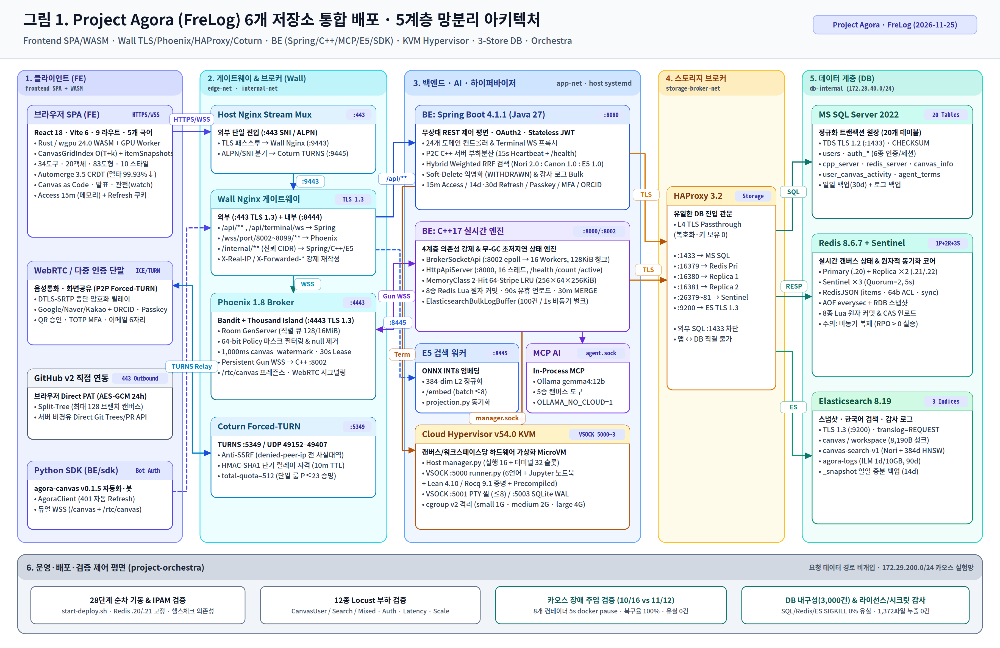
> *그림 1. Project Agora 6개 저장소 통합 배포 및 5계층 망분리 아키텍처 ([고해상도 벡터 SVG 원본](./images/11_system_architecture_diagram.svg))*

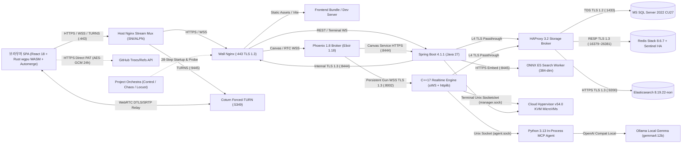

### 1.2 아키텍처 3단계 진화 비교 (`refs/` → 중간 → 최종)
| 진화 축 | 9월 초기 설계 (`refs/`) | 10월 중간 보고서 (2026-10-13) | 11월 최종 구현 (2026-11-25) |
|---|---|---|---|
| **실시간 연결·동기화** | 브라우저 → C++ uWebSockets(`:8001`) 직접 접속, 브라우저 Host 선출 | Nginx → Phoenix Broker → C++ 분리 착수, 90s 유휴 생명주기 도입 | **Hostless 서버 권위(`sync_protocol: 2`)**, 델타 패치(`edit_protocol: 2`), 1s Watermark + 8종 Redis Lua 원자 커밋 |
| **프론트엔드 렌더링** | React DOM + PixiJS 8.21.0 + RBush 4.0.1 | `ScenePreparationQueue`($O(N)$), 10만~50만 객체 60FPS 달성 | **Rust/`wgpu 24.0` WASM** + Shared OffscreenCanvas GPU Worker + **2-Level 1px Grid(`CanvasGridIndex`)** + `StaticPreviewQueue` |
| **인증·계정·보안** | 단일 24h JWT, 기본 이메일 로그인 | 일반 JWT + Canvas Access JWT 분리, Soft-Delete | **15m Access + 14d/30d Refresh 회전(30s grace)**, Google/Naver/Kakao + **ORCID**, **Passkey**, **QR**, **TOTP MFA**, **Bot 토큰** |
| **코드 실행·AI·협업** | 단순 텍스트/드로잉/코드 배치 중심 | 향후 과제 5종 유보 | **KVM MicroVM(6언어+Lean4/Rocq+PTY)**, **In-Process MCP(Local Gemma `gemma4:12b`)**, **GitHub v2 Split-Tree**, **댓글/멘션/발표**, **Python SDK** |
| **데이터 계층 및 격리** | 앱→DB 직접 연결, 단일 Redis | Redis Sentinel HA 도입, ES 스냅샷 정교화 | **HAProxy L4 Storage Broker** 망분리, **E5 384-dim Weighted RRF 검색**, **20개 SQL 테이블**, **Coturn Forced-TURN** |

---

## 2. 구현된 백엔드(`project-agora-BE`) 심층 구조 설계

`project-agora-BE`는 **4개의 런타임 서브시스템**(`spring/`, `cpp/`, `agent/`, `search/`)과 **1개의 공식 클라이언트 패키지**(`sdk/python/`)으로 구성된다.

### 2.1 [구조도 1] 백엔드 전체 프로세스 및 내/외부 통신 토폴로지

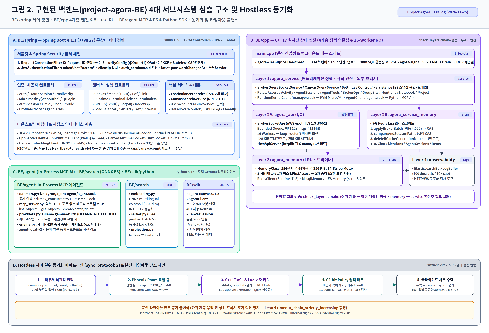
> *그림 2. 구현된 백엔드(`project-agora-BE`) 4대 서브시스템(`spring`, `cpp`, `agent`, `search`, `sdk`) 심층 구조도 ([벡터 SVG 원본](./images/12_backend_internal_architecture_diagram.svg))*
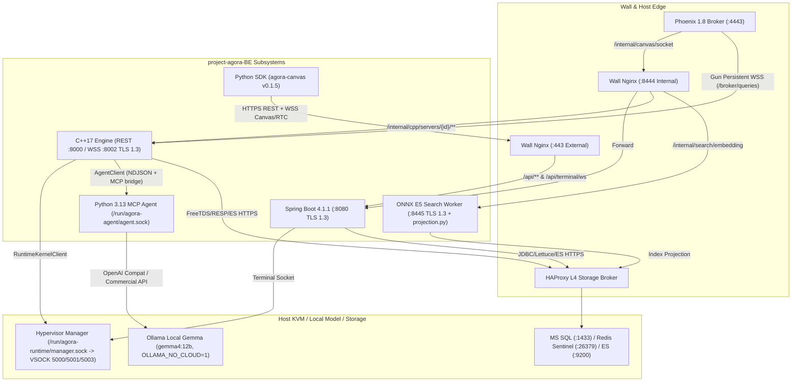

### 2.2 [구조도 2] Spring Boot (`BE/spring`) 보안 필터 체인 및 도메인 패키지 구조도
```mermaid
flowchart LR
  REQ["HTTPS Request (:8080)"] --> COR["RequestCorrelationFilter (X-Request-ID)"]
  COR --> SEC["SecurityConfig (Stateless + CORS Patterns)"]
  SEC -->|"@Order OAuth2"| OAUTH["GoogleOAuthConfig (PKCE / Naver POST)"]
  SEC --> JWTF["JwtAuthenticationFilter (tokenUse / IP / sid / iat >= pwChangedAt / MFA)"]

  JWTF --> CTRL["Controllers (24 Classes)"]
  CTRL --> SVC["Domain Services"]
  SVC --> REPO["JPA Repositories (MS SQL 20 Tables)"]
  SVC --> CLI["External & Storage Clients"]

  subgraph CTRL_GRP["Spring Controllers by Domain"]
    C_AUTH["Auth / OAuthSession / EmailVerification / Mfa / Passkey / QrLogin / AuthSession"]
    C_USR["User / UserProfile / AgentTerms / ProfileActivity"]
    C_CNV["Canvas / CanvasMedia / CanvasPdf / CanvasRuntime / CanvasGithub / CanvasBot / CanvasTerminalTicket / CanvasSocketService"]
    C_EXT["IradeWorkspace / Orcid / LinkPreview / LoadBalancer / TestPage / CanvasTerminalSocket"]
  end

  subgraph CLI_GRP["Adapters & Background Daemons"]
    CL1["CppServerClient (via Wall :8444)"]
    CL2["CppRuntimeClient & CanvasTerminalSocket"]
    CL3["CanvasElasticsearchService & CanvasEmbeddingClient"]
    CL4["CanvasRedisDocumentReader (Sentinel HA Failover)"]
    BG["HaFailoverMonitor + ElasticsearchBulkLogService + RuntimeCleanupWorker"]
  end

  CTRL --- CTRL_GRP
  CLI --- CLI_GRP
  SVC --> GEH["GlobalExceptionHandler (ErrorCode 33종)"]
```

- **Power of Two Choices (P2C) 서버 할당 (`LoadBalancerService.java`)**: 최근 15초 내 Heartbeat가 유효하고 Wall 내부 `/health`를 통과한 C++ 서버 목록에서 서로 다른 2대(`idx1 != idx2`)를 무작위 추출한 뒤, `/internal/cpp/servers/{id}/api/canvas/count` 실시간 활성 캔버스 수를 비교해 부하가 적은 쪽을 선택한다($\frac{\ln\ln n}{\ln 2} + \Theta(1)$).
- **Hybrid Weighted RRF 검색 (`CanvasSearchService.java`)**: Korean Nori BM25(`2.0`) + Canonical BM25(`1.0`) + ONNX E5 384-dim `int8_hnsw` kNN(`1.0`) 3개 순위를 $RRF(d) = \sum \frac{w_i}{60 + r_i(d)}$로 융합하며, 임베딩 워커 타임아웃 시 Canonical BM25로 자동 강등한다.

### 2.3 [구조도 3] C++17 실시간 엔진 (`BE/cpp`) 4계층 정적 라이브러리 의존성 구조도
`CMakeLists.txt` 및 `tests/check_layers.cmake`는 빌드 시점에 상위 계층이 하위 스토리지 드라이버를 직접 참조하거나(`service → memory/`), 하위 계층이 상위 비즈니스 정책(`memory → service/`)을 침범하지 않도록 강제한다.

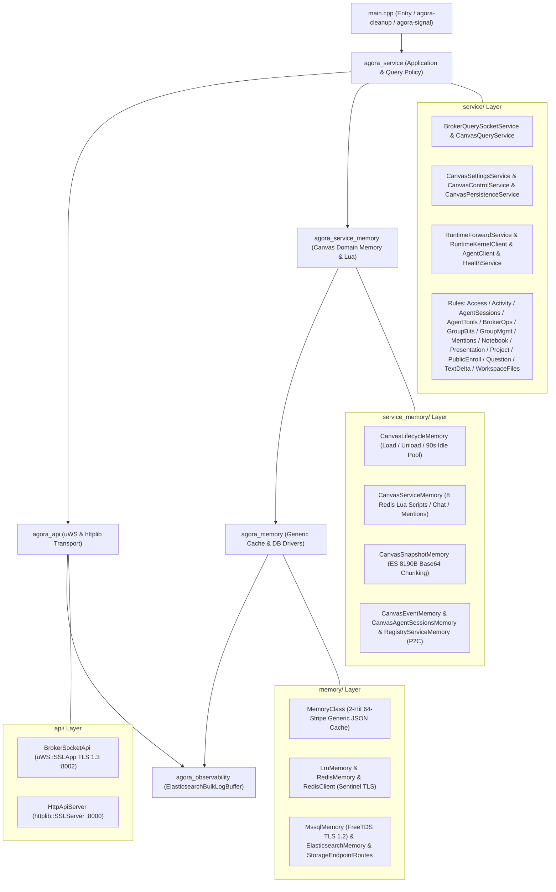

### 2.4 [구조도 4] C++17 멀티스레드 I/O 및 백그라운드 데몬 구조도
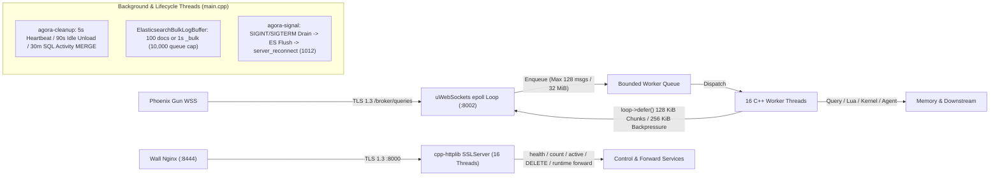

### 2.5 [구조도 5] `MemoryClass` 2-Hit 64-Stripe LRU 캐시 & 8종 Redis Lua 원자 스크립트
- **2-Hit Admission Filter (`MemoryClass.cpp`)**: 일회성 전체 캔버스 스캔이 핫 아이템을 밀어내는 캐시 오염을 막기 위해 1차 미스 시 `kFirstAccess` 표식만 남기고, 2차 접근 시에만 LRU(기본 **256문서 × 문서당 64영역 × 최대 256 KiB**, `64-stripe mutex`, victim 퇴거 시 `try_to_lock` 데드락 회피)에 승격한다.
- **Remote Fields 보호 & `executeAtomic()`**: `chat_room.data` 배열은 크기 변동이 커 LRU 사본에서 제외(`remote_fields`)하고 쓰기 flush 시 Redis 최신 배열과 병합한다. `executeAtomic()`은 스트라이프 락 획득 → dirty 영역 선행 flush → Lua 원자 실행 → 영향 경로 무효화 순서로 동작한다.

| # | Lua 스크립트 (`CanvasServiceMemory.cpp` / `CanvasAgentSessionsMemory.cpp`) | 원자적 처리 책임 |
|---:|---|---|
| 1 | `applyBrokerBatch` | `uid:clientId` 멱등 영수증(최대 4,096건), `count == last + 1` 순번, `__broker_revision` CAS, `JSON.SET/DEL`, KST 일별 활동량 누적, 삭제 객체 멘션 정리 |
| 2 | `compareAndSetJsonPaths` | `settings-revision` 일치 시에만 설정·비밀번호·그룹 권한 일괄 패치 (`CompareSetResult::Applied/Conflict`) |
| 3 | `deleteIfCacheGenerationMatches` | `_cache_generation` 일치 시에만 키 삭제 (언로드 중 재접속 경쟁 방어) |
| 4 | `commitChatMessage` | `uid:reqId` 멱등성 + `next_sequence` 원자 증가 + `JSON.ARRAPPEND` + 수신자별 미읽음 멘션 생성 |
| 5 | `appendChatMessage` & `getChatHistoryPage` | 채팅/댓글 고속 슬라이스 페이지네이션 조회 및 정렬 폴백 |
| 6 | `storeMentionState` & `purgeMentionStates` | 사용자별 `mention-states` 읽음/미읽음 기록 및 삭제된 채팅방 멘션 일괄 정리 |
| 7 | `agentSessions` | AI 대화 v2(`drafts`, `summaries`, `messages`, `receipts`, `index`, `revision`) 원자 저장 (450KB 페이지 상한, 5분 stale 자동 종료) |
| 8 | `agentItemIds` | `$.items` 대용량 문서 페이지네이션 키 목록 조회 (`JSON.OBJKEYS`) |

### 2.6 [구조도 6] Python In-Process MCP 에이전트 · E5 검색 워커 · Python SDK 구조도
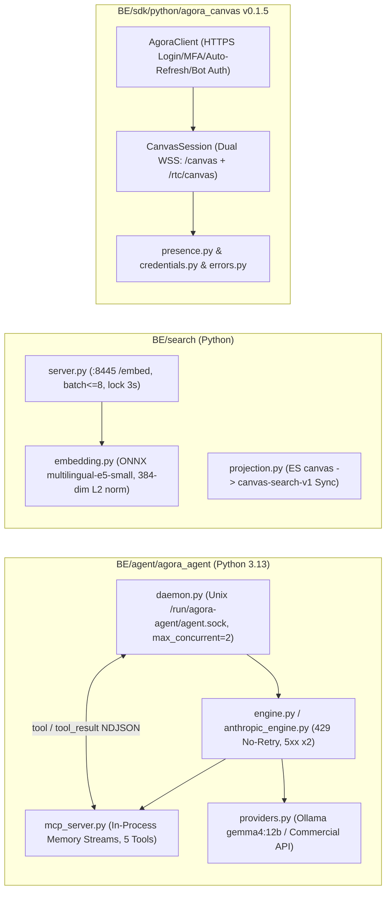

---

## 3. 게이트웨이 · 브로커 (`Wall`) & 프론트엔드 (`FE`) & 하이퍼바이저 설계

### 3.1 Phoenix 1.8 브로커 (`project-agora-Wall/broker`) OTP 슈퍼비전 트리 및 동기화 시퀀스
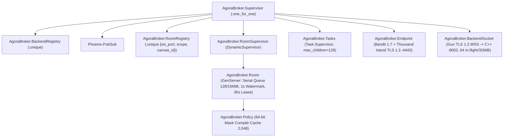

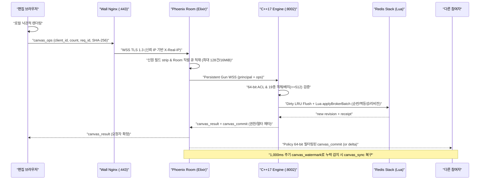

### 3.2 프론트엔드 (`project-agora-FE`) 4계층 하이브리드 렌더링 및 6대 자료구조
1. **Rust/`wgpu 24.0` WASM 스프라이트 엔진 (`rust/agora-wgpu-renderer/src/lib.rs`, `shader.wgsl`)**: WebGL2 우선(`prefer_webgl = true`), WebGPU 폴백, 소프트웨어 GPU 즉시 거절 → Canvas 2D 폴백. 인스턴스당 **48B `SpriteInstance`** 패킹, `tint` 최상위 비트 `0x80000000u`로 **Zero-Upload 드래그**(버텍스 재업로드 없이 `CameraUniform`만 갱신).
2. **Shared OffscreenCanvas GPU Worker (`WorkerGpuRenderer.js`, `gpuRenderer.worker.js`)**: 단일 `GpuWorkerHost`가 깊이별 `SceneState`를 `select_scene`으로 전환하고 Transferable `ImageBitmap` 반환, 대기 중 CSS `translate3d`/`scale` 재투영.
3. **텍스처 아틀라스 & 크롭 래스터 (`textureAtlas.js`, `flatShapeTint.js`, `rasterViewportRegion.js`)**: `1,024×1,024` 아틀라스(깊이당 최대 8장), 단색 사각형은 **단일 화이트 텍스처 + GPU `tint`**, 고배율(최대 **32×**) 시 4M px 뷰포트 크롭 래스터화.
4. **Canvas 2D Ink & DOM 최적화 (`CanvasSelect.jsx`, `StaticPreviewQueue.js`)**: 자유 드로잉(`perfect-freehand 1.2.3`) 전용 2D 잉크 레이어, 64개 초과 선택 시 래스터 외곽선 대체, DOM 이탈 **2초(96개) 유예**, `<select>` → `CanvasSelect` 버튼 프록시, `iframe` 최대 6개 LRU.

| 모듈 | 해결한 병목 | 도입 알고리즘 / 자료구조 | 복잡도·성능 개선 |
|---|---|---|---|
| **`CanvasGridIndex.js`** | RBush 힙 할당 및 $O(\log N + k)$ 순회 | 2레벨 1px 그리드(`1024×1024` 매크로 + `128×128` 파인), `packCoord`, `Uint32Array` 스탬프 | $O(\log N + k) \to O(T + k)$, 힙 할당 **0건** (500k 쿼리 p95 **0.0017ms**) |
| **`ScenePreparationQueue.js`** | 매 프레임 `Object.entries()` 재열거 $O(N^2)$ 기아 | 불변 스냅샷 1회 열거 + 중단 가능 커서(8ms 청크) | $O(N^2) \to O(N)$ (100k~500k 밀집 타임아웃 120s → **5.47~25.03s**) |
| **`itemSnapshots.js`** | 객체 이동 시 `{...items}` 전체 복사 $O(N)$ | **1,024-버킷** FNV-1a 지연 할당 프록시 + 64-hop `WeakRef` | 수정 복사 $O(N/1024)$, diff $O(\Delta)$ (초기 힙 108MB → **27MB**) |
| **`ConnectionIndex.js`** | 복사·이동 시 연결선 $O(N)$ 선형 스캔 | 객체 ID 기준 인접 연결선 해시 인덱스 | $O(N) \to O(\deg(S))$ (100k 전처리 56.631ms → **0.008ms, 7,079×**) |
| **`blueprintGraph.js`** | 코드 실행 순서 결정 및 사이클 방어 | DFS 사이클 탐지 + `MinHeap` Kahn 위상 정렬(≤256노드/32코드) | $O(V + E \log V)$ |
| **`collaborativeSync.js`** | 10만 객체 전량 WASM 할당 시 메모리 고갈 | CRDT 이력 존재 객체만 지연 초기화(`@automerge/automerge/slim`) | 유휴 객체 WASM 메모리 **0바이트** |

### 3.3 KVM 하이퍼바이저 (`hypervisor-for-agora`) 호스트–게스트 VSOCK 구조도
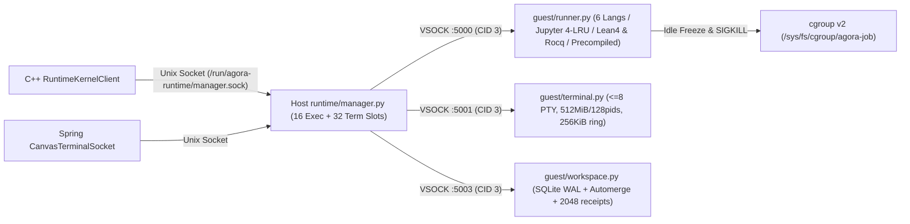

---

## 4. 인터페이스 상세 설계서 (REST API & WebSocket 전수 카탈로그)

### 4.1 Spring Boot & C++ REST API 전수 명세표
| 도메인 | 메서드 | 엔드포인트 URI | 인증 / 권한 | 핵심 기능 |
|---|---|---|---|---|
| **인증·세션** | `POST` | `/api/auth/signup`, `/api/users` | 없음 | 이메일 검증 토큰 소비 후 `SERIALIZABLE` 가입 (`201`) |
| **인증·세션** | `POST` | `/api/auth/login` | 없음 | 로그인 (`Access 15m` + `Refresh 쿠키`, 또는 `mfaRequired`) |
| **인증·세션** | `POST` | `/api/auth/session/refresh`, `/logout`, `/logout-all` | 쿠키+헤더 / JWT | Refresh 회전(30s grace), 단일/전체 세션 폐기 |
| **인증·세션** | `GET/POST` | `/api/auth/me`, `/providers`, `/health`, `GET /api/auth/users` | JWT/Bot / 없음 | 현재 주체 조회, OAuth 제공자 상태, 헬스체크 |
| **이메일인증** | `GET/POST` | `/api/auth/email/{status,request,verify}` | 없음 | 가용 여부, 6자리 HMAC 코드 발송(`202`), 일회용 검증 토큰 발급 |
| **OAuth/ORCID** | `GET/POST` | `/api/auth/oauth2/{authorize/{p},session,enrollment,email/request}` | 없음 / 쿠키 | Google/Naver/Kakao OAuth2 및 최초 가입 이메일 확인 |
| **OAuth/ORCID** | `GET/POST` | `/api/irade/auth/orcid/{status,start,callback,link,session,me}` | 없음 / JWT | ORCID 인증·콜백·일회성 세션 교환·계정 연동 |
| **TOTP MFA** | `GET/POST/DEL` | `/api/auth/mfa`, `/enrollment{/confirm}`, `/verify`, `/disable`, `/recovery-codes` | JWT / 없음 | TOTP 상태, 등록 시작/확인/취소, 로그인 2FA, 복구코드 재발급 |
| **패스키** | `GET/POST/DEL` | `/api/auth/passkeys/{status, ,registration/*,login/*,{id}}` | 없음 / JWT | WebAuthn 패스키 등록·로그인 옵션/검증 및 삭제(최대 10개) |
| **QR 로그인** | `POST` | `/api/auth/qr/{start,poll,cancel,preview,decide}` | 없음 / JWT | 3중 256-bit 해시 QR 발급, 폴링, 취소, 6자리 코드 승인/거절 |
| **사용자·약관** | `GET/PUT/PATCH/DEL` | `/api/users/{nick}/{tag}`, `/profiles/{nick}/{tag}`, `/profile-images/{id}`, `/me/profile-image`, `/me/activity`, `/agent-terms` | JWT (목록 Admin) | 프로필·아바타·일별 편집 잔디 조회, `agent-local-v3` 동의, Soft-Delete 탈퇴 |
| **캔버스 CRUD** | `GET/POST/DEL` | `/api/canvases`, `/search?name=`, `/{id}`, `/{id}/preview`, `/{id}/image` | JWT | 생성(JSON/Multipart 5MiB), RRF 검색, 요약/프리뷰, PNG 정규화 이미지, 삭제 |
| **캔버스 인가** | `GET/PATCH/POST/DEL` | `/api/canvases/{id}/{settings,name,description,password,people,access}` | JWT / 관리자 | 설정·참여자 관리(활성 시 `409 CANVAS_006`), `access`(P2C + 5m JWT + 4h Grant) |
| **미디어/PDF/링크** | `POST/GET` | `/api/canvases/{id}/media{,/{mid}}`, `.../pdfs{,/{pid},/{pid}/thumbnail}`, `POST /api/link-preview` | JWT | 미디어(≤102MiB)·PDF 업로드/썸네일, 허용 URL 오픈그래프 미리보기 |
| **봇·GitHub** | `GET/POST/DEL` | `/api/canvases/{id}/bots{,/{botId},/{botId}/rotate}`, `.../github{,/bind,/branches,/initialized,/permissions,/authorize}` | JWT / 관리자 | 스코프 봇(최대 50) 생성·회전·폐기, GitHub 브랜치(128개)·그룹 권한 위임 |
| **런타임/터미널** | `GET/PUT/POST/WSS` | `/api/canvases/{id}/runtime/{settings,resources,disk,java/dependencies,reset,execute,execute/stream,build,notebook,terminal,terminal/ticket}`, `WSS /api/terminal/ws` | JWT | VM 설정·리소스·디스크·Maven·실행·빌드·노트북·일회성 티켓 PTY 터미널 |
| **IRADE/LB/진단** | `GET/POST/PATCH/DEL` | `/api/irade/workspaces/**`, `/api/servers/**`, `/api/load-balancer/allocate/{server,redis,database}`, `/api/database/address`, `/api/test/**` | JWT / Admin | IRADE 격리 워크스페이스, C++/Redis 풀 관리 및 P2C 할당, DB 세션 스냅샷 |
| **내부 브리지/C++** | `POST/GET/DEL` | Spring `POST /internal/canvas/socket`, C++ `:8000` `/health`, `/api/canvas/{count,active,{id}}`, `/api/runtime/forward*` | 내부 토큰 | Phoenix→Spring 파일/봇 브리지, Spring→Wall `:8444`→C++ 상태·삭제·런타임 포워딩 |

### 4.2 WebSocket 및 Phoenix ↔ C++ 브로커 프레임 명세표
| 채널 / 프로토콜 | 메시지 유형 (`type` / `command`) | 방향 | 핵심 책임 및 페이로드 규격 |
|---|---|---|---|
| **Phoenix ↔ C++ (`/broker/queries`)** | `connect` / `query` | `Phoenix ↔ C++` | 인증된 `principal` + `route{canvas_id, connection_id, request_id, scope}` 기반 연결 인가(`init_items`) 및 상태 변경·조회 질의 |
| **Canvas Data WSS** | `canvas_ops` → `canvas_result` / `canvas_commit` | `Client ↔ Phoenix ↔ C++` | `(client_id, request_count, request_id, SHA-256)` 기반 배치(≤512 ops), `text_edits`/`notebook_edits` 델타 및 64-bit 필터 브로드캐스트 |
| **Canvas Data WSS** | `canvas_watermark` / `canvas_sync` | `Server ↔ Client` | 1,000ms 주기 전역 `revision` 통지, 순번 누락 또는 `force_sync: true` 시 스냅샷 재동기화 |
| **Canvas Data WSS** | `canvas_settings_get/update` → `changed`/`revoked` | `Client ↔ Server` | `expected_revision` CAS 설정 변경; ACL 변경 시 `canvas_access_changed` 무중단 능력 갱신 또는 `canvas_access_revoked` 종료 |
| **Canvas Data WSS** | `chat` / `chat_history` / `mentions_get` / `mention_read` | `Client ↔ Server` | 채널 채팅 및 `object_id` 댓글 스레드, 원자적 순번 부여, 미읽음 멘션 100건 조회/읽음 확인 |
| **Canvas Data WSS** | `runtime_execute` → `runtime_output` / `runtime_result` | `Client ↔ Phoenix ↔ C++` | `action: execute|build|notebook|manage|agent` 비차단 비동기 실행(룸 예산 `vm=1, agent=2, agent_status=4, service=4`) |
| **Canvas Data WSS** | `workspace_files` → `result` / `changed` | `Client ↔ Phoenix ↔ C++` | `stat/list/read/write/mkdir/rename/delete` (≤128KiB 파일/Automerge 문서, 700KB 프레임 상한) |
| **RTC / Presence WSS** | `rtc_ready`/`rtc_join`, `canvas_relay`, `rtc_signal`, `voice_state` | `Client ↔ Phoenix` | `cursor`/`laser`/`editor_presence` 릴레이, WebRTC SDP/ICE(≤256KiB) 채널별 중계, `media_relay` Forced-TURN 자격 갱신 |
| **Terminal WSS** | `attach` / `input` / `resize` / `close` → `ready`/`output` | `Client ↔ Spring ↔ KVM` | 15초 일회성 티켓 바인딩, 절대 byte `offset` Base64 푸시, 2초 주기 권한 재검사 |

---

## 5. 데이터베이스 및 저장소 상세 스키마 설계 (`project-agora-DB`)

### 5.1 MS SQL 20개 테이블 ERD (`init-mssql.sql` + 20개 마이그레이션)

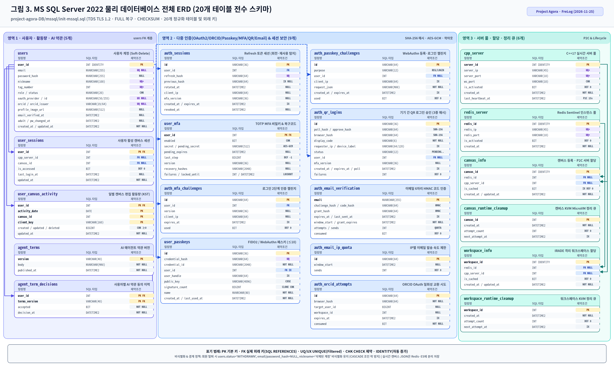
> *그림 3. MS SQL Server 2022 물리 데이터베이스 20개 테이블 전체 ERD ([벡터 SVG 원본](./images/13_database_erd_20tables_diagram.svg))*
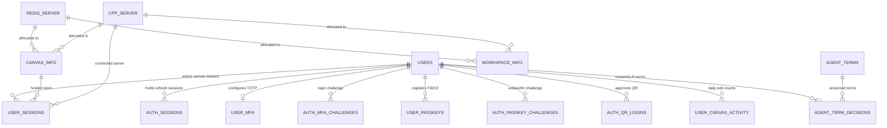

### 5.2 MS SQL 20개 테이블 전 컬럼 데이터 사전
| # | 테이블명 | 주요 컬럼 및 데이터 타입 | 제약조건 (PK / FK / UQ / CHECK / INDEX) |
|---:|---|---|---|
| 1 | `users` | `user_id` INT IDENTITY, `email` NVARCHAR(255) NULL, `password_hash` NVARCHAR(255) NULL, `nickname` NVARCHAR(100), `tag_number` INT, `role` NVARCHAR(20), `status` NVARCHAR(20), `oauth_provider` NVARCHAR(50) NULL, `oauth_id` NVARCHAR(255) `BIN2` NULL, `orcid` VARCHAR(19) NULL, `orcid_issuer` VARCHAR(64) NULL, `profile_image_url` NVARCHAR(512) NULL, `email_verified_at` / `adult_verified_at` / `password_changed_at` / `created_at` / `updated_at` DATETIME2 | PK `user_id`; UQ filtered `UQ_Users_Email`, `UQ_Users_Nickname_TagNumber`, `UX_users_OAuthIdentity`, `UQ_Users_OrcidIssuer`; CHECK `CK_users_Auth`(비밀번호/OAuth/ORCID/`WITHDRAWN`), `CK_users_EmailRequired`, `CK_users_Role`, `CK_users_Status` |
| 2 | `user_sessions` | `user_id` INT, `cpp_server_id` INT NULL, `canvas_id` INT NULL, `is_accessed` BIT(0), `last_login_at` DATETIME2 NULL, `updated_at` DATETIME2 | PK/FK `user_id→users`; FK `cpp_server_id`, `canvas_id`; IX `(canvas_id, is_accessed)`, `(cpp_server_id)` |
| 3 | `cpp_server` | `server_id` INT IDENTITY, `server_ip` VARCHAR(45), `server_port` VARCHAR(10), `ws_port` VARCHAR(10), `is_activated` BIT(0), `created_at` DATETIME2, `last_heartbeat_at` DATETIME2 | PK `server_id`; UQ `(server_ip, server_port)`; CHECK 공백 불가 |
| 4 | `redis_server` | `redis_id` INT IDENTITY, `redis_ip` VARCHAR(45), `redis_port` VARCHAR(10), `is_activated` BIT(0), `created_at` DATETIME2 | PK `redis_id`; UQ `(redis_ip, redis_port)`; CHECK 공백 불가 |
| 5 | `canvas_info` | `canvas_id` INT IDENTITY, `redis_id` INT NULL, `cpp_server_id` INT NULL, `is_cached` BIT(0), `created_at` DATETIME2, `updated_at` DATETIME2 | PK `canvas_id`; FK `redis_id`, `cpp_server_id`; IX `(is_cached)`, `(cpp_server_id)` |
| 6 | `canvas_runtime_cleanup` | `canvas_id` INT, `created_at` DATETIME2, `attempt_count` INT(0), `next_attempt_at` DATETIME2 | PK `canvas_id`; IX `(next_attempt_at, canvas_id)` |
| 7 | `workspace_info` | `workspace_id` INT IDENTITY, `redis_id` INT NULL, `cpp_server_id` INT NULL, `is_cached` BIT(0), `created_at` DATETIME2, `updated_at` DATETIME2 | PK `workspace_id`; FK `redis_id`, `cpp_server_id`; IX `(cpp_server_id)` |
| 8 | `workspace_runtime_cleanup` | `workspace_id` INT, `created_at` DATETIME2, `attempt_count` INT(0), `next_attempt_at` DATETIME2 | PK `workspace_id`; IX `(next_attempt_at, workspace_id)` |
| 9 | `auth_sessions` | `id` VARCHAR(36), `user_id` INT, `refresh_hash` VARCHAR(64), `previous_hash` VARCHAR(64) NULL, `rotated_at` DATETIME2 NULL, `client_ip` VARCHAR(64) NULL, `mfa_version` VARCHAR(36) NULL, `created_at` / `expires_at` / `revoked_at` DATETIME2 | PK `id`; FK `user_id`; UQ `refresh_hash`; IX `(user_id)`, filtered `(previous_hash)`, `(expires_at)` |
| 10 | `user_mfa` | `user_id` INT, `enabled` BIT(0), `secret` VARCHAR(512) NULL, `pending_secret` VARCHAR(512) NULL, `pending_expires` DATETIME2 NULL, `last_step` BIGINT(-1), `version` VARCHAR(36) NULL, `recovery_hashes` VARCHAR(2048) NULL, `failures` INT(0), `locked_until` DATETIME2 NULL | PK/FK `user_id→users`; CHECK `CK_UserMfa_Enabled` |
| 11 | `auth_mfa_challenges` | `id` VARCHAR(64), `user_id` INT, `version` VARCHAR(36) NULL, `client_ip` VARCHAR(64) NULL, `expires_at` DATETIME2 NULL, `used` BIT(0) | PK `id`; FK `user_id`; IX `IX_MfaChallenge_Expires` |
| 12 | `auth_email_verification` | `email` NVARCHAR(255), `challenge_hash`/`code_hash`/`grant_hash` VARCHAR(64), `expires_at`/`last_sent_at`/`window_start`/`grant_expires_at` DATETIME2, `attempts` INT(0), `sends` INT(0), `consumed` BIT(0) | PK `email`; IX `IX_EmailProof_Expires` |
| 13 | `auth_email_ip_quota` | `id` VARCHAR(64), `window_start` DATETIME2 NULL, `sends` INT(0) | PK `id` |
| 14 | `user_passkeys` | `id` VARCHAR(36), `credential_hash` VARCHAR(64), `credential_id` VARCHAR(2048), `user_id` INT, `user_handle` VARCHAR(64), `public_key` VARCHAR(4096), `signature_count` BIGINT, `name` NVARCHAR(80), `created_at` / `last_used_at` DATETIME2 | PK `id`; UQ `credential_hash`; FK `user_id`; IX `(user_id, created_at)`, `(user_handle)` |
| 15 | `auth_passkey_challenges` | `id` VARCHAR(64), `purpose` VARCHAR(12), `user_id` INT NULL, `client_ip` VARCHAR(64), `request_json` VARCHAR(MAX), `created_at`/`expires_at` DATETIME2, `used` BIT(0) | PK `id`; FK `user_id`; IX `(expires_at)`, `(client_ip, created_at)` |
| 16 | `auth_qr_logins` | `id` VARCHAR(36), `poll_hash`/`approve_hash`/`browser_hash` VARCHAR(64), `display_code` VARCHAR(6), `requester_ip` VARCHAR(64), `device_label` VARCHAR(120), `status` VARCHAR(12), `created_at`/`expires_at`/`last_poll` DATETIME2, `user_id` INT NULL, `mfa_version` VARCHAR(36) NULL, `failures` INT(0) | PK `id`; FK `user_id`; IX `(requester_ip, created_at)`, `(expires_at)`, `(user_id)` |
| 17 | `auth_orcid_attempts` | `id` VARCHAR(64), `browser_hash` VARCHAR(64), `target_user_id` BIGINT NULL, `workspace_id` INT NULL, `expires_at` DATETIME2, `consumed` BIT | PK `id`; IX `IX_OrcidAttempt_Expiry` |
| 18 | `user_canvas_activity` | `user_id` INT, `canvas_id` INT, `client_key` VARCHAR(160), `activity_date` DATE, `created_count`/`updated_count`/`deleted_count` BIGINT(0), `updated_at` DATETIME2 | 복합 PK `(user_id, activity_date, canvas_id, client_key)`; FK `user_id` ON DELETE CASCADE; CHECK `counts >= 0` |
| 19 | `agent_terms` | `version` VARCHAR(40), `body` NVARCHAR(MAX), `published_at` DATETIME2 | PK `version` (`agent-local-v2`, `agent-local-v3` 등재) |
| 20 | `agent_term_decisions` | `user_id` INT, `terms_version` VARCHAR(40), `accepted` BIT, `decision_at` DATETIME2 | 복합 PK `(user_id, terms_version)`; FK `user_id`, `terms_version` |

### 5.3 RedisJSON · Elasticsearch 스키마 및 Canvas 생명주기 상태도

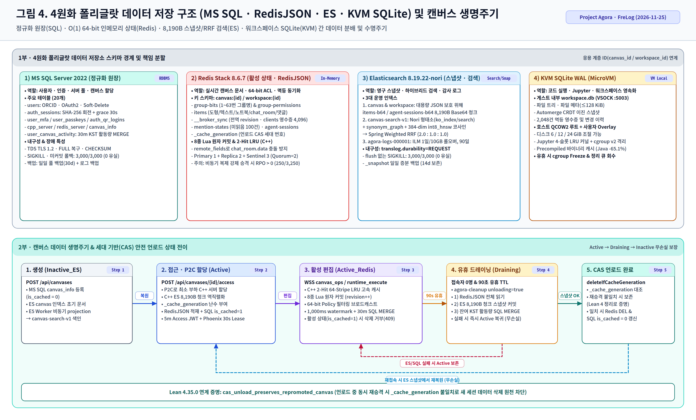
> *그림 4. 4원화 폴리글랏 데이터 구조(MS SQL · RedisJSON · ES · KVM SQLite) 및 CAS 기반 캔버스 생명주기 ([벡터 SVG 원본](./images/14_polyglot_data_lifecycle_diagram.svg))*
- **RedisJSON (`canvas:{id}` / `workspace:{id}`)**: `canvas-name`, `canvas-id`, `admin-user-id`, `description`, `visibility`, `canvas-password-hash`, `password-revision`, `people`, `init-group`, `inner-group`, `group-bits`, `group-permissions`, `settings-revision`, `items` (내부 `chat_room`, `object-comment-*` 포함), `__broker_sync` (`revision`, `clients`), `mention-states`, `agent-sessions`, `_cache_generation`.
- **Elasticsearch 3대 인덱스**:
  1. `canvas` & `workspace` (1 shard / 0 replica, `translog.durability=REQUEST`, `items-b64` / `agent-sessions-b64` **8,190B Base64 청크** 저장)
  2. `canvas-search-v1` (별칭 `canvas-search`, `ko_index`/`ko_search` Nori + `synonym_graph` + `dense_vector` **384차원 `int8_hnsw`** 코사인)
  3. `agora-logs-000001` (별칭 `agora-logs`, ILM 1일/10GB 롤오버, 90일 삭제)

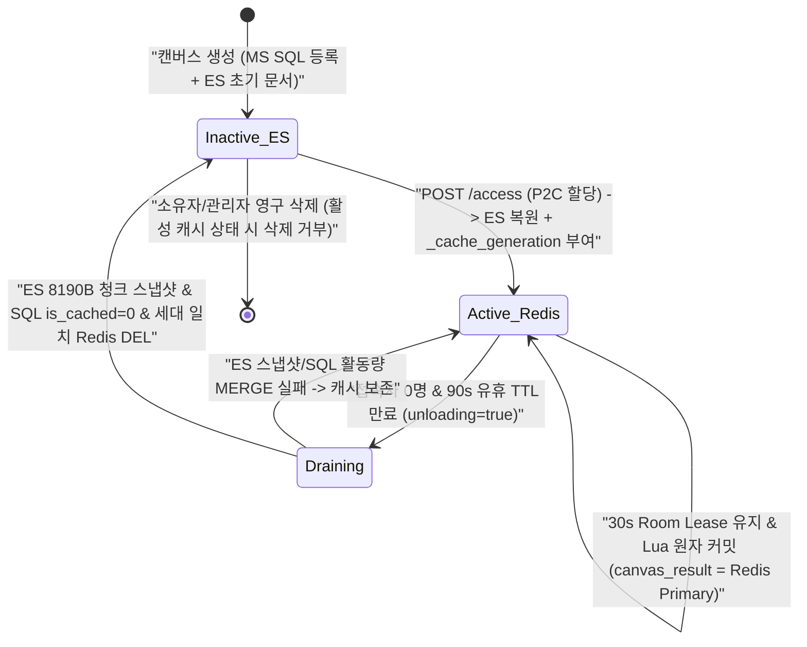
