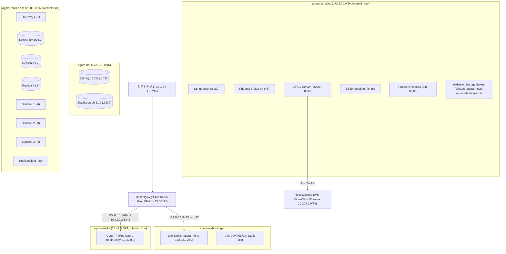
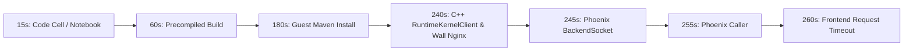
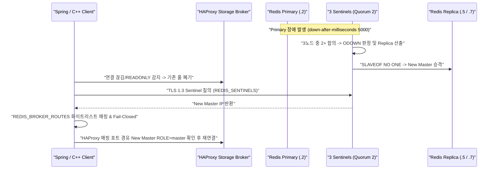

# Project Agora (FreLog) 인프라 및 분산 처리 설계서

| 항목 | 내용 |
|---|---|
| **프로젝트명** | Project Agora (서비스명: **FreLog / FLog**) |
| **기준 저장소** | `project-agora-Wall`, `project-agora-DB`, `hypervisor-for-agora`, `project-orchestra`, `project-agora-BE`, `project-agora-FE` |
| **작성 기준일** | 2026-11-25 |

---

## 1. 하드웨어 환경 및 15개 컨테이너 배포 아키텍처

### 1.1 통합 개발·검증 및 GPU 벤치마크 장비 사양
| 구분 | 통합 개발·도커 운영 장비 (`refs/중간보고서`) | 프론트엔드 대규모 GPU 벤치마크 환경 (`FE/docs/`) |
|---|---|---|
| **CPU** | 12th Gen Intel Core i5-12400F (2.50 GHz) | Intel 데스크톱 환경 (Chrome 155 / 157 HW GPU) |
| **RAM** | DDR4 32 GB | 32 GB |
| **GPU** | NVIDIA GeForce RTX 3060 | **NVIDIA GeForce RTX 3060 Ti 8 GB** (Driver 595.99.02, OpenGL ES 3.2 ANGLE) |
| **Storage** | M.2 NVMe SSD 1 TB | NVMe SSD |
| **용도** | 15개 Docker 컨테이너 동시 구동, 카오스·내구성·부하·KVM 시험 | 12k / 100k / 200k / 500k 객체 60FPS 렌더링 및 GPU Worker 스루풋 실측 |

### 1.2 전체 15개 컨테이너 배포 · 하드닝 명세표
`Wall`과 `Orchestra`의 서비스 컨테이너는 최소 권한 원칙(`uid/gid 10001`, `read_only: true`, `cap_drop: [ALL]`, `no-new-privileges: true`)을 적용하며, 2026-11-12 개선 이후 게이트웨이/브로커 로그는 **파일당 20 MB × 5개(최대 100 MB)**로 로테이션한다.

| # | 컨테이너 / 서비스명 | 소속 저장소 | 연결 네트워크 | 주요 포트 (내부) | 보안 하드닝 및 데이터 영속 볼륨 |
|---:|---|---|---|---|---|
| 1 | `agora-mssql` | `DB` | `agora-net` | `1433` (TLS 1.2) | `linux/amd64`, `mssql_data` 영속 볼륨, `agora_runtime` 최소권한 |
| 2 | `agora-elasticsearch` | `DB` | `agora-net` | `9200` (TLS 1.3) | `es_data` + 분리된 `ES_SNAPSHOT_HOST_DIR`, Nori 플러그인 내장 |
| 3 | `agora-redis-primary` | `DB` | `agora-redis-ha` | `6379` (TLS 1.3) | `172.20.0.2`, AOF `everysec`, `canvas:*` ACL 격리 |
| 4 | `agora-redis-replica-1` | `DB` | `agora-redis-ha` | `6379` (TLS 1.3) | `172.20.0.7`, 비동기 복제본 |
| 5 | `agora-redis-replica-2` | `DB` | `agora-redis-ha` | `6379` (TLS 1.3) | `172.20.0.5`, 비동기 복제본 |
| 6 | `agora-redis-sentinel-1~3` | `DB` | `agora-redis-ha` | `26379` (TLS 1.3) | `172.20.0.{6,3,4}`, quorum=2, 읽기 전용 Sentinel ACL |
| 7 | `agora-redis-insight` | `DB` | `agora-redis-ha` + 관리망 | `8001` (loopback HTTPS) | `172.20.0.20`, 호스트 `127.0.0.1:8001`만 바인딩 |
| 8 | `agora-storage-broker` | `Wall` | `agora-services`, `agora-net`, `agora-redis-ha` | `1433, 9200, 16379~26381` | `172.20.0.21`, `uid 10001`, `read_only`, `cap_drop: ALL`, TLS 키 미보유 |
| 9 | `agora-spring` | `BE` | `agora-services` | `8080` (TLS 1.3) | non-root, `read_only`, `agora-backend-spring-resources` 볼륨 |
| 10 | `agora-cpp` | `BE` | `agora-services` | `8000` REST, `8002` WSS (TLS 1.3) | non-root, `read_only`, `manager.sock` & `agent.sock` 마운트 |
| 11 | `agora-agent` | `BE` | egress 전용 | Unix `agent.sock` | 공개 포트 0, Ollama(`gemma4:12b`) 또는 상용 API 통신 |
| 12 | `agora-search-embedding` | `BE` | `agora-services` | `8445` (TLS 1.3) | CPU 2코어 / RAM 2 GiB 제한, ONNX E5-small 로컬 추론 |
| 13 | `agora-broker` (Phoenix) | `Wall` | `agora-services` | `4443` (TLS 1.3) | `uid 10001`, `read_only`, 20MB×5 로그 로테이션 |
| 14 | `agora-media-relay` (Coturn) | `Wall` | `agora-media` | `5349` (TLS/TURNS) | `10.42.0.2`, 외부 UDP 포트 0, Anti-SSRF 필터 |
| 15 | `agora-nginx` & FE (`vite`/`dist`) | `Wall` / `FE` | `agora-services`, `agora-web` | `443` 외부, `8444` 내부 (TLS 1.3) | `172.23.0.250`, `agora-frontend-dist` 심볼릭 링크 원자 전환 |

---

## 2. 5계층 네트워크 망분리 및 정적 IPAM 설계

### 2.1 네트워크 토폴로지 다이어그램

### 2.2 정적 IP 할당 및 IPAM 자동 검증 (`STARTUP_NETWORK_VALIDATION.md`)
2026-11-10 기동 순서에 따라 동적 IP를 쓰던 `storage-broker`가 `.8`을 선점하여 `redis-insight` 정적 IP(`.8`)와 충돌하던 장애를 근본적으로 해결하기 위해 `redis-insight`를 `.20`, `storage-broker`를 `.21`로 재배치하고, `orchestra/startup.py`에 사전 IPAM 검증(중복 IP·서브넷 불일치·`agora-redis-ha` 내 동적 IP 할당 즉시 거부)을 내장하였다.

| 네트워크 | 대역 / 속성 | 컨테이너 (서비스명) | 고정 IP / 포트 | 역할 |
|---|---|---|---|---|
| `agora-redis-ha` | `172.20.0.0/16` (`internal: true`) | `agora-redis-primary` | `172.20.0.2` (`:6379` TLS 1.3) | 활성 캔버스 마스터 |
| `agora-redis-ha` | `172.20.0.0/16` | `agora-redis-sentinel-{2,3,1}` | `172.20.0.{3,4,6}` (`:26379` TLS 1.3) | 3노드 쿼럼(2) 감시 |
| `agora-redis-ha` | `172.20.0.0/16` | `agora-redis-replica-{2,1}` | `172.20.0.{5,7}` (`:6379` TLS 1.3) | 비동기 복제본 |
| `agora-redis-ha` | `172.20.0.0/16` | `agora-redis-insight` / `storage-broker` | `172.20.0.20` / `172.20.0.21` | 관리 UI / L4 중계 |
| `agora-net` | `172.21.0.0/16` | `agora-mssql`, `agora-elasticsearch`, `storage-broker` | `:1433` (TLS 1.2), `:9200` (TLS 1.3) | RDB · 검색/스냅샷 |
| `agora-services` | `172.23.0.0/16` (`internal: true`) | `agora-nginx`, `spring`, `broker`, `cpp`, `search-embedding`, `storage-broker` | `nginx: 172.23.0.250` | 앱–게이트웨이 내부망 |
| `agora-media` | `10.42.0.0/24` (`internal: true`) | `agora-media-relay` (Coturn) | `10.42.0.2` (`:5349` TLS) | Forced-TURN 미디어 |
| Host KVM `netns` | `10.204.0.0/24`, `10.205.0.0/30` | `agora-runtime-<id>` | 64개 `/30` 슬롯 (`10.205.0.2` 게스트) | MicroVM 격리 네트워킹 |

---

## 3. 게이트웨이, E2E TLS, 분산 타임아웃 체인 및 Storage Broker

### 3.1 Host Nginx Stream Mux & Wall Nginx 1.31.9 라우팅 표
- **Host Nginx (`media/ingress.conf`, `:443`)**: `ngx_stream_ssl_preread_module`이 TLS를 복호화하지 않고 SNI(`frelog.p-e.kr`)와 ALPN을 판독한다. `h2`/`http/1.1` → `127.0.0.1:9443`(`proxy_protocol` 유지 → Wall Nginx `:443`), `stun.turn` 또는 ALPN 부재 → `127.0.0.1:9445`(`proxy_protocol` 제거 → Coturn `10.42.0.2:5349`, `24h` 타임아웃). 호스트 UFW는 `1433/tcp`를 명시 차단하고 `80/tcp`는 폐쇄한다.

| 리스너 | Location 경로 | 대상 Upstream | 보안 · 타임아웃 · 버퍼 정책 |
|---|---|---|---|
| **`:443` (외부)** | `/internal/` | (차단) | 무조건 **`404`** 반환 |
| **`:443` (외부)** | `^/api/canvases/[1-9][0-9]*/media` | `agora-spring:8080` | `client_max_body_size 102m`, `120s`, `proxy_request_buffering off` |
| **`:443` (외부)** | `^/api/canvases/.*/runtime/(notebook\|java/dependencies\|build\|execute/stream)` | `agora-spring:8080` | `240s`, 무버퍼링(`proxy_buffering off`), `gzip off` |
| **`:443` (외부)** | `= /api/terminal/ws` | `agora-spring:8080` | WebSocket Upgrade, `proxy_read_timeout 3600s`, `send 60s` |
| **`:443` (외부)** | `= /api/irade/auth/orcid/callback` | `agora-spring:8080` | `access_log off`, `Referrer-Policy: no-referrer` (코드 유출 방지) |
| **`:443` (외부)** | `/api/` | `agora-spring:8080` | TLS 1.3 + CA/SAN 검증, `X-Real-IP` / `X-Forwarded-Port` 전달 |
| **`:443` (외부)** | `^/wss/port/(8002~8099)/(rtc/)?(canvas\|workspace)/([0-9]+)` | `agora-broker:4443` | WebSocket Upgrade, `86400s`, `access_log off` (토큰 query 로깅 차단) |
| **`:443` (외부)** | `= /html-preview.html` | FE 정적/Vite | 격리 CSP(`default-src 'none'; script-src 'unsafe-inline'`), `no-referrer` |
| **`:8444` (내부)** | `= /internal/canvas/socket` | `agora-spring:8080` | `1m`, `60s`, `X-Agora-Internal-Token` 전달 |
| **`:8444` (내부)** | `= /internal/broker/workspace-broadcast` / `search/embedding` | `agora-broker:4443` / `search:8445` | `64k`, `read_timeout 3s` |
| **`:8444` (내부)** | `^/internal/cpp/servers/{id}/(api/.*\|health)` | `cpp-routes.conf` 매핑 | `240s`, 무버퍼링, `cpp_api_upstream` 미매핑 시 `404` |

### 3.2 분산 실행 타임아웃 체인 단조 정렬 (`2026-11-12` 교정)

*(하위 계층이 완료되기 전에 상위 프록시/브로커가 먼저 연결을 끊어 `QUERY_OUTCOME_UNKNOWN`이 발생하던 문제를 해결하기 위해 `15 < 60 < 180 < 240 < 245 < 255 < 260`의 엄밀한 단조 증가 계층을 강제하고 Lean 4 `timeout_chain_strictly_increasing`으로 검증하였다.)*

### 3.3 HAProxy 3.2 L4 Storage Broker & Coturn Forced-TURN 격리
- **HAProxy 3.2 (`haproxy.cfg`)**: TLS 개인키나 DB 비밀번호를 전혀 보유하지 않고(`maxconn 4096`, `timeout connect 5s`, `client/server 1h`) L4 TCP 패스스루만 수행한다. `:1433`→`mssql:1433`, `:9200`→`elasticsearch:9200`, `:16379~16381`→Redis 3노드, `:26379~26381`→Sentinel 3노드로 매핑되며, `REDIS_BROKER_ROUTES` 화이트리스트에 없는 Redis IP는 즉시 Fail-Closed 차단한다.
- **Coturn 4.7.0 (`media/setup-media.py`)**: `denied-peer-ip=0.0.0.0-255.255.255.255` + `allowed-peer-ip=10.42.0.2` 조합으로 릴레이 할당 간 통신만 허용(내부망 SSRF 차단), `user-quota=64`, `total-quota=512`, `max-bps=10Mbps`, `bps-capacity=200Mbps` 적용.

---

## 4. 하이퍼바이저 샌드박스 인프라 (`hypervisor-for-agora`)

### 4.1 공급망 검증 · 리소스 템플릿 · 6개 언어 런타임 매트릭스
- **공급망 핀닝**: Cloud Hypervisor **v54.0**(CVE-2026-27211/45782 패치) + edk2 UEFI(`ch-97eeb7b09`) + Ubuntu 24.04(`release-20261017`), `config/SHA256SUMS` 및 Canonical GPG 키(`D2EB44626FDDC30B513D5BB71A5D6C4C7DB87C81`) 검증.
- **VM 템플릿 & 호스트 총량 상한 (`manager.py`)**: 동시 활성 VM 최대 **4대**, 총합 **8 GiB RAM / 8 vCPU**, 가용 메모리 `new_vm_ram + 512 MiB(VMM) + 2,048 MiB(여유)`, 디스크 6/12/24 GiB(최대 32개 캔버스, 호스트 최소 8 GiB 잔여, VM당 50 MiB/s · 1,000 IOPS), 30초 감시로 **15분(900초)** 유휴 시 자동 정지.

| 템플릿 | vCPU | VM RAM | 호스트 `MemoryMax` | 호스트 `CPUQuota` | 게스트 워커 Cgroup RAM / PIDs |
|---|---:|---:|---:|---:|---|
| **`small` (기본)** | 1 | 1 GiB | 1,536 MiB | 100% | 768 MiB / 64 pids |
| **`medium`** | 2 | 2 GiB | 2,560 MiB | 200% | 1,536 MiB / 128 pids |
| **`large`** | 4 | 4 GiB | 4,608 MiB | 400% | 3,072 MiB / 256 pids |

| 언어 | 설치된 컴파일러 / 인터프리터 | 선택 가능 옵션 및 특이사항 |
|---|---|---|
| **C++** | Clang 19 / 21, GCC 14 | C++11/14/17/20/23, `O0–O3`, 경고, `-Werror`, 예외, RTTI (Clang 증분 JIT vs GCC 독립 바이너리) |
| **C** | Clang 19 / 21, GCC 14 | C11/17/23, `O0–O3`, 경고, `-Werror` |
| **Python** | CPython 3.11 / 3.12 / 3.13 / 3.14 / 3.15 | 최적화(`-O`/`-OO`), 바이트코드 저장, 경고, 버전별 `/workspace/.python/<ver>` 격리 + Jupyter 4-커널 LRU |
| **Java** | Temurin JDK 17 / 21 / 25 | target release, 최대 힙, assertions, `--enable-preview`, **Maven Central 최대 20개 의존성** |
| **JavaScript** | Node.js 20 / 22 / 24 | strict 모드, 경고, V8 코드 캐시 Precompiled 지원 |
| **Shell & 증명** | Bash 5.2, **Lean 4.10.0**, **Rocq 9.1.1** | `errexit`, `nounset`, `pipefail`; `%%lean4`/`%%rocq` 합본 12s 검증 + 8s 목표 상태 HTML 리포트 |

---

## 5. 고가용성(HA), 백업·복구 및 Scale-Out 인프라

| 계층 | 고가용성 / Scale-Out 구조 | 백업·보존 및 백프레셔 정책 |
|---|---|---|
| **Redis Stack 8.6.7** | **1 Primary + 2 Replica + 3 Sentinel** (`down-after-ms 5000`, `failover-timeout 60000`), P2C 논리 풀 분산 | `redis/snapshot-ha.sh` (`--rdb` + `redis-check-rdb`, `0600`), 2-Hit 64-Stripe LRU(256×64×256KiB) |
| **MS SQL 2022 CU27** | Express(`FULL`, `PAGE_VERIFY=CHECKSUM`); 멀티호스트 Basic AG(2 Sync + 1 Config-only + Pacemaker) 템플릿 구비 | `mssql/backup-database.sh` (`BACKUP WITH CHECKSUM` + `RESTORE VERIFYONLY`) |
| **Elasticsearch 8.19** | `translog.durability=REQUEST`, 1 shard / 0 replica | **ILM**(`agora-logs-retention`: 1d/10GB, 90일 삭제) + **SLM**(`agora-daily`: 02:30 UTC, 35일 보관) + `03:15 UTC` 통합 백업 |
| **Edge / Broker / C++** | Host/Wall Nginx 무상태 확장, Phoenix 룸 분산, C++ P2C 수평 확장 | 브로커 `240 msg/s`, 룸 큐 `128건/16MiB`, C++ 워커 `128건/32MiB`, 아웃바운드 `128 KiB` 청크 |

---

## 6. 운영 자동화 및 검증 인프라 (`project-orchestra`)

### 6.1 28단계 의존성 순차 기동 파이프라인 (`orchestra/startup.py`)
`project-orchestra`는 `.startup-lock` 하에 비밀키 길이(≥32B)·파일 권한(`0600`)·IPAM 정적 충돌을 선검증하고 `--wait-timeout 300s`(30~1800s) 기준으로 28개 세부 단계를 순차 기동한다:
1. **사전 검증(Preflight)**: Secret ≥32B, `.env` `0600`, JWT/내부 토큰 일치, IPAM 정적 충돌 검사 (1단계)
2. **저장소 데이터 계층 순차 기동**: ES 권한 준비 → `mssql` → `elasticsearch` → `redis-primary` → `redis-replica-1/2` → `redis-sentinel-1/2/3` 개별 기동 및 health 대기 (8단계)
3. **스키마·인덱스·관리 UI 초기화**: SQL 스키마/계정 → Redis ACL/인덱스/`redis_server` 등록 → ES 계정/인덱스 → 검색 프로젝션 스키마 → `RedisInsight(.20)` 기동 (5단계)
4. **망분리 중계 & 호스트 런타임**: Wall `storage-broker(.21)` 기동(60s 대기) → BE 이미지 빌드 및 TLS 볼륨 초기화 → 호스트 `agora-runtime-egress`/`manager` 서비스 상태 확인 (4단계)
5. **애플리케이션 & 검색 워커**: `agora-agent` → `agora-spring` → `agora-cpp` 순차 기동 → E5 검색 워커 동기화 → BE HTTPS/로그 계정 검증 (5단계)
6. **미디어·브로커·프론트엔드·게이트웨이**: `agora-media-relay` → Phoenix TLS 볼륨/브로커 기동 → Wall 게이트웨이 preflight → FE 정적 빌드 export(또는 `agora-web` + Vite 기동) → Wall Nginx 기동/리로드(운영 시 Vite 중지) → `/` & `/api/auth/health` HTTPS 최종 프로브 (5단계)

### 6.2 12종 Locust 부하 프로파일 · 카오스 엔진 · DB 내구성 실험기
- **Locust 12개 읽기 전용 프로파일 (`locustfile.py`, 실패율 ≤ 1%, p95 ≤ 1,000ms 합격 기준)**: `GatewayUser`, `FrontendUser`, `SpringUser`, `CppUser`, `PhoenixUser`, `ElasticsearchUser`, `CanvasUser`(access→WSS `init_items`→`crud read`), `MssqlUser`(ODBC TLS 1.2), `RedisPrimaryUser`, `RedisJsonUser`, `RedisReplica1User`/`RedisReplica2User`, `SentinelUser`.
- **Chaos Engine (`orchestra/chaos.py`)**: `pause` / `stop` / `disconnect` / `cpu` 4종 장애를 `0600` fsync 저널 기반으로 주입 후 자동 복원하며, 격리 서브넷(`172.29.200.0/24`)에서 4단계 사용자 플로우(`login → search → connect → save`, 단계당 2,000ms)를 실행해 JSONL/CSV/Audit를 생성한다.
- **Database Durability Lab (`tests/database_durability_lab.py`)**: Redis(512 MiB)/MS SQL(1 GiB)/ES(512 MiB)에 1,000건×3단계(3,000건) 커밋 후 `Graceful Restart`, `SIGKILL`, `Kill + Recreate`, `Replication-Gap Stale Promotion`, `Uncommitted Rollback`을 자동 실증한다.
