# Project Agora (FreLog) 최종 결과 보고서
> **하나의 스토리로 읽는 6개 저장소 통합 아키텍처, 프론트엔드 전 기능, Lean 4 형식 검증 및 다차원 실증 보고서**

| 항목 | 내용 |
|---|---|
| **프로젝트명 / 서비스명** | **Project Agora** / **FreLog (FLog)** |
| **수행 팀 / 지도교수** | **End Point** (연성대학교 컴퓨터소프트웨어과 2학년 A반 — 팀장 이현수 2023100173, 팀원 김영상 2023100199) / 지도교수 최영수 |
| **개발 및 검증 기간** | 2026-09-01 ~ 2026-11-25 (6개 GitHub 저장소 통합 구축, Lean 4 검증 및 실측 완료) |
| **연계 문서 세트** | [01. 요구사항 명세서 및 추적표](./01_요구사항_명세서_및_추적표.md) · [02. 시스템 및 정책 정의서](./02_시스템_및_정책_정의서.md) · [03. 아키텍처 설계서](./03_아키텍처_설계서.md) · [04. 인프라 및 분산처리 설계서](./04_인프라_및_분산처리_설계서.md) · [Lean 4 검증 코드](./lean/AgoraVerification.lean) |

---

## Executive Summary: 핵심 정량 성과 요약

| 검증 영역 | 핵심 지표 | 달성 수치 (실측 및 기계 검증 기반) | 근거 산출물 |
|---|---|---|---|
| **대규모 GPU 렌더링** | 12k / 100k~500k 객체 프레임 유지 | 12k 밀집 **60.00 FPS**, 500k 분산 **60.00 FPS**, 200k Rust/`wgpu` **60.65 FPS** (vs 2D 43.79 FPS), GPU Worker **124.98 FPS** | `FE/docs/`, `FE/docs/performance/` |
| **프론트엔드 최적화** | 복잡도·메모리·레이아웃 개선 | 복사 인덱스 **7,079×**, 공간 쿼리 **99.6×**, 패닝 스파이크 **7.65×** 감소, 초기 JS 힙 **4×** 절감(108→27MB), 혼합 이동 레이아웃 **170→5회** | `FE/docs/benchmarks/canvas-frames-2026-11-22-after.md` |
| **동기화 델타 압축** | 20셀 노트북 1자 편집 패킷 크기 | **250,870 B → 168 B (99.93% 절감, 1,493×)**; 60 KB 코드 1자 삽입 **65 B** | `orchestra/docs/CANVAS_WEBSOCKET_DELTA_2026-11-12.md` |
| **HTTP API & 검색** | 43,000건 순차 벤치마크 (동시성 1) | Spring 36k 평균 **40.16ms**, 검색 **8.58~13.31ms**, C++ REST 7k **27.20ms**, 에러율 **0.00%** | `BE/benchmark-results/` |
| **KVM 실행 & 터미널** | MicroVM Precompiled & WSS 에코 | Java Precompiled **-65.1%** (262.74→91.77ms), 실 WSS→VSOCK 에코 **p50 17.04ms / p95 19.39ms** | `FE/docs/benchmarks/precompiled-execution-2026-11-03.md`, `BE/API_SPEC.md` |
| **Lean 4 형식 검증** | Mathlib + Lean 4.35.0 기계 증명 | 연속시간 리만 적분 3종 + **5개 모듈 25+ 정리** (`sorry` 0건, 경고 0건 컴파일 통과) | `lean/AgoraVerification.lean`, `refs/중간보고서` |
| **카오스 가용성** | 5초 `docker pause` 주입 후 복구 | 전체 **77.19% → 83.46%**, 복구 구간 **90.45% → 100.00% (470/470, 8/8 전 타깃 5초 즉시 복구)**, `redis-primary` **43.81% → 85.86%**, 유실 **0건** | `orchestra/docs/CHAOS_*`, `INFRA_FIXES_*` |
| **DB 내구성 & 보안** | 3종 DB 3,000건 장애 및 비밀유출 감사 | Redis/SQL/ES 재기동·SIGKILL **3,000/3,000 (0% 유실)**, 6개 저장소 1,372개 파일 Secret Leak **0건** | `orchestra/docs/DATABASE_DURABILITY.md`, `REPOSITORY_HYGIENE_*` |

---

## 제1장. 과제의 개요 및 진화 스토리

### 1.1 추진 배경, 필요성 및 목표
원격 협업과 엔지니어링·연구 워크플로가 보편화되면서(SPRi 2024, *"비대면 업무 환경 도입에 따른 협업 툴 시장 동향 및 전망"*), 사용자는 텍스트 문서나 단순 화이트보드를 넘어 **시각적 다이어그램(도형·연결선·드로잉)**, **구조화된 지식(표·시트·PDF·수식)**, 그리고 **실행 가능한 결과물(코드·Jupyter 노트북·형식 증명·터미널·AI 분석)**이 하나의 캔버스에서 실시간으로 연결되기를 요구한다.

**Project Agora (FreLog)**는 별도 프로그램 설치 없이 웹 브라우저만으로 접속하여 34종 도구의 멀티모달 콘텐츠를 64-bit 그룹 권한 하에 실시간 공동 편집하고, 캔버스 전용 Cloud Hypervisor KVM MicroVM과 In-Process MCP AI 에이전트를 통합 활용하며, 3원화 데이터 계층과 고가용성·망분리 인프라 위에서 99.9% 가용성 목표를 수학과 실험으로 실증하는 차세대 협업 플랫폼이다.

### 1.2 경쟁 도구군 및 전통적 아키텍처의 7대 구조적 단점 vs. 도입 해법
*(주: 타사의 비공개 내부 벤치마크 수치를 추정·창작하지 않고, 공개된 아키텍처 특성 및 `refs/` 기획 근거에 기반한 구조적 대조를 수행한다.)*

| # | 기존 경쟁 도구 / 전통 아키텍처의 구조적 단점 | Project Agora의 도입 기술 및 아키텍처 해법 | 정량적 검증 성과 |
|---|---|---|---|
| **1** | **도구 파편화 (Miro/FigJam vs. Notion vs. Colab)** 화이트보드는 코드·터미널·증명 실행이 불가하고, 노트북 도구는 자유 2차원 공간 배치가 불가하다. | **단일 캔버스 통합 + KVM MicroVM 격리 실행** 9카테고리 34도구(수식·시트·간트·HTML 등) + Cloud Hypervisor v54.0으로 6개 언어·Jupyter·**Lean 4/Rocq**·PTY 터미널 통합. | 34도구·83도형, 6언어, Java Precompiled **-65.1%**, 터미널 에코 p95 **19.39ms** |
| **2** | **단일 WAS 모놀리식의 GC 멈춤 및 스레드 경합 (KICS 2023)** Spring WAS가 비즈니스 트랜잭션과 실시간 브로드캐스트를 겸하면 Stop-the-World GC와 락 경합이 발생한다. | **제어 평면(Spring)과 실시간 엔진(Phoenix + C++17) 분리** 무상태 API는 Spring Boot(Java 27)가, WS 팬아웃은 Phoenix(Elixir 1.18)가, 상태·권한·캐시는 GC 없는 C++17(uWS+16워커)이 전담. | Spring 36k **40.16ms**, C++ REST 7k **27.20ms**, 11/12 카오스 복구 **100%** |
| **3** | **DOM 기반 대규모 캔버스의 렌더링 붕괴 & 트리 순회 병목** 수천 개 DOM은 리플로우를 폭발시키고 R-Tree(RBush)는 잦은 쿼리 시 힙 할당과 $O(\log N)$ 순회를 유발한다. | **Rust/`wgpu 24.0` WASM + Shared GPU Worker + `CanvasGridIndex` + `ScenePreparationQueue`** 48B 스프라이트 배칭, `0x80000000u` Zero-Upload 드래그, 2레벨 1px 그리드($O(T+k)$), 1,024-버킷 `itemSnapshots` 도입. | 12k DOM(475.8ms)→GPU **60.00 FPS**, 500k 분산 **60.00 FPS**, GPU Worker **124.98 FPS**, 힙 **4×** 감소 |
| **4** | **전체 상태 재전송 및 브라우저 호스트 선출 동기화의 불안정** 매 편집마다 전체 JSON을 보내면 대역폭이 폭증하고, 브라우저 호스트 이탈 시 턴 전환 지연이 발생한다. | **Hostless 서버 권위 동기화(`sync_protocol: 2`) + 델타 패치(`edit_protocol: 2`) + 8종 Redis Lua** C++ Lua `applyBrokerBatch`로 멱등 영수증·순번·CAS를 원자 커밋하고, `textdelta`·셀 차분만 64-bit ACL 필터링 전송. | 20셀 노트북 1자 편집 **250,870B → 168B (99.93% 절감)**, 20MB 스냅샷·24회 전환 무오류 |
| **5** | **RDBMS 단일 의존성으로 인한 ACL 조인 병목 및 탈퇴 연쇄 락** 패킷마다 SQL 조인 조회 시 지연이 누적되고, 회원 탈퇴 시 `CASCADE DELETE`가 대규모 락을 일으킨다. | **3원화 저장소(MS SQL·Redis Sentinel·ES) + 64-bit RedisJSON ACL + Soft-Delete 비식별화** RedisJSON O(1) 권한, 2-Hit 64-Stripe LRU, ES Weighted RRF 검색, `삭제된 계정` FK 톰스톤 비식별화 적용. | ES 검색 **8.58~13.31ms**, DB 3종 재기동·SIGKILL **3,000/3,000 (0% 유실)** |
| **6** | **단일 서버 부하 집중 및 네트워크/데이터 유출 위험** 무작위 할당은 부하 편차를 방치하고, 앱–DB 동일 망 배치나 P2P WebRTC는 공격 표면을 넓힌다. | **Power of Two Choices (P2C) + HAProxy L4 Storage Broker + Forced-TURN/TLS** 무작위 2대 중 부하 최소 서버 선택($\frac{\ln\ln n}{\ln 2}$), 5계층 망분리, Coturn Anti-SSRF 릴레이, 브라우저 PAT 격리. | Secret Leak **0건**(1,372파일), SQL 외부 포트·Storage 직접 도달 **0** |
| **7** | **정성적 검증과 AI 공급자 약관 컴플라이언스 간과** 단순 Uptime은 부분 장애를 숨기며, 외부 AI/CLI 약관 위반은 서비스 중단 리스크를 야기한다. | **리만 적분·Lean 4.35.0 기계 증명 + Orchestra 카오스/내구성 + In-Process MCP(Local Gemma)** 연속·이산 가용성 및 동기화/ACL 형식 증명과 28단계 기동·카오스를 제도화하고, EXAONE/CLI를 제거해 `gemma4:12b` 구축. | 카오스 11/12 **8/8 타깃 5초 100% 복구**, `redis-primary` **+42.05%p** 개선 |

### 1.3 팀명 의미, 역할 분담 및 3단계 진화 스토리
팀명 **End Point**는 사용자 브라우저, API 게이트웨이, 실시간 브로커, 인메모리 캐시, 영구 저장소, 그리고 커널 하이퍼바이저가 만나는 모든 "끝단의 접점"의 정합성과 신뢰성을 완결하겠다는 의미다. **팀장 이현수**는 인증/API 직결부·WebSocket/WebRTC/CRDT/저장 통합·Backend(Spring/C++/Agent/SDK)·Wall·DB·Hypervisor·Orchestra를, **팀원 김영상**은 프론트엔드 일반 UI·34종 캔버스 도구·대규모 Rust/`wgpu` 및 하이브리드 렌더링·객체 UX를 주도하였다.

1. **제1기 (2026년 9월 — 설계 기틀)**: WBS v2.0(`2026-09-17`), 5종 요구사항 추적표(55+ 기반 ID) 및 정책 정의서를 수립하고, `2026-09-21` Spring API 52/53 통과 및 DB 연동 29/29 통과를 확인했다.
2. **제2기 (2026년 10월 초중순 — 좌절과 구조적 돌파)**: `2026-10-05` C++ 단독 WebSocket 벤치마크가 `101 Switching Protocols` 대신 `200`을 반환하며 전량 실패하자 **Phoenix/Elixir 1.8 브로커(`Wall/broker`)**를 전면 도입해 연결·팬아웃을 분리했다. 이어 프론트엔드 10만~50만 밀집 장면의 120초 타임아웃 기아를 **`ScenePreparationQueue`($O(N)$ 커서)**로 돌파해 5.47~25.03초로 해결했고, `2026-10-16` 첫 카오스 실험에서 `redis-primary` 성공률이 **43.81%**에 그친 경고에 착수했다.
3. **제3기 (2026년 10월 말 ~ 11월 말 — 전방위 고도화 및 완결)**: **Rust/`wgpu 24.0` WASM** + GPU Worker + `CanvasGridIndex`, **HAProxy Storage Broker** 망분리, **Host Nginx SNI/ALPN + Coturn Forced-TURN**, **Cloud Hypervisor v54.0(6언어+Lean4/Rocq+PTY)**, **GitHub v2(128브랜치)·댓글/멘션·발표자 모드**를 완성했다. `2026-11-12` IPAM 교정(`.8`→`.20/.21`)·UFW `1433` 차단·타임아웃 단조 정렬(`240→245→255→260s`)·델타 패치(**99.93% 절감**) 후 재실시한 카오스에서 **`redis-primary` 성공률이 43.81% → 85.86%로 도약하고 8/8 전 타깃 5초 복구율 100.00%**를 달성했다. 또한 `2026-11-09`~`11-23` 약관 감사에 따라 EXAONE 및 VM OAuth CLI를 즉시 제거하고 **In-Process MCP 기반 Local Gemma(`gemma4:12b`) + `agent-local-v3` 동의 체계**로 완결하였다.

---

## 제2장. 전체 시스템 및 구현된 백엔드 심층 아키텍처

### 2.1 전체 6개 저장소 통합 구조 및 동작 환경
Project Agora는 **실행·장애 격리 단위**에 따라 6개 저장소(`project-agora-FE`, `project-agora-BE`, `project-agora-Wall`, `project-agora-DB`, `hypervisor-for-agora`, `project-orchestra`)로 분리되어 15개 Docker 컨테이너와 호스트 systemd KVM 서비스로 구동된다(상세 네트워크·컨테이너 명세는 [04_인프라_및_분산처리_설계서.md](./04_인프라_및_분산처리_설계서.md) 참조).

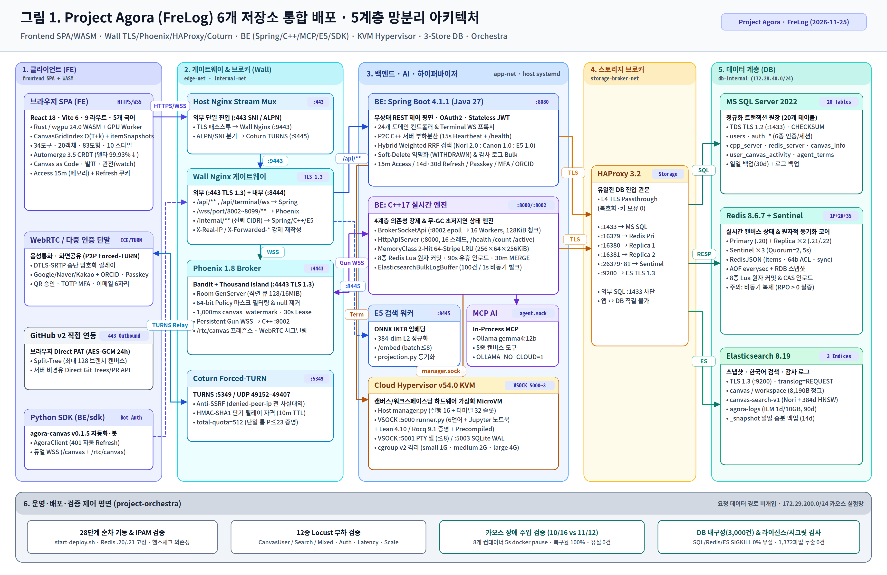
> *그림 1. Project Agora (FreLog) 6개 저장소 통합 배포 및 5계층 망분리 아키텍처 ([고해상도 벡터 SVG 원본](./images/11_system_architecture_diagram.svg))*

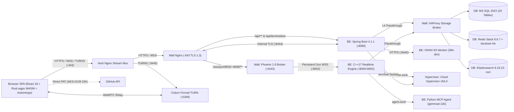

### 2.2 구현된 백엔드(`project-agora-BE`) 4대 서브시스템 심층 구조
백엔드 저장소는 **제어 평면(`spring/`)**, **실시간 상태·캐시 엔진(`cpp/`)**, **In-Process MCP AI 에이전트(`agent/`)**, **E5 임베딩/프로젝션 워커(`search/`)**, 그리고 **공식 Python SDK(`sdk/python/`)**로 구성된다.

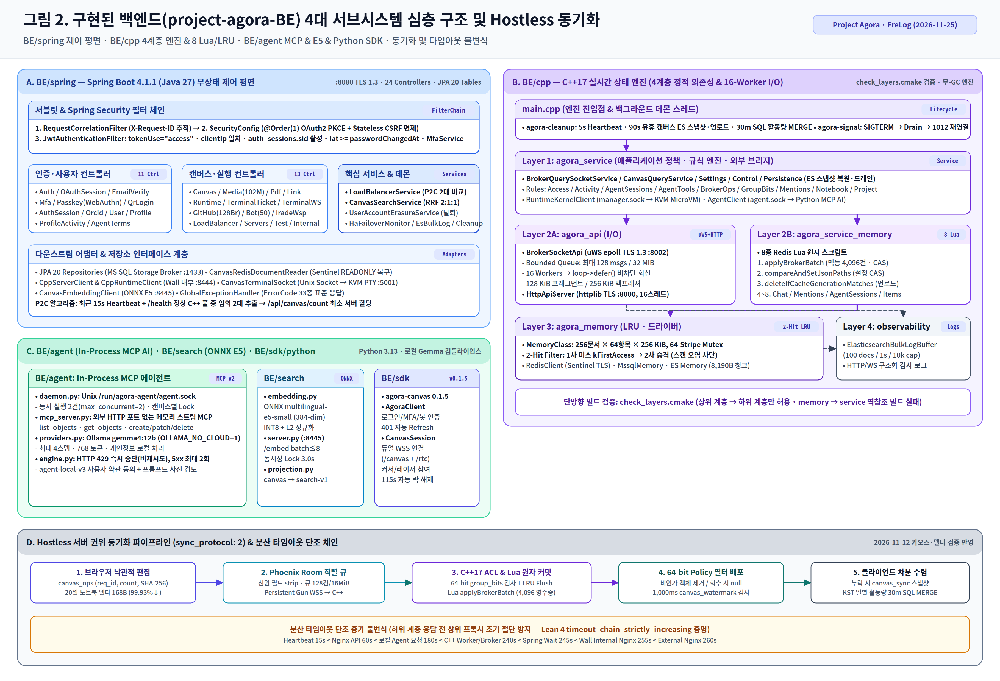
> *그림 2. 구현된 백엔드(`project-agora-BE`) 4대 서브시스템 심층 구조 및 Hostless 동기화/타임아웃 체인 ([벡터 SVG 원본](./images/12_backend_internal_architecture_diagram.svg))*

#### (1) Spring Boot 4.1.1 (`BE/spring`, Java 27) 제어 평면 구조
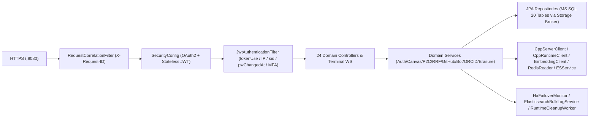
- **다중 인증 및 보안**: `@Order(1)` OAuth2 체인(Google/Kakao PKCE, Naver) + Stateless JWT 필터 체인이 `tokenUse="access"`, `clientIp`, `auth_sessions.sid`, `iat >= passwordChangedAt`, `MfaService.accepts()`를 매 요청 검증한다. 이메일 6자리 HMAC, TOTP MFA(AES-256-GCM), FIDO2 Passkey(`webauthn-server-core:2.10.1`), QR 3중 256-bit 해시, ORCID, 캔버스 봇(`agora_bot_*`)을 모두 수용한다.
- **P2C 서버 할당 & Hybrid Weighted RRF**: `LoadBalancerService`는 최근 15초 내 Heartbeat + Wall 내부 `/health`가 정상인 C++ 서버 중 무작위 2대를 뽑아 실시간 활성 캔버스 수(`/api/canvas/count`)를 비교 할당한다. `CanvasSearchService`는 Korean Nori BM25(`2.0`) + Canonical BM25(`1.0`) + ONNX `multilingual-e5-small` 384차원 `int8_hnsw` kNN(`1.0`)을 $k=60$ RRF로 융합한다.

#### (2) C++17 실시간 처리 엔진 (`BE/cpp`) 4계층 의존성 및 멀티스레드 구조
`CMakeLists.txt`와 `check_layers.cmake`는 `agora_service → agora_api & agora_service_memory → agora_memory → agora_observability` 4계층 단방향 의존성을 빌드 시점에 검증한다.

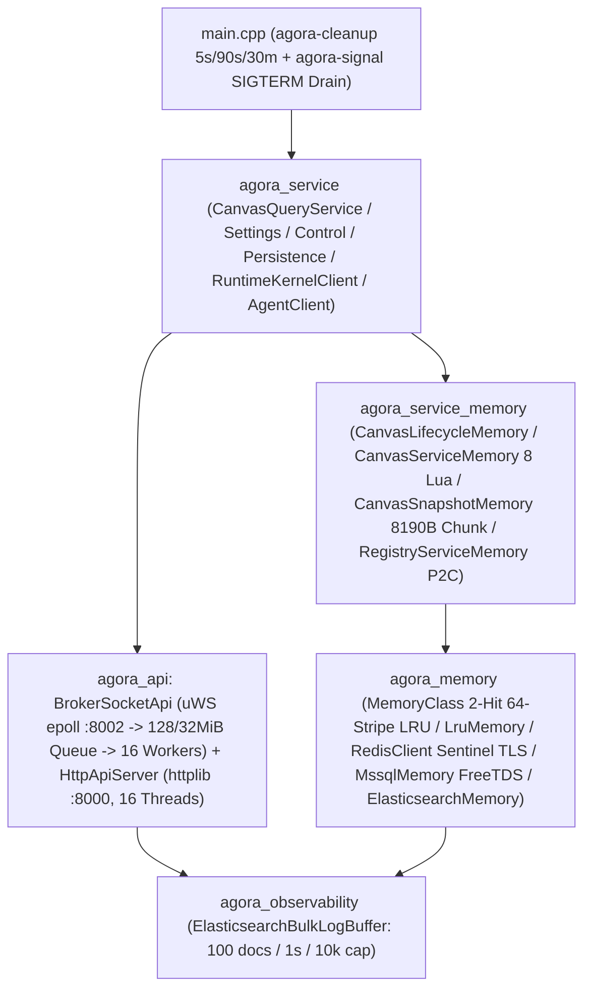
- **논블로킹 팬아웃 회신**: 16개 C++ 워커 스레드는 처리 결과를 `uWS::Loop::defer()`로 epoll 스레드에 돌려보내 **128 KiB** 프래그먼트로 분할 전송하고, 소켓 백프레셔가 **256 KiB**를 넘으면 전송을 일시 정지해 메모리 폭주를 막는다.
- **2-Hit 64-Stripe LRU & 8종 Redis Lua**: `MemoryClass`는 기본 **256문서 × 64항목 × 256 KiB**를 `64-stripe mutex`로 관리하며, 1차 미스는 `kFirstAccess`만 기록해 스캔 오염을 방지하고 2차 접근 시 승격한다. `chat_room.data`는 `remote_fields`로 보호하고, `executeAtomic()`은 dirty flush → 8종 Lua(`applyBrokerBatch`, `compareAndSetJsonPaths`, `deleteIfCacheGenerationMatches`, `commitChatMessage`, `append/getChatHistoryPage`, `store/purgeMentionStates`, `agentSessions`, `agentItemIds`) 실행 → 캐시 무효화를 원자 수행한다.

#### (3) Python In-Process MCP Agent (`BE/agent`), E5 Search (`BE/search`), Python SDK (`BE/sdk/python`)
- **`agora_agent`**: `asyncio` 유닉스 소켓(`/run/agora-agent/agent.sock`, 동시 실행 2건)으로 C++ `AgentClient`와 연결되며, 외부 MCP HTTP 포트 없이 메모리 스트림(`mcp_server.py`)으로 5종 도구(`list_objects`, `get_objects`, `create_objects`, `patch_objects`, `delete_objects`)를 구동한다. Local Gemma(`gemma4:12b`, 최대 4스텝/768토큰)와 승인 상용 API를 지원하며 HTTP `429`는 절대 재시도하지 않는다.
- **`agora-canvas` SDK v0.1.5**: `AgoraClient`(401 자동 Refresh, 봇 인증) + `CanvasSession`(문서 `/canvas/{id}` + 프레즌스 `/rtc/canvas/{id}` 듀얼 WSS)으로 자동화 스크립트·봇도 브라우저 참여자 목록·커서·레이저에 실시간 합류한다.

### 2.3 핵심 알고리즘 요약
1. **Hostless Lua 멱등 커밋 & 64-bit `Policy` 필터링**: C++ `applyBrokerBatch`가 `uid:clientId`의 `(request_count, request_id, SHA-256)` 영수증과 `__broker_revision` CAS를 검증하고 `user_canvas_activity` 일별 카운터를 누적한다. Phoenix `Policy`는 `group_bits`를 64-bit 정수 마스크로 컴파일해 수신자가 읽을 수 없는 항목을 제거하고, 권한이 박탈된 기존 가시 객체는 `null`(화면 제거)로 변환한다.
2. **Rust/`wgpu` Zero-Upload 드래그 & `CanvasGridIndex`**: `shader.wgsl`이 `tint` 최상위 비트 `0x80000000u`를 판별해 드래그 중 버텍스 버퍼 재업로드 없이 `CameraUniform.(drag_dx, drag_dy)`만 갱신한다. `CanvasGridIndex`는 `1024px` 매크로 + `128px` 파인 정수 격자와 `Uint32Array` 스탬프로 힙 할당 없이 $O(T+k)$ 공간 질의를 수행한다.

### 2.4 데이터베이스 20테이블 물리 ERD 및 4원화 폴리글랏 수명주기
트랜잭션 원장(**MS SQL 2022 20개 테이블**), 활성 상태 및 64-bit ACL(**Redis Stack + Sentinel**), 영구 청크 스냅샷·하이브리드 검색(**Elasticsearch 8.19 Nori+HNSW**), 그리고 MicroVM 로컬 워크스페이스(**KVM SQLite WAL**) 간의 정확한 경계와 `_cache_generation` CAS 기반 언로드 파이프라인은 아래와 같다.

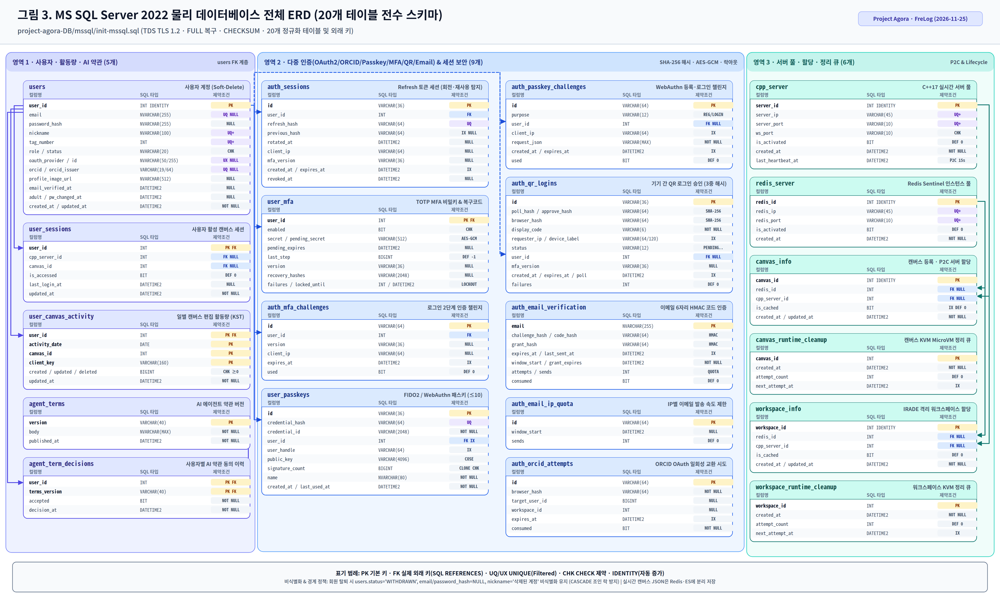
> *그림 3. MS SQL Server 2022 물리 데이터베이스 전체 20테이블 ERD ([벡터 SVG 원본](./images/13_database_erd_20tables_diagram.svg))*

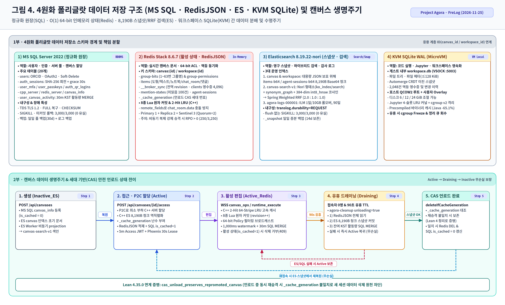
> *그림 4. 4원화 폴리글랏 데이터 구조(MS SQL · RedisJSON · ES · KVM SQLite) 및 CAS 기반 캔버스 생명주기 ([벡터 SVG 원본](./images/14_polyglot_data_lifecycle_diagram.svg))*

---

## 제3장. 프론트엔드 사용자 활용 기능 종합 가이드 및 운영 매뉴얼

### 3.1 웹 페이지 및 캔버스 진입·탐색·다국어 UX
프론트엔드(`project-agora-FE`)는 React 18 SPA로서 **9개 라우트**(`/`, `/docs`, `/terms`, `/privacy`, `/login`, `/qr-login`, `/profile`, `/search`, `/canvases/:canvasId`)를 제공하며, UI 전체가 **한국어(`ko`), 영어(`en`), 중국어 간체(`zh`), 일본어(`ja`), 프랑스어(`fr`) 5개 국어**(`localStorage['frelog_locale']`)를 실시간 전환한다.
- **인증·계정·프로필**: 이메일 6자리 코드 검증 회원가입, 비밀번호 로그인, Google/Kakao/Naver OAuth2, **ORCID 연구자 로그인**, **FIDO2/WebAuthn 패스키**(최대 10개), **기기 간 QR 로그인**(`/qr-login` 6자리 코드 승인), **TOTP MFA 2단계 인증** 및 10개 복구코드를 지원한다. `/profile`에서는 아바타 관리, 닉네임·비밀번호 수정, C++가 30분마다 집계하는 **일별 캔버스 편집 활동 잔디(`ProfileProgress`)**, 다중 세션 일괄 로그아웃, 계정 탈퇴를 이용할 수 있다.
- **탐색·뷰포트·조작**: `/search`에서 Nori+E5 하이브리드 검색과 `private`/`public`(선택적 비밀번호·PNG/JPEG 5MiB 대표 이미지) 캔버스 생성·삭제를 수행한다. 캔버스 작업 화면에서는 **손 도구(`hand`)**, **미니맵**, **개인 위치 앵커(`anchor`)**, **최대 1600% 확대/축소**, **동적 배율 격자·X/Y 축 눈금·스냅**, **다중 선택(Shift+클릭/마퀴)**, **그룹화(`Ctrl/⌘+G`/`Shift+G`)**, **스타일 복사/붙여넣기(`Ctrl+Alt+C/V`)**, **깊이(Z-order) 조절**, **객체 잠금(`locked`) 및 숨김**, **실행 취소(`Ctrl/⌘+Z`)**, **하단 빠른 도구 단축키(`Ctrl/⌘+1~0`, `Shift+1~2`)**를 사용할 수 있다.

#### 회원가입 · 다중 인증 · 프로필 관리 실제 절차 예시
1. **1단계 — 회원가입 입력 및 이메일 6자리 HMAC 코드 요청**: 닉네임·이메일 입력 후 `인증 메일 보내기`를 호출하면 60초 재발송 쿨다운과 5분 만료 타이머가 시작되며, 12자 이상 영문/숫자/특수문자 비밀번호 정책과 Google·Naver·Kakao·ORCID 간편 로그인 옵션을 확인할 수 있다.
   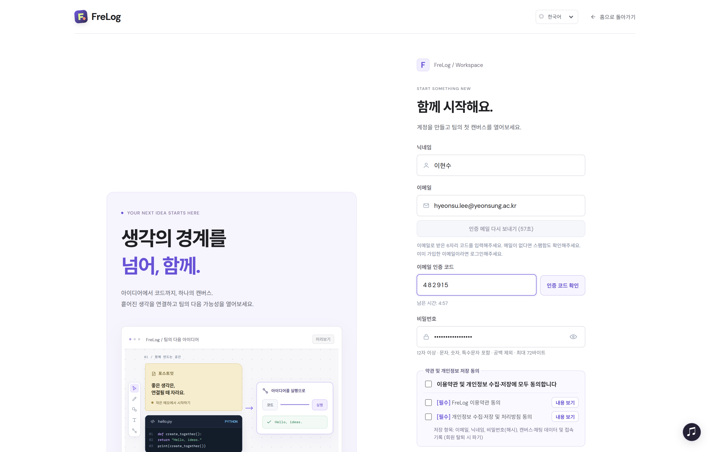
2. **2단계 — 이메일 인증 완료 · 약관 동의 · 계정 생성 활성화**: 6자리 코드 검증에 성공하면 녹색 완료 배지(`✓ 이메일 인증이 완료되었습니다.`)로 전환되며, 필수 이용약관·개인정보 수집·저장 동의 체크박스(`SignupConsent`)를 모두 선택해야 `계정 만들기`가 활성화된다.
   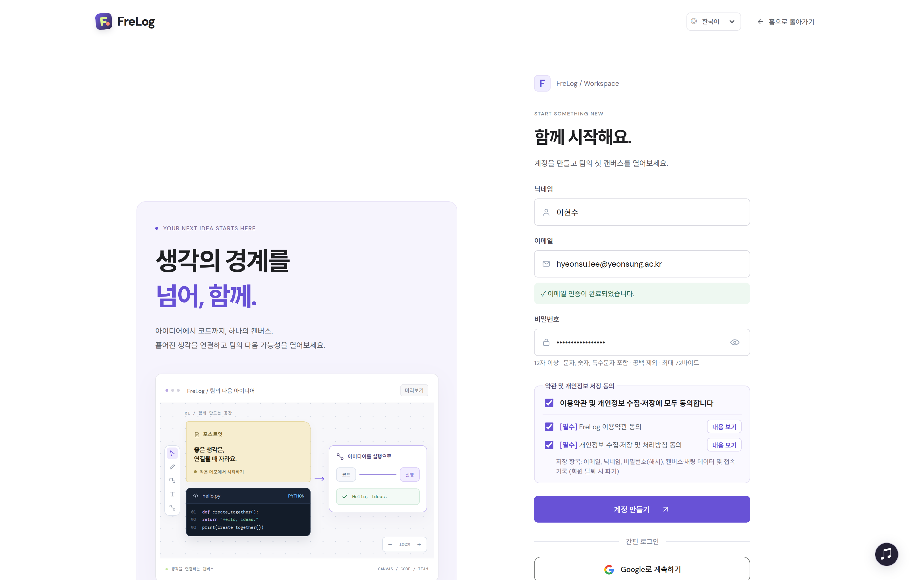
3. **3단계 — 기기 간 QR 승인 로그인 & TOTP 2단계 인증**: 이미 로그인된 기기로 일회용 QR 코드(`displayCode: 739412`)를 스캔해 승인하거나, TOTP 인증앱 6자리 코드(`619048`)·일회용 복구 코드로 2차 인증을 완료한다.
   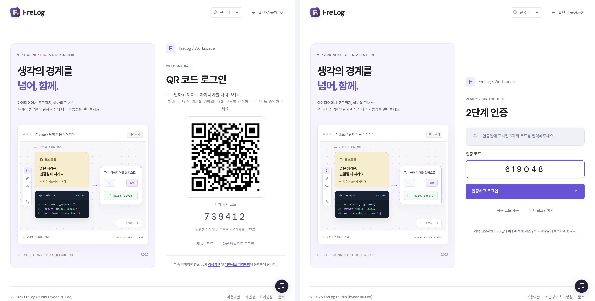
4. **4단계 — 내 프로필 · 도전과제 · 일별 편집 활동 잔디 (`/profile`)**: C++ 엔진이 30분 주기로 SQL에 적재한 KST 일별 편집 횟수 잔디(`ProfileProgress`), 4종 도전과제 달성률, TOTP MFA·FIDO2 패스키(최대 10개)·전체 세션 로그아웃 및 Soft-Delete 탈퇴를 수행할 수 있다.
   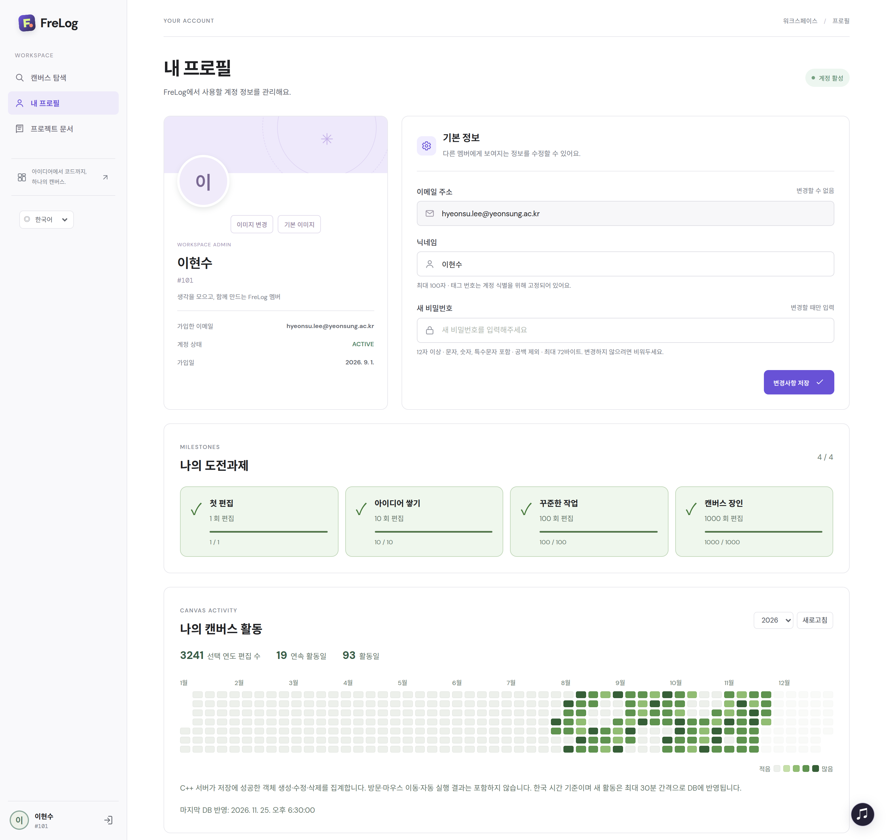

### 3.2 9개 카테고리 34개 도구 · 20종 객체 · 83종 도형 · 고급 스타일 전수 설명
| 카테고리 | 탑재 도구 및 사용자 활용 기능 |
|---|---|
| **1. 탐색·협업 (5종)** | `선택(select)`, `손(hand)`, `사용자 그룹(user-group, 최대 50명 프로필 카드 묶음)`, `앵커(anchor)`, `포인터(laser, 타 참여자에게 실시간 궤적 전파)` |
| **2. 그리기 (2종)** | `펜(pen)`: 필압/속도 기반 **4종 브러시(`펜`/`붓`/`형광펜`/`스프레이`)**; `지우개(eraser)`: **2종 모드(`부분 지우기`/`선 전체 지우기`)** |
| **3. 도형·연결 (2종)** | `도형(shape)`: **9개 서브카탈로그 총 83종 도형**(기본·용지 21종[A1~A4 포함], 체스 6종, 논리회로 9종[AND~전가산기], 개발·흐름도 8종[UML·서버랙], 자료구조 6종, 수학 6종, 과학·실험 6종, 공학·회로 8종, 입체·기하 13종). `연결(connect)`: 직선·곡선·A* 직교 라우팅, 흐름 대시 애니메이션, 라벨, 양끝 화살촉 |
| **4. 글쓰기 (5종)** | `내용(text)`: **일반 텍스트 · Markdown · LaTeX(MathJax 4 로컬 TeX-to-SVG, 1,200자) · 코드(구문 강조)** 4모드 & Automerge CRDT 인라인 색상 마크 동시편집; `포스트잇(note)`: 자동 저장 메모; `HTML` · `CSS` · `JavaScript`: 연결선으로 HTML 객체에 CSS/JS를 주입해 샌드박스(`/html-preview.html`) 실시간 미리보기 |
| **5. 진행·발표 (4종)** | `프레임(frame)`: 발표 슬라이드 단위 + 오토레이아웃; **Portfolio 발표 모드**(최대 100p/2,000객체, **8종 애니메이션** `none/fade/slide-up/slide-left/zoom/pulse/float/spin`, 애니메이션 후 등장 `revealAfterAnimation`, 스페이스바 재생, 보기 링크 복사) & 참여자 **시점 따라가기 관전(`canvas_watch`)**; `프로젝트 관리(project)`: 이슈·칸반·스크럼·스프린트·간트 로드맵(DAG); `타이머(timer)`; `문제 객체(question)`: 객관식(2~10보기)/주관식 공동 답안 & 수동 채점 피드백 |
| **6. 데이터·시각화 (4종)** | `연속 값(continuous-value)` 실수 슬라이더, `이산 값(discrete-value)` 정수·버튼·선택·문자 입력(실행 코드 표준입력으로 연결 가능), `테이블(table)`(최대 100행×30열), `그래프(chart)`(bar/line/area/pie/donut/scatter 6종) |
| **7. 코드·실행 (5종)** | `코드 객체(code)` · `실행 객체(executor)` · `실행 결과 객체(execution-output)`: 연결선 방향에 따른 **블루프린트 DAG 위상 정렬 실행**(이전 출력 → 다음 코드 `stdin` 연쇄 전달, 6개 언어 및 Precompiled 모드); `주피터 노트북(notebook)`: 최대 32셀 Python IPython + **Lean 4.10.0 / Rocq 9.1.1 형식 증명 셀**(`%%lean4`/`%%rocq`, 2단 목표 상태 HTML 리포트); `터미널(terminal)`: `@xterm/xterm 6.0` 기반 실시간 KVM PTY 셸(`pip install` 및 `apt install` 지원). 상단 **실행 환경** 대화상자에서 언어/컴파일러/VM 템플릿(`small`/`medium`/`large`)/디스크(`6/12/24 GiB`)/Maven 의존성(20개) 설정 |
| **8. AI 에이전트 (6종)** | `에이전트 입력(agent-input)`(텍스트·이미지·오디오·동영상·PDF), `라우터(agent-router)`, `AI 에이전트(agent-node)`, `모형 에이전트(agent-mock)`, `오케스트레이터(agent-orchestrator)`, `에이전트 출력(agent-output)`으로 **다중 에이전트 협업 그래프** 구성 + 상단 **AI 에이전트 패널**에서 `agent-local-v3` 동의 후 Local Gemma(`gemma4:12b`) 공유 대화 세션 실행 |
| **9. 미디어 (5종)** | `동영상·GIF(media-file, ≤102MiB)`, `데이터 시트(sheet, CSV/TSV/XLSX ≤10만 셀/2MiB)`, `PDF(pdf, pdfjs-dist 페이지 동기화)`, `사진(image)`, `링크(link, YouTube ≥200×200px 준수 플레이어 및 오픈그래프 카드)` *(재생 상태 `mediaState` 참여자 공유)* |

- **10대 고급 디자인 스타일 (`style1:`)**: 불투명도/11종 블렌드 모드, 모서리 반경(0~240px), 다중 채우기 레이어(`solid`/`linear`/`radial`/`conic`/`image`), 테두리(안쪽/가운데/바깥쪽, 대시/개별 변), 4종 효과(`drop-shadow`/`inner-shadow`/`layer-blur`/`background-blur`), 6종 필터, 타이포그래피(`truncate`/`auto-fit`), 연결선 라우팅/애니메이션, 오토 레이아웃(`row`/`column`/`wrap`), 허용 속성 기반 `customCss`(≤1,000자) 및 스타일 프리셋·토큰 일괄 치환.
- **협업·버전관리·권한·통화**: **다중 채널 채팅(`text`/`voice`/`category`)**, **객체별 댓글 스레드**, **`@nickname#tag` 멘션 자동완성 및 알림 센터 점프**, **WebRTC Forced-TURN 채널별 음성통화·화면공유(마이크/시스템 오디오 분리 게인)**, **64-bit 그룹별 읽기/쓰기/실행 권한 및 캔버스 봇(최대 50개) 발급**, **`Canvas as Code`(`window.frelogCanvas`) 선언형 JSON diff/apply**, 그리고 **브라우저 직접 GitHub v2 분할 저장소 연결(최대 128 브랜치 캔버스 생성·커밋 그래프·PR·병합)**을 모두 제공한다.

### 3.3 프론트엔드 핵심 워크플로 실제 사용 예시

1. **캔버스 탐색 (`/search`) 및 새 캔버스 생성 모달**
   - 로그인 직후 진입하는 `/search`에서 Nori+E5 하이브리드 검색으로 참여한 캔버스를 필터링하고, `새 캔버스 만들기` 모달에서 대표 이미지(PNG/JPEG)·`공개`/`비공개` 범위·선택 비밀번호를 지정해 즉시 실시간 협업 캔버스를 생성할 수 있다.
   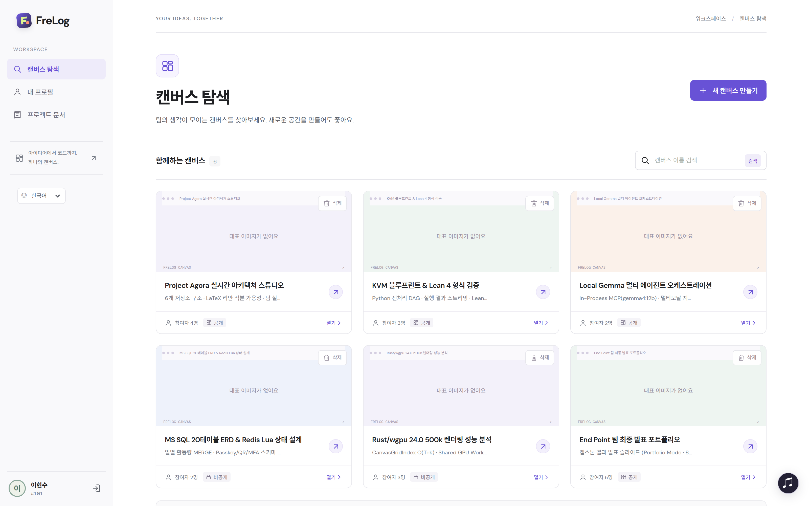
   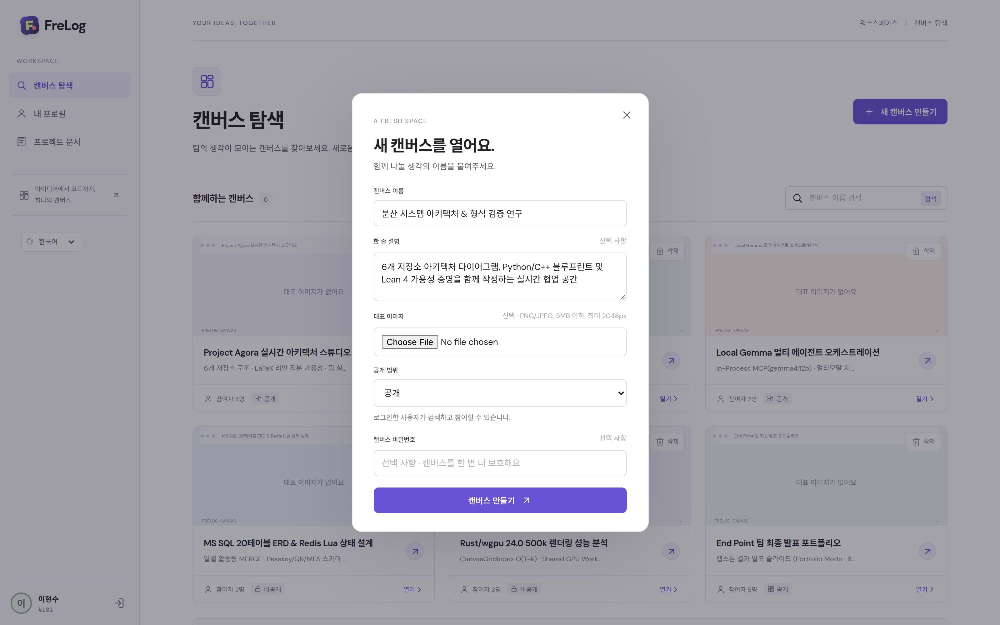

2. **실시간 멀티모달 협업 스튜디오 (`/canvases/:id`)**
   - 좌측 9카테고리 34도구 패널, 상단 실시간 접속 상태(`연결됨`)·참여자 아바타·음성 통화·모니터링 바, 하단 빠른 도구 독과 다중 채널 채팅/통화 패널이 통합되며, 도형·연결선·MathJax 4 LaTeX 수식·포스트잇·다차원 표·Markdown을 한 화면에서 동시 편집한다.
   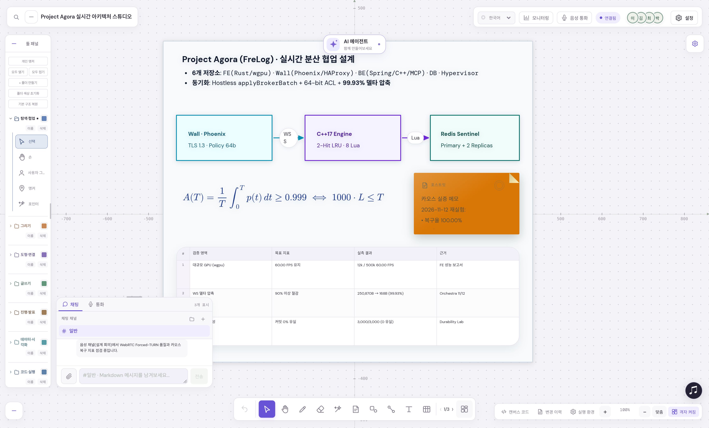

3. **블루프린트 DAG 코드 실행 & Lean 4 Jupyter 노트북**
   - `실행 객체 → Python 코드 스니펫 → 실행 결과 객체`로 이어지는 블루프린트 DAG 파이프라인과, 동일 캔버스 내 Python + `%%lean4` 형식 검증 셀을 실행해 `CLEAN_LEAN_OK` 결과를 즉시 렌더링하는 Jupyter 노트북을 함께 운용할 수 있다.
   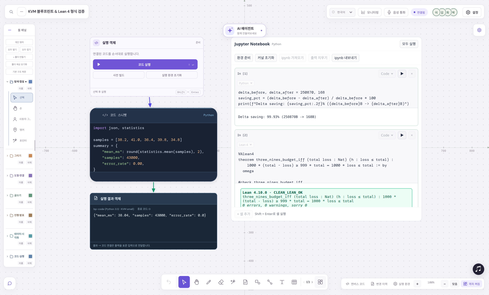

4. **멀티 AI 에이전트 협업 그래프 & In-Process MCP Local Gemma 패널**
   - 6종 AI 에이전트 노드(`입력 → 오케스트레이터 / 라우터 → 전문 에이전트 → 출력`)로 작업 흐름을 설계하고, 우측 `AI 에이전트` 공유 대화 패널에서 `gemma4:12b` 로컬 모델이 5종 MCP 도구(`list_objects`·`get_objects`·`patch_objects`)로 캔버스 객체를 직접 분석·갱신한다.
   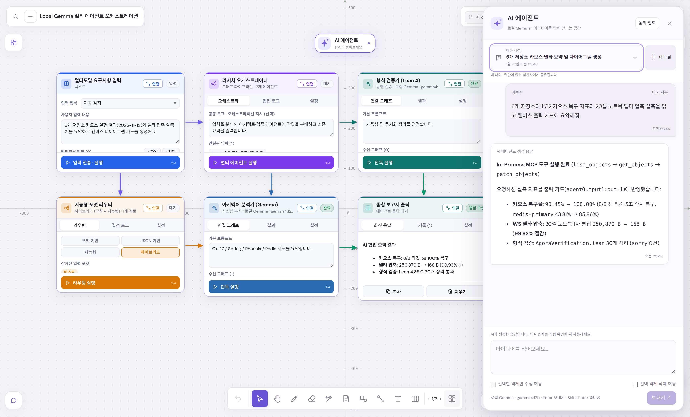

5. **브라우저 직접 GitHub v2 분할 트리 버전 관리**
   - 서버로 PAT를 전송하지 않고 브라우저 암호화 보관소(AES-GCM 24h)만으로 GitHub 저장소와 연결하여 다중 브랜치 SVG 커밋 그래프(`CanvasCommitGraph`) 확인, 특정 커밋 시점 캔버스 스냅샷 복구 및 코드 diff 검토를 수행한다.
   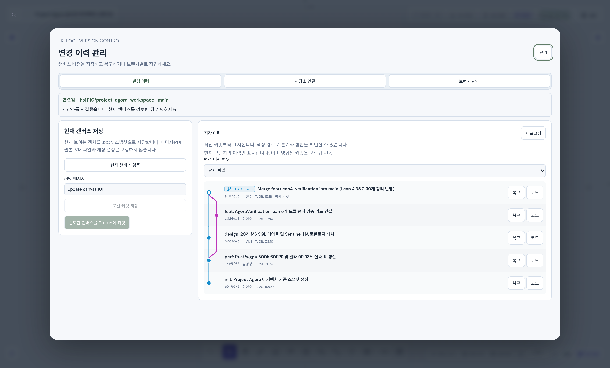

### 3.4 개발자 및 운영자 실행·검증 매뉴얼 요약
- **순차 기동**: `cd project-orchestra && ./scripts/start-dev.sh --tls-dir /path/to/certs` (개발 Vite) 또는 `./scripts/start-deploy.sh --initialize --tls-dir /path/to/certs` (배포 정적 FE + 28단계 DB/BE/Wall 기동).
- **부하·카오스·내구성 검증**: `./scripts/run-load.sh CanvasUser --users 10 --spawn-rate 2 --run-time 1m`, `.venv/bin/orchestra run --node cpp --fault pause --duration 10`, `python3 tests/database_durability_lab.py --records 1000`.

---

## 제4장. Lean 4 기반 엄밀한 수학적 모델링 및 형식적 검증

### 4.1 연속시간 리만 적분 기반 일반화 가용성 모델
전통적 지표 $A_{\text{classic}} = \frac{\text{MTBF}}{\text{MTBF} + \text{MTTR}}$는 `{정상(1), 장애(0)}` 이진 상태만 다뤄 부분 장애를 포착하지 못한다. 운영 구간 $[0, T]$ ($T > 0$)에서 시각 $t$의 순간 요청 성공 확률 $p: [0, T] \to [0, 1]$을 정의하고 구간을 $n$등분($\Delta t = \frac{T}{n}$)하면 리만 적분 기반 시간 평균 가용성을 얻는다:
$$A(T) = \lim_{n \to \infty} \frac{1}{n}\sum_{k=1}^{n} p(t_k) = \frac{1}{T}\int_{0}^{T} p(t)\,dt, \qquad A_w(T) = \frac{\int_{0}^{T} \lambda(t)p(t)\,dt}{\int_{0}^{T} \lambda(t)\,dt}$$
$p(t) \in \{0, 1\}$이면 $A(T) = \frac{T_{\text{up}}}{T_{\text{up}} + T_{\text{down}}}$로 환원되어 고전 정의를 특수 경우로 포함한다. 또한 완전 장애 환산 손실 $L = \int_0^T (1 - p(t))\,dt$에 대해 $A(T) = 1 - \frac{L}{T}$이므로, **365일 중 1일 완전 중단($p=0$)과 2일간 50% 부분 장애($p=0.5$)는 모두 $L=1\text{일}$ ($A \approx 99.73\%$)의 등가 손실**로 정량 평가된다.

### 4.2 `Mathlib` 연속시간 가용성 3대 정리 (`refs/프로젝트중간보고서_End_Point.hwp`)
1. **`timeAvailability_bounds`**: $0 < T$, $\forall t \in [0, T], 0 \le p(t) \le 1$, 적분 가능 가정 하에 `intervalIntegral.integral_nonneg` 및 `integral_mono_on`으로 $0 \le \frac{1}{T}\int_0^T p(t)\,dt \le 1$ 증명.
2. **`three_nines_iff_budget`**: `(1 - loss / T ≥ 999 / 1000) ↔ 1000 * loss ≤ T` 동치 증명.
3. **`promotion_occurs`**: `oldVisible = false ∧ replicaReady = true ∧ sentinelQuorum = true`일 때 `promote`가 `promoted = true`를 도출함을 증명하고, 구 Primary 쓰기 잔존(`oldWriteEnabled = true`) 위험을 별도 분리.

### 4.3 Lean 4.35.0 기계 검증 스위트 (`lean/AgoraVerification.lean`) 및 실측 연계
외부 미빌드 패키지 없이 표준 Lean 4.35.0 커널(`/home/steam/.elan/bin/lean`)로 **즉시 컴파일 검증(오류 0건, 경고 0건, `sorry` 0건)**되는 5개 검증 모듈을 작성하여 아키텍처 핵심 불변식 전체를 기계적으로 증명하였다.

| Lean 4 모듈 / 주요 정리명 | 형식화된 핵심 명제 및 증명 방식 | 대응 시스템 구현 및 실측 수치 연계 |
|---|---|---|
| **`Agora.Availability`** `three_nines_budget_iff` `monthly_three_nines_max_loss` `annual_three_nines_max_loss` `chaos_*_improved` | `loss ≤ total → (1000*(total-loss) ≥ 999*total ↔ 1000*loss ≤ total)` (`omega`); 30일(`2,592,000s`) 최대 손실 `2,592s`(43.2분), 365일(`31,536,000s`) `31,536s`(8h45m36s) 및 카오스 교차곱 개선(`1841*792 < 661*2385`, `1279*470 < 470*1414`, `131*99 < 85*299`) (`decide`) | `2026-10-16` vs `2026-11-12` 카오스 실험: 전체 `77.19% → 83.46%`, 복구 `90.45% → 100.00%`, `redis-primary` `43.81% → 85.86%` 개선이 통계적 근사 없이 정수 비로 엄밀 검증됨 |
| **`Agora.BrokerSync`** `revision_monotonic` `idempotent_retry_n` `tampered_retry_rejected` `sequence_gap_rejected` `watermark_gap_recovery` | C++ Lua `applyBrokerBatch` 상태 전이 모델에 대해 전역 `revision` 단조 증가, 동일 `(count, reqId, digest)`를 **임의의 $k$회 재전송해도 최초 1회 적용 상태와 완전 동일(Exact-Once)**함을 귀납법으로 증명; 변조 시 `ClientRequestMismatch`, 누락 시 `ClientSequenceConflict`, 워터마크 격차 시 `needsWatermarkSync = true` 증명 | `BE/cpp/src/service_memory/CanvasServiceMemory.cpp` Lua 영수증(4,096건) & `1,000ms` `canvas_watermark` 복구; 카오스 감사 **데이터 누락 0 / 변조 0**의 논리적 근거 |
| **`Agora.AclBitmask`** `write_implies_read_access` `execute_implies_read_access` `confidentiality_sound` `revocation_emits_tombstone` `watch_mode_read_only` | `BitVec 64` 4종 마스크의 `WellFormedUserMasks` 하에 쓰기/실행 권한이 읽기를 함의함을 증명; Phoenix `filterCommit`이 비인가자에게 절대 `Deliver`하지 않으며 권한 회수 시 `TombstoneNull`(`null`)을 출력하고, 관전 모드는 `WatchReadOnly`를 반환함을 증명 | `Wall/broker/lib/agora_broker/policy.ex` & `CanvasGroupPermissions.java`; 64그룹 비트마스크 ACL 및 실시간 권한 박탈 화면 제거 보장 |
| **`Agora.StorageSafety`** `promotion_occurs` `split_brain_possible_without_fencing` `async_replication_positive_rpo` `durability_exp_250_loss_exact` `cas_unload_preserves_repromoted_canvas` | Sentinel 승격 증명 + 구 Primary 쓰기 미차단 시 Split-Brain 공존 명시; 비동기 복제 갭 `unreplicated > 0`이면 유실량 `primaryAcked - synced > 0` 증명(`3250 - 3000 = 250`); `_cache_generation` 불일치 시 언로드 키 삭제 차단(`PreservedOnMismatch`) 증명 | `2026-10-15` DB 내구성 실험(비동기 복제 단절 강제 승격 시 **250/3,250 유실** 실증) 및 C++ `deleteIfCacheGenerationMatches` 언로드 안전성 |
| **`Agora.PerformanceBounds`** `p2c_tail_strictly_smaller` `two_hit_scan_resistance` `timeout_chain_strictly_increasing` `notebook_delta_saving_over_99_93_pct` `webrtc_coturn_room_quota_bound` | 단일 선택 대비 P2C 꼬리 확률 제곱 감소(`num * num < num * den`); `MemoryClass` 2-Hit 필터의 일회성 스캔 방어 증명; 분산 타임아웃 `15 < 60 < 180 < 240 < 245 < 255 < 260`; 20셀 노트북 델타 절감률 `> 99.93%`; WebRTC $P(P-1) \le 512$에서 **단일 룸 상한 $P=23$명($P=24$ 시 552 > 512)** 증명 | P2C 부하 분산($\frac{\ln\ln n}{\ln 2}$), 2-Hit 64-Stripe LRU, `2026-11-12` 타임아웃 체인 교정, 20셀 노트북 **99.93% 절감**, Coturn `total-quota=512` 기반 SFU 진화 필요성 도출 |

---

## 제5장. 수치적 실측치 기반 다차원 실험 및 검증 결과

### 5.1 대규모 GPU 렌더링 및 프론트엔드 최적화 실측 (`FE/docs/`)
모든 대규모 GPU 측정은 Chrome 155/157, NVIDIA RTX 3060 Ti 8GB (Driver 595.99.02, OpenGL ES 3.2 ANGLE) 환경에서 수행되었다(객체·렌더 데이터 준비 완료 후 프레임 계측, 초기 다운로드·서버 처리 제외).

1. **12,000 객체 60 FPS 검증 (`2026-10-14`, 1800×1100)**:
   - 최적화 전 DOM(12,000 HTML): 중앙값 **475.8 ms**, p95 **653.4 ms** (~2.1 FPS).
   - 최적화 후 GPU(HTML 0개): 반복 도형 **60.00 FPS**(p95 17.1ms), 분산 **59.99 FPS**(17.0ms), 모두 다른 색상 **59.99 FPS**(17.2ms), 도형+텍스트 **60.00 FPS**(17.0ms), **12,000개 전체 선택(래스터 윤곽선)** **59.98 FPS**(배포 59.99 FPS), 연속 줌 **60.00 FPS**(17.0ms).
2. **100,000 ~ 500,000 객체 확장성 & `ScenePreparationQueue` 효과 (`2026-10-14`, 300/600프레임)**:
   - **분산 배치(160×120 그리드)**: 100k **60.00/60.00 FPS**(준비 4.64s), 200k **60.00/59.80 FPS**(5.88s), **500k(JSON 94.16M 자) 팬 60.00 FPS / 줌 60.00 FPS**(p95 17.1ms, 준비 8.60s).
   - **밀집 배치(전 객체 1200×700 뷰포트 내부)**: 개선 전 100k/200k(894개만 준비)/500k(256개만 준비) **전부 120s 타임아웃** → 개선 후(`ScenePreparationQueue`) 100k **5.47s**(팬 59.98/줌 58.06 FPS), 200k **8.88s**(팬 58.06/줌 50.42 FPS), 500k(121.86M 자) **25.03s**(팬 53.81/줌 43.59 FPS; 단 최대 186.2ms 프레임 존재).
3. **실시간 입력 · 패닝 · Rust/`wgpu` · GPU Worker · 프레임 완화 실측 (`2026-10-14 ~ 11-23`)**:
   - **실시간 입력**: 1,500 혼합(텍스트 **8.4 → 59.1 FPS**, 드로잉 **10.1 → 60.0 FPS**); 100,000 객체(텍스트 **58.8 FPS**/배포 58.2, 드로잉 **58.8 FPS**/배포 60.0).
   - **10만 코드 객체 패닝 (`2026-11-17`)**: 평균 **33.7 → 50.0 FPS**, p95 **50.1ms → 33.4ms**, 최대 프레임 **383.4ms → 50.1ms (7.65× 감소)**.
   - **Rust/`wgpu` vs. Canvas 2D (`2026-11-17`, 20만 혼합)**: **Rust/wgpu WebGL 60.65 FPS (max 16.8ms)** vs. **Canvas 2D 43.79 FPS (max 266.6ms)**.
   - **Shared GPU Worker 스루풋 (`2026-11-18`, 2만/20만 × 팬/줌)**: 워커 제출 속도 **0.00~0.25 → 124.49~124.98 FPS**, 왕복 p95 **1.10~1.40ms**, 13개 깊이 레이어 동시 갱신 시에도 워커별 **124.74 FPS**.
   - **DOM·프레임 완화 (`2026-11-18 ~ 11-22`, 17개 시나리오)**: HTML 72객체 네비게이션 **42.20 → 59.16 FPS**(생성 `iframe` **166→0**), `CanvasSelect` 프록시로 혼합 이동 레이아웃 **170→5회**(101→2ms, 이동 작업 2,261→1,277ms), 깊이 240개 `itemSnapshots` 지연 버킷으로 JS 힙 **108 MB → 27 MB (4×)**, CPU 4배 감속 혼합 이동 지연 **16.1% → 8.9%**; HTML 미리보기 백지 레이스 해결(4× 스로틀 성공 **4/8 → 8/8**).
   - **CPU 인덱스 단독 벤치마크**: 복사 인접 인덱스(10만 **56.631→0.008ms, 7,079×**), 더티 공간 검색(10만 500쿼리 **324.6→3.26ms, 99.6×**), `CanvasGridIndex` 50만 빌드 1,254.1ms · 쿼리 p95 **0.0017 ms**.

### 5.2 백엔드 HTTP API · 델타 동기화 · KVM MicroVM 실측
- **HTTP API 순차 벤치마크 (`2026-10-05`, 로컬 Docker 포트 직접 측정, 동시성=1, TLS/Nginx/WAN 제외, `p99` 미기록)**:
  - 총 **41개 경로 조합 / 43,000건 / 1,641.65초(27.4분) / 에러율 0.00% (43,000/43,000 성공, 26.19 req/s)**.
  - **Spring Boot (34경로, 36,000건)**: 가중 평균 **40.16 ms** — 검색(`GET /api/canvases/search`) **8.58~13.31 ms**(p95 ≤18.85ms), 설정 조회 **8.78 ms**, 생성 **38.63~39.23 ms**, 삭제 **57.91 ms**, P2C 서버 할당 **33.50~33.90 ms**, Redis 할당 **5.99~6.12 ms**. BCrypt 해싱 포함 경로(`access` **148.66 ms**, `signup` **176.81 ms**, `login` **189.56 ms**, `PATCH password` **194.64~197.28 ms**)가 의도된 계산 비용을 반영.
  - **C++ REST (7경로, 7,000건)**: 가중 평균 **27.20 ms** (`GET /health` 27.14 ms, `GET /api/canvas/count` 27.19 ms, `GET /api/canvas/active` 27.21 ms, p95 43.85~43.92 ms).
- **WebSocket 델타 & 대용량 복구**: 20셀 노트북 1자 편집 **250,870 B → 168 B (99.93% 절감, 1,493×)**, 60 KB 코드 1자 삽입 **65 B**; `20,021,894 B` 초기 스냅샷 100청크 전송, 70s 유휴 유지, HTTP 503/WS 1013 자동 복구 및 535회 변경 중 **오류 0건**.
- **KVM MicroVM Precompiled & 실 WSS 터미널 (`2026-11-03 ~ 11-04`)**:
  - `small` VM(1 vCPU/1 GiB, 3라운드×8회): **Java(`jdk21`) 반복 실행 262.74→91.77ms (-65.1%)**, +300함수 **327.19→119.32ms (-63.5%)**; **C(`clang19`+300) 33.40→25.44ms (-23.8%)**, **C++(`clang19`+300) 33.73→26.78ms (-20.6%)**; **Bash `-9.9%/-11.1%`**. *(반면 Python/Node는 웜 상주 워커가 cold-process보다 빠름을 정직하게 확인.)*
  - 실제 공개 WSS → Spring → Unix Socket → KVM VSOCK 터미널 에코(20키): **중앙값 17.04 ms, p95 19.39 ms** (raw VSOCK ~10.5 ms).

### 5.3 카오스 엔지니어링 가용성 실증 (`2026-10-16` vs. `2026-11-12`)
격리 서브넷(`172.29.200.0/24`)에서 초당 ~4건의 4단계 실제 사용자 플로우(`login → search → connect → save`, 단계당 2,000ms 데드라인, 클라이언트 재시도 0회)를 실행하며 8개 컨테이너에 **5초간 `docker pause`**를 주입하였다.

| 지표 / 코호트 | `2026-10-16` (3라운드, 24장애) | `2026-11-12` 개선 전 (`d135a2bb18`) | `2026-11-12` 개선 후 (`957eef57a7`) |
|---|---:|---:|---:|
| **정상 대조군 (Control)** | 40/40 (**100.00%**) | 40/40 (**100.00%**) | 40/40 (**100.00%**) |
| **전체 플로우 성공률** | 1,841/2,385 (**77.19%**, W95 75.46–78.83%) | 666/796 (**83.67%**) | 661/792 (**83.46%**, W95 80.71–85.88%) |
| **Baseline / Fault / Recovery** | 87.83% / 26.99% / 90.45% | 88.82% / 30.86% / **100.00%** | 87.58% / 31.06% / **100.00% (470/470)** |
| **전 타깃 `t=5s` 즉시 100% 복구** | 3/8 타깃 (`redis-primary` 39.55%) | **8/8 전 타깃 즉시 100% 복구** | **8/8 전 타깃 즉시 100% 복구** |
| **전체 OK 지연 (p50/p95/p99)** | 854 / 2,389 / 3,131 ms | 854 / 2,103.5 / 2,687.5 ms | 911 / 2,208 / 2,708.8 ms |
| **복구 구간 지연 (p50/p95/p99)** | 943 / 2,273.2 / 3,019 ms | 872 / 1,918.4 / 2,108.1 ms | 932 / 2,001.8 / 2,200.1 ms |
| **데이터 감사 (누락 / 변조)** | **0 / 0** (1,884 확정 + 5 타임아웃 저장) | **0 / 0** (707 확정) | **0 / 0** (702 확정 + 1 타임아웃 저장) |

```mermaid
xychart-beta
    title "Chaos Recovery & Redis Availability: 2026-10-16 vs 2026-11-12 (%)"
    x-axis ["Overall", "Recovery", "redis-primary", "cpp", "broker", "spring", "gateway"]
    y-axis "Success Rate (%)" 0 --> 100
    bar [77.19, 90.45, 43.81, 78.19, 80.81, 80.47, 81.67]
    bar [83.46, 100.00, 85.86, 78.79, 81.82, 84.85, 83.84]
```

### 5.4 데이터베이스 내구성(Durability) 및 RPO/RTO 검증 (`2026-10-15`) & 위생 감사
| DB 엔진 | Graceful Restart (보존 / RTO) | SIGKILL Restart (보존 / RTO) | Kill + Recreate (보존 / RTO) | 변조 | 특수 검증 (비동기 복제 / 롤백) |
|---|---|---|---|---:|---|
| **Redis 8.6.7** (`AOF everysec`) | 1,000/1,000 / **0.362s** | 2,000/2,000 / **0.338s** | 3,000/3,000 / **1.024s** | **0** | **복제 갭 강제 승격**: 복제본 중단 중 250건 추가 후 Primary SIGKILL → 구 복제본 승격 시 **3,000/3,250 보존, 250건 유실(`RPO > 0` 실증)**, RTO **0.584s** |
| **MS SQL 2022** (`FULL`, `CHECKSUM`) | 1,000/1,000 / **6.395s** | 2,000/2,000 / **6.793s** | 3,000/3,000 / **7.155s** | **0** | **미커밋 롤백**: 1건 미커밋 + SIGKILL → **미커밋 0건, 커밋 3,000/3,000 무결**, RTO **6.656s** |
| **Elasticsearch 8.19** (`translog=REQUEST`) | 1,000/1,000 / **26.835s** | 2,000/2,000 / **25.304s** | 3,000/3,000 / **22.268s** | **0** | 명시적 flush 없이도 translog 기반 **3,000/3,000 (0 유실)** 검증 |

- **저장소 위생·라이선스 감사 (`2026-11-04`)**: 6개 저장소 **1,372개 추적 파일**(FE 755, BE 349, DB 85, Wall 50, Orchestra 71, Hypervisor 62) 및 전체 Git 이력(`--all`) 검사 결과 **비밀정보·토큰 유출 0건**. FE 61종 npm 고지 완료, Spring `BOOT-INF/lib` 120개 JAR 중 29개 라이선스 파일명 누락분을 식별해 통합 고지 보완 과제로 기록했다.

---

## 제6장. 결론, 정직한 기술적 한계 및 향후 발전 방향

### 6.1 중간보고서 미구현 5대 과제 달성 현황
| 중간보고서 유보 항목 (`2026-10-13`) | 최종 상태 (`2026-11-25`) | 실제 구현 상세 |
|---|---|---|
| **버전 관리 기능** | **구현 완료** | 브라우저 직접 GitHub v2 Split-Tree(`frelog.canvas.repository`), 최대 128 브랜치 캔버스, PR·병합·커밋 그래프 |
| **댓글 및 멘션 기능** | **구현 완료** | 객체별 댓글 스레드, `@nickname#tag` 자동완성, Redis Lua 원자 멘션 알림 센터 및 점프 |
| **발표자(관전) 모드** | **구현 완료** | `canvas_watch` 실시간 시점 따라가기(60ms 스로틀, 관전 중 읽기전용) + Portfolio 100p 슬라이드·8종 애니메이션 |
| **계층형 Canvas-in-Canvas** | **향후 과제** | GitHub 브랜치 캔버스 및 Portfolio 프레임으로 일부 대체되었으나 중첩 캔버스는 차기 과제로 유보 |
| **재사용 가능 모듈 기능** | **향후 과제** | 스타일 프리셋·도구 폴더는 구현되었으며, 객체 집합 단위 모듈 템플릿은 차기 과제로 유보 |
| *(추가 달성)* **KVM · AI MCP · SDK · Rust/wgpu** | **신규 완성** | Cloud Hypervisor v54.0 + Lean4/Rocq, In-Process MCP(Local Gemma), `agora-canvas` SDK v0.1.5, Rust/`wgpu` WASM |

### 6.2 정직한 기술적 한계 및 완화 과제
1. **단일 호스트 배치 한계**: 현재 운영 스택은 단일 호스트 Docker 기반 실측이다. MS SQL AG(`mssql/cluster/`)와 Redis 멀티호스트(`docker-compose.ha-node.yml`) 템플릿은 구비되었으나 물리 3노드 이상 분산 환경의 크로스 노드 지연 실측이 향후 필요하다.
2. **Redis 비동기 복제 `RPO > 0`**: `appendfsync=everysec`, `min-replicas-to-write=0` 정책 상 `canvas_result`는 Primary 메모리 반영 확인이며, 복제 지연 중 Primary 영구 소실 시 유실(실험상 250/3,250)이 발생할 수 있다.
3. **WebRTC P2P $O(P^2)$ 확장 한계**: Forced-TURN 메시 구조에서 연결 수는 $P(P-1)/2$, 릴레이 슬롯은 $P(P-1)$로 증가하므로 Lean 4 정리 `webrtc_coturn_room_quota_bound`에서 증명했듯 `total-quota=512` 하에 단일 룸 최대 23명까지 수용 가능하다. 대규모 회의를 위해 **SFU(Selective Forwarding Unit)** 도입이 필요하다.
4. **단일 HAProxy Storage Broker SPOF**: 무상태 L4 패스스루 1대로 동작하므로 무중단 운용을 위해 Keepalived/다중 HAProxy 이중화가 필요하다.
5. **측정 조건 범위 제한**: 60 FPS는 RTX 3060 Ti 환경, 43,000건 API 벤치마크는 로컬 Docker 동시성 1(`p99` 미기록), 카오스 성공률은 의도적 5초 장애 주입 실험값이며 실서비스 SLA로 환산하지 않는다.

### 6.3 기대효과 및 개발자별 최종 회고
- **기대효과**: 시각 다이어그램·수식·데이터·격리 코드·형식 증명·AI 에이전트·버전관리를 단일 캔버스에 결합해 엔지니어링·연구·교육의 문맥 단절을 해소하고, 계층별 책임 분리와 형식적·실험적 이중 검증 체계를 통해 장기 운영 가능한 확장 기반을 확립하였다.
- **팀장 이현수**: *"고가용성과 대규모 렌더링 최적화를 요구하는 Project Agora를 6개 저장소로 완주하면서, 단순한 기능 구현보다 상태 정합성과 장애 격리 경계가 시스템의 생명을 결정한다는 점을 체감했습니다. 리만 적분 기반 가용성 모델과 Lean 4.35.0 기계 검증, 그리고 Project Orchestra의 카오스·내구성 실험을 연결함으로써 '이론적 설계'와 '실험적 실증'을 하나의 언어로 검증하는 값진 경험을 얻었습니다."*
- **팀원 김영상**: *"React DOM에서 출발해 PixiJS와 RBush를 거쳐 최종 Rust/`wgpu` WASM과 2레벨 1px 그리드 인덱스까지 렌더링 파이프라인을 3세대에 걸쳐 개편하며, 프레임 예산 16.6ms를 지키기 위한 자료구조와 메모리 구조적 공유의 위력을 깊이 배웠습니다. 50만 개 객체 환경에서도 사용자가 끊김 없이 사고하고 협업할 수 있는 인터페이스를 구현한 것이 가장 큰 보람입니다."*

### 6.4 참고문헌
1. 소프트웨어정책연구소(SPRi), *"비대면 업무 환경 도입에 따른 협업 툴 시장 동향 및 전망"*, 2024.
2. 한국정보통신학회(KICS), *"대규모 동시 접속 환경에서 Web Application Server의 가비지 컬렉션 지연 시간에 관한 연구"*, 2023.
3. Y. Azar, A. Z. Broder, A. R. Karlin, and E. Upfal, *"Balanced Allocations"*, SIAM Journal on Computing, 29(1), 1999.
4. Lean 4 Community, *Lean 4 Theorem Prover & Mathlib4 Documentation*, https://lean-lang.org/.
5. Cloud Hypervisor, *v54.0 Virtual Machine Monitor Documentation*; Redis Ltd., *Redis Sentinel & RedisJSON Specification*; Elastic, *Elasticsearch 8.19 ILM/SLM & kNN Search*.
